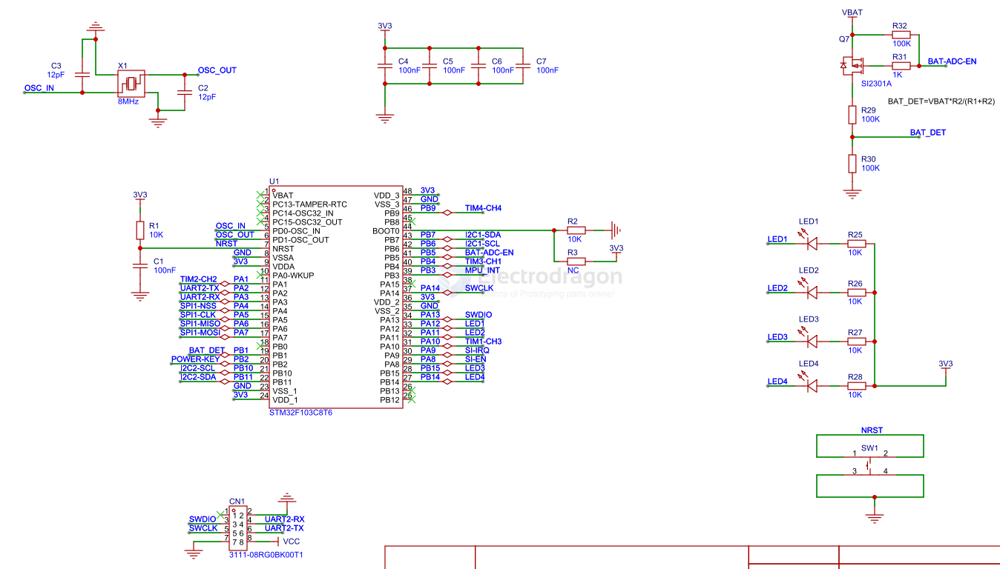
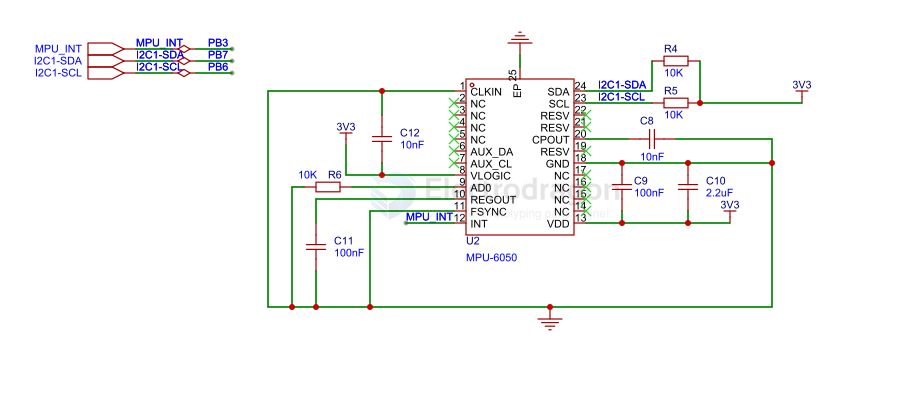
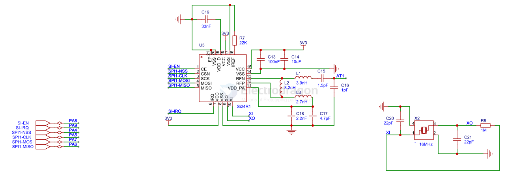
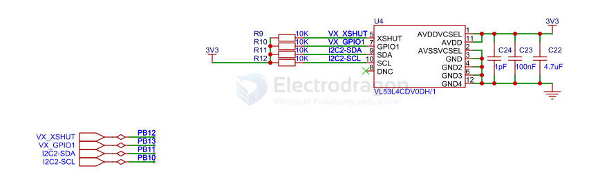
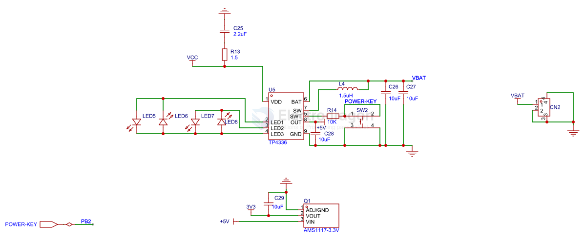
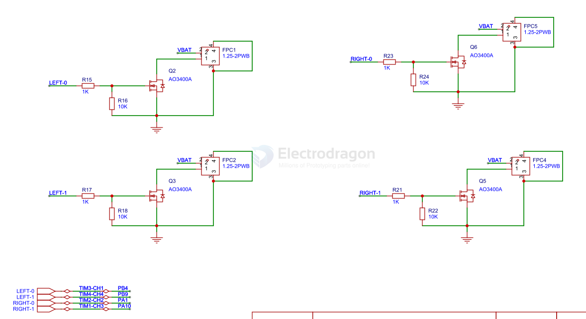

# drone-PCB-dat

- [[drone-dat]] - [[drone-PCB-dat]]

## build 

build 1 - [[STM32-F1-dat]] - [[STM32-F1-dat]] 

- [[MPU-6050-dat]] - [[drone-PCB-dat]] - [[STM32-F1-dat]] 

- [[SI24R1-dat]] - [[drone-PCB-dat]] 

- [[VL53L1x-dat]] - [[sensor-TOF-dat]] 

- [[TP4336-dat]] - [[drone-PCB-dat]]

- [[mosfet-dat]] 

## 