# Wireless-Video-Doorbell-dat

- [[Wireless-Video-Doorbell-dat]] - [[xiaomi-dat]] 

## Wireless-Video-Doorbell-dat 3 

xiaomi智能门铃3

产品型号：MJML05-FJ

CMIIT ID:2021DP9279

电池容量：5200mAh（TYP）

额定输入：5V-2A 

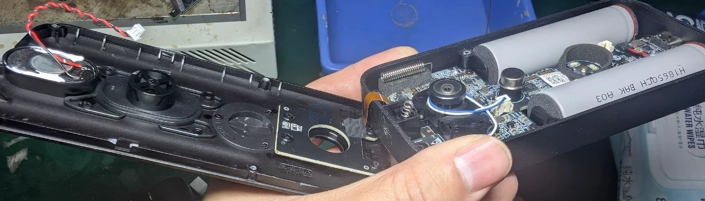

8EAZ SOT23-5

- [[HSM-dat]] - [[Wireless-Video-Doorbell-dat]] - [[xiaomi-dat]] - [[IOT-dat]]

- [[TP2124-dat]] - [[amplifier-dat]] - [[Wireless-Video-Doorbell-dat]] - [[xiaomi-dat]] - [[3peak-dat]]

- [[CMS8S6990-dat]] - [[Cmsemicon-dat]]

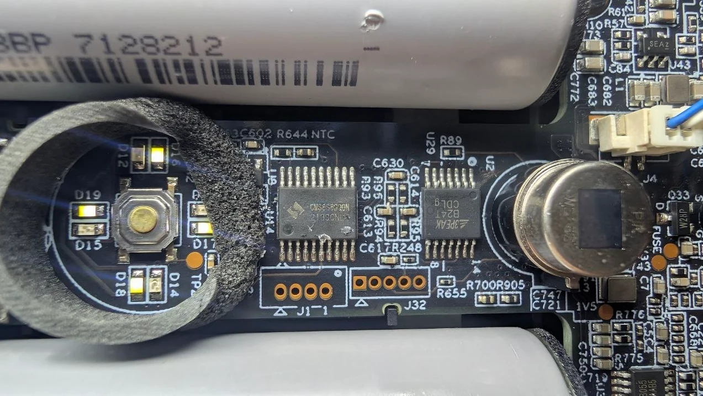

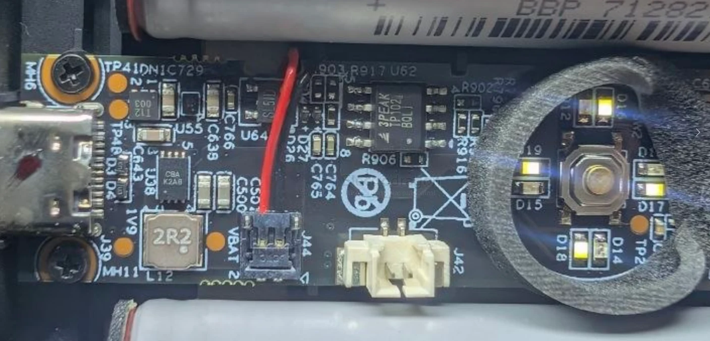

- [[3peak-dat]] - [[TP102-dat]] - [[Wireless-Video-Doorbell-dat]] - [[xiaomi-dat]]

SL5ID 

T12 003 - [[TVS-dat]] - [[Wireless-Video-Doorbell-dat]] - [[xiaomi-dat]]

CBA K2AB

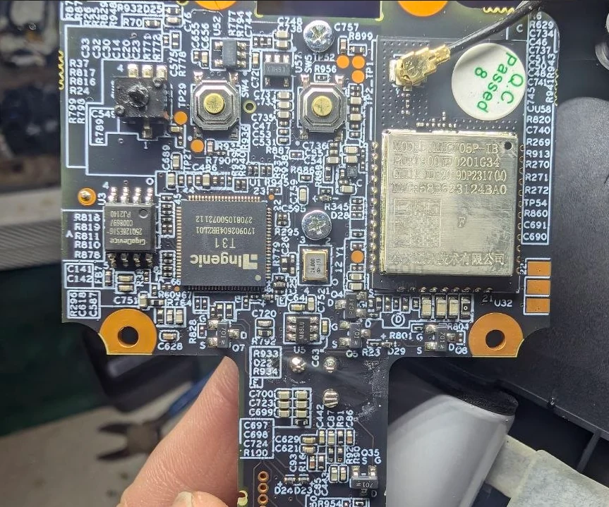

MHCW05P-IB

- [[MT7682-dat]] - [[mediatek-dat]] - [[Wireless-Video-Doorbell-dat]] - [[xiaomi-dat]]

## Wireless-Video-Doorbell-dat 2 

MJML2J_MBOARD_V33

MUML2J_SENSOR V31

xiaomi智能门铃3

产品型号：MJML05-FJ

CMITID:2021DP9279

额定输入：5V=2A

电池容层：5200mAh（TYP）

生产者：北京疯景科技有限公司

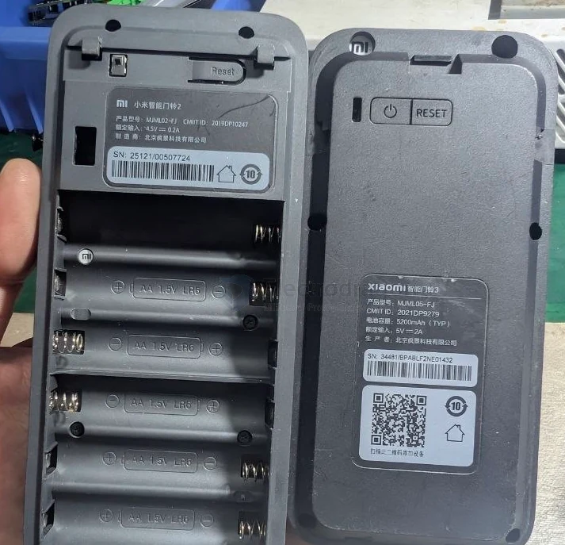

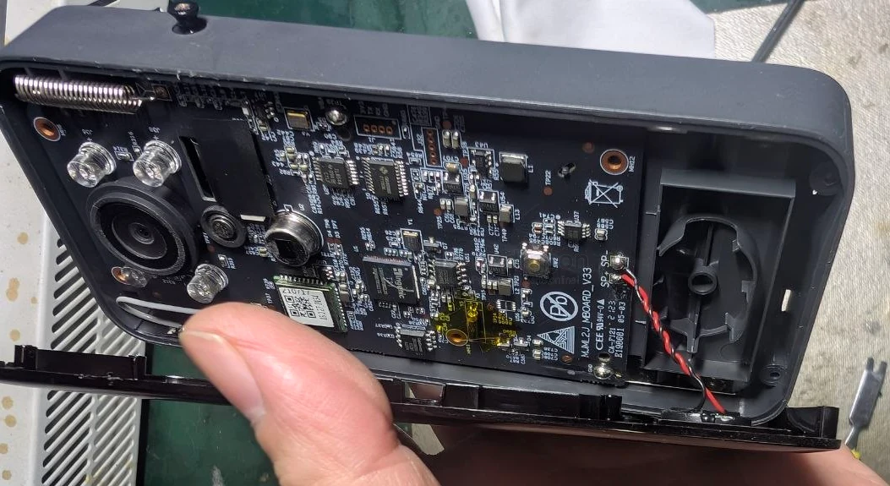

these are either version 2 or 3 

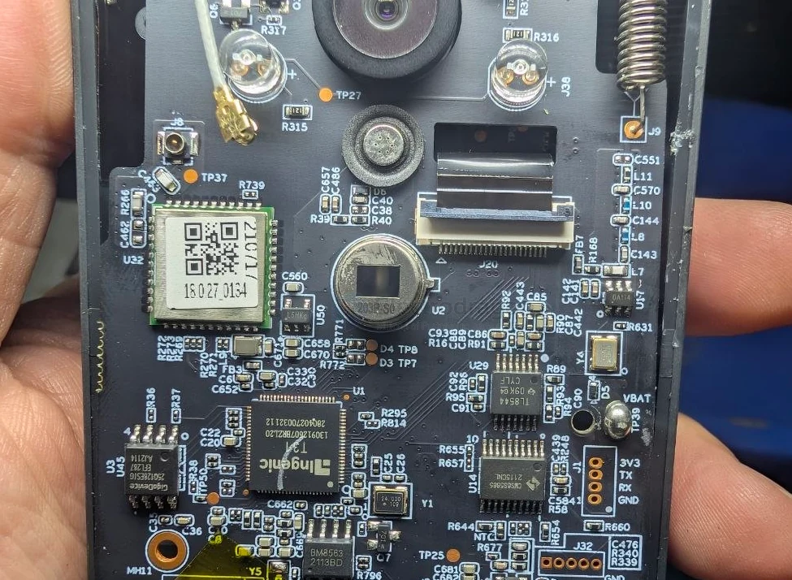

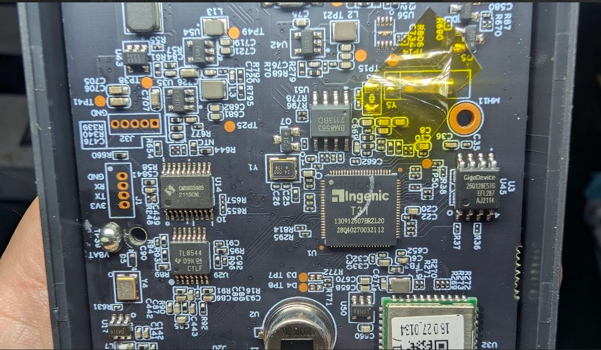

- [[sensor-PIR-dat]] - [[amplifier-dat]] - [[amplifier-transimpedance-dat]]

- [[CMS8S5885-dat]] - [[Cmsemicon-dat]]

- [[belling-dat]] - [[BM8563-dat]] - [[RTC-dat]] - [[clock-dat]]

1033 EAAs SOT23-5

IUAr SOT23-5 - [[dcdc-down-dat]]

L6HKq

DA114 OA114 

- [[gigadevice-dat]] - 25Q128ESIG EFL287 - [[flash-nor-dat]] - [[25Q128-dat]]

8055 - [[awinic-dat]] - [[amplifier-audio-dat]] - [[AW8055-dat]]

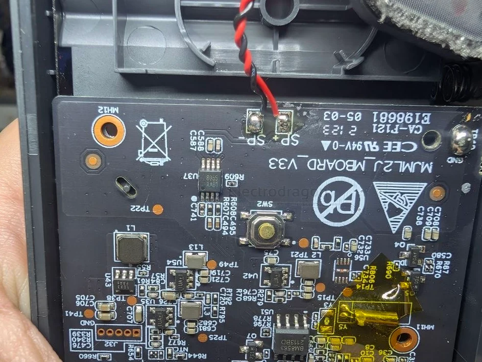

- [[Ingenic-dat]] - [[T31-dat]]

- [[203B-dat]] - [[xinyongcheng-dat]] - [[sensor-PIR-dat]] - [[Wireless-Video-Doorbell-dat]]

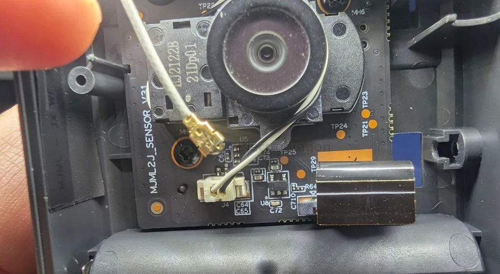

L6HLB

M65KY

- [[antenna-FPC-dat]] - [[Wireless-Video-Doorbell-dat]]

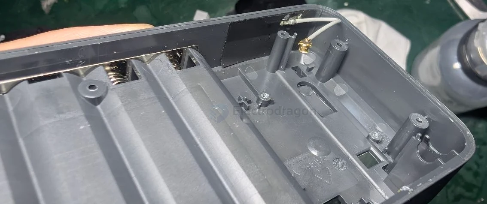

- [[case-plastic-dat]] - [[Wireless-Video-Doorbell-dat]]

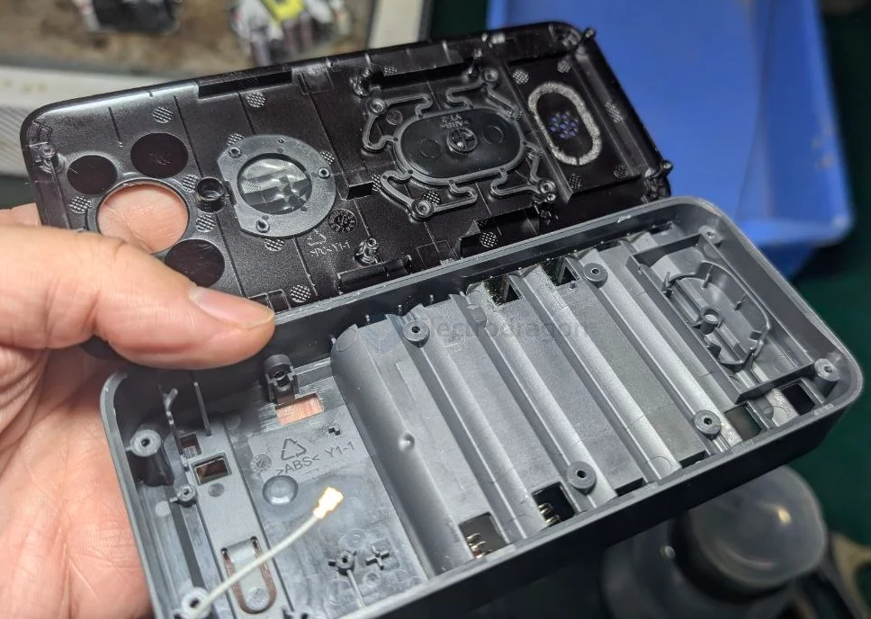

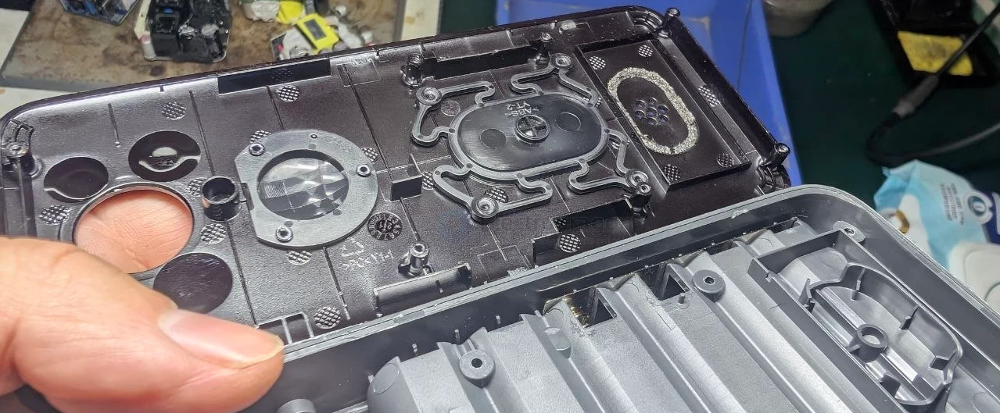

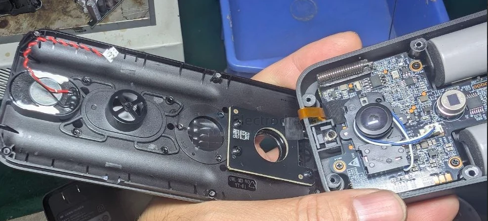

- [[sensor-camera-sensor-dat]] - [[cable-FPC-dat]] - [[conn-FPC-dat]] - [[Wireless-Video-Doorbell-dat]]

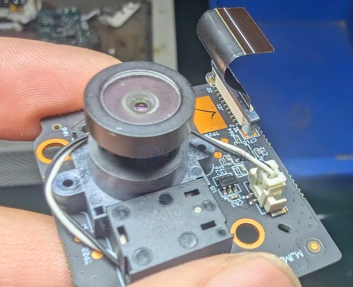

## ref 

