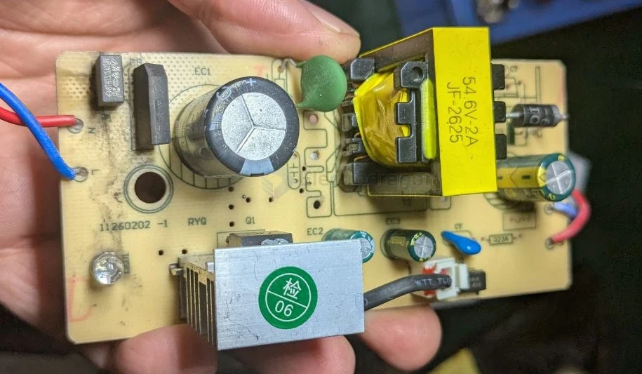
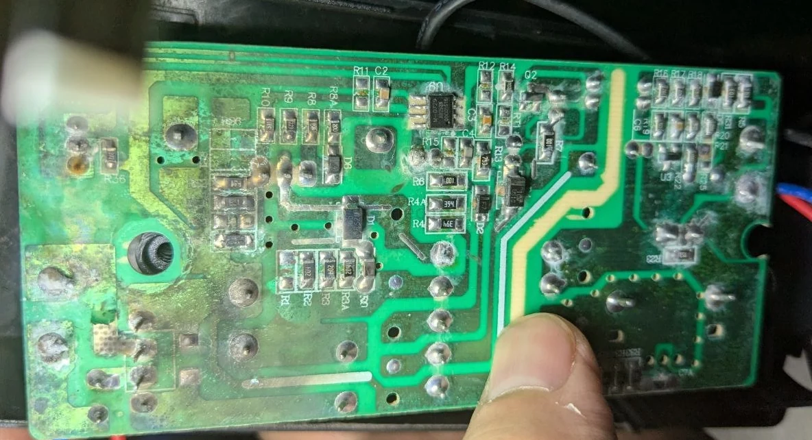
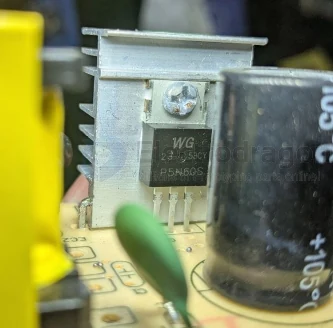

# ac-adapter-dat

- [[power-adapter-dat]] - [[power-dat]] - [[ac-adapter-dat]]

- [[ac-adapter-dat]] - [[ac-mains-dat]] - [[acdc-dat]]

## build 

- [[manned-vehicle-dat]] - [[unmanned-vehicle-dat]] - [[electric-scooter-dat]]

型号：48V2A
输入：AC220V-AC240V/50Hz
输出：DC54.6VDC1.8A

- [[mosfet-dat]] - P5N60S

## ref 