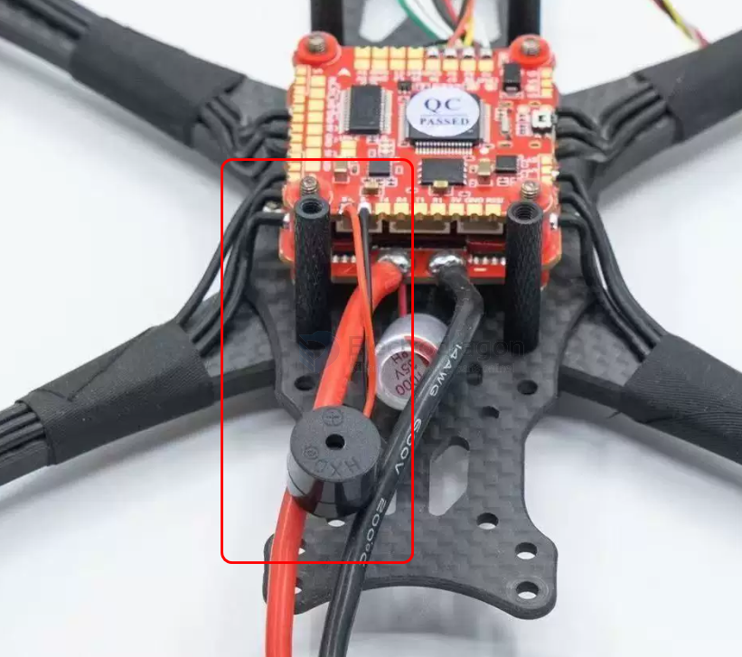

# beeper-dat.md

- [[beeper-dat]] - [[buzzer-dat]] - [[FPV-build-dat]]
  
- [[voltage-app-dat]]

- [[finder-dat]]

== [[buzzer-active-dat]] - [[SSL1019-dat]]

Wiring and configuring a buzzer (beeper) in Betaflight depends slightly on whether you are using a standard **passive/active buzzer** or a **self-powered lost model finder** (like a ViFly Finder).

---

### Step 1: How to Wire the Beeper

Look at your flight controller (FC) layout diagram and locate the dedicated buzzer pads, typically labeled **BZ+** (or 5V/VCC) and **BZ-** (or BZ).

#### Option A: Standard 2-Pin Buzzer

* **Red Wire (+):** Solder to **BZ+**
* **Black Wire (-):** Solder to **BZ-**

#### Option B: Self-Powered Finder (e.g., ViFly Finder with 3 Wires)

* **Red Wire (VCC / 5V):** Solder to any regulated **5V** pad on the FC (Do **not** solder this to VBAT/battery voltage unless the buzzer specs explicitly allow it; most fry if connected to raw battery voltage).
* **Black Wire (GND):** Solder to any **GND** pad on the FC.
* **Yellow/White Wire (Signal / BZ-):** Solder to the **BZ-** pad on the FC.
*(The built-in battery charges through the 5V/GND lines while flying, and the FC pulls the signal line low to trigger the alarm if the main battery ejects).*

---

### Step 2: How to Setup the Beeper in Betaflight

Once your hardware is wired, plug in your flight controller via USB, open the **Betaflight Configurator**, and follow these steps:

#### 1. Enable the Beeper Mode (Switch Activation)

To map a switch on your radio transmitter to trigger the beeper manually (crucial for finding a downed craft in tall grass):

1. Go to the **Modes** tab on the left sidebar.
2. Scroll down until you find **BEEPER**.
3. Click **Add Range**.
4. Set the dropdown to the AUX channel controlled by your desired switch (or click **AUTO** and flip the switch on your radio to bind it automatically).
5. Adjust the yellow range slider so that it highlights when your switch is flipped to the "on" position.
6. Click **Save** in the bottom right.

#### 2. Configure Beeper Triggers (Optional Preferences)

By default, Betaflight triggers the buzzer for low battery, arming/disarming, and failsafes. You can customize which events cause the buzzer to sound:

* Go to the **Configuration** tab.
* Scroll down to the **Beeper** section.
* Check or uncheck the specific events you want (e.g., `RX_LOST`, `BAT_LOW`, `ARMING`, etc.). Alternatively, you can fine-tune these using the **CLI** tab.

- [[betaflight-motors-dat]] - [[BF-beeper-dat]] - [[beeper-dat]] - [[betaflight-dat]]

## ref 