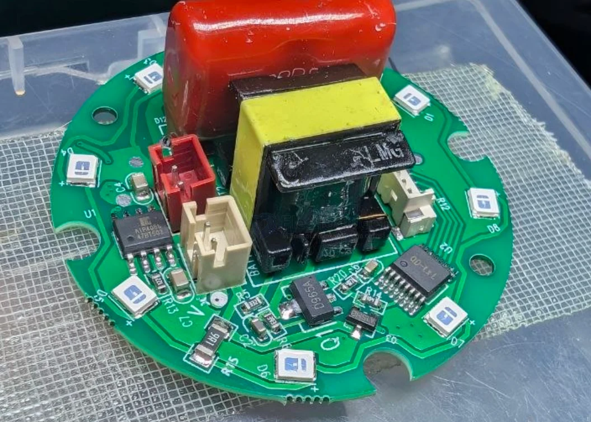
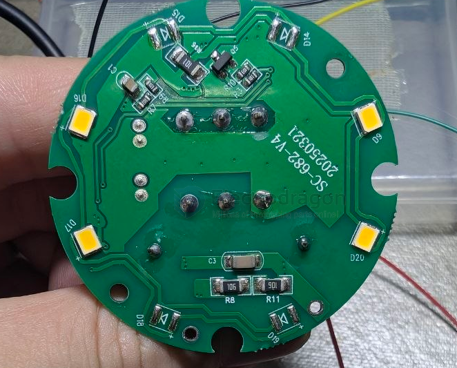
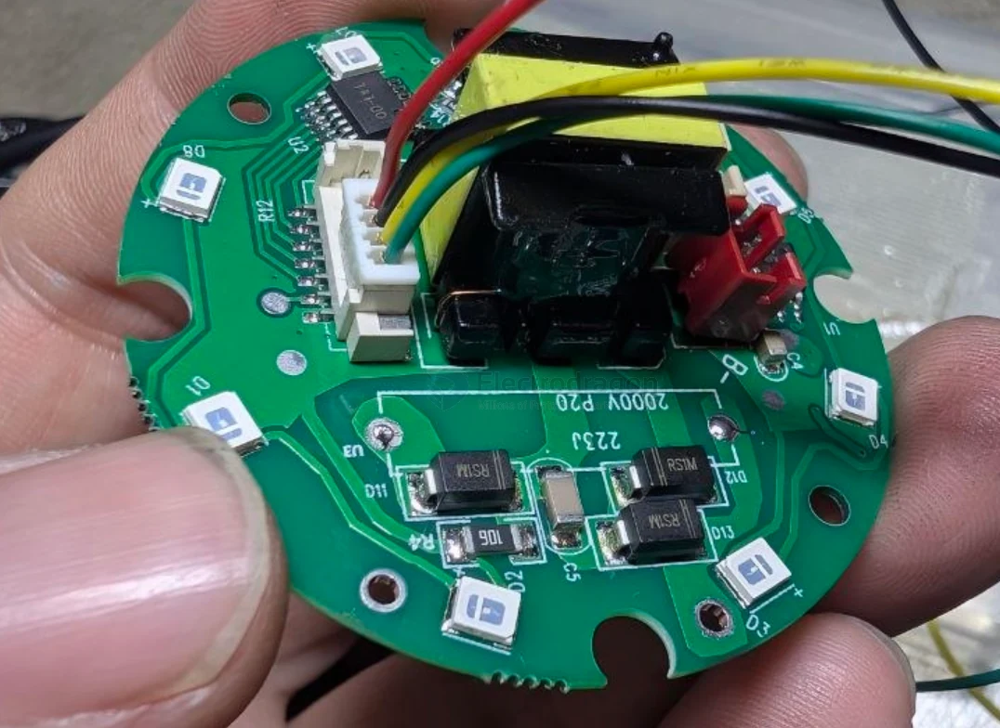

# bug-zapper-dat

- [[battery-charger-dat]] 

chip - `QD-LxL`

D965A - [[transistor-dat]]

over voltage test  - https://t.me/electrodragon3/442

- [[capacitor-CBB-dat]] - [[capacitor-dat]]

- [[LED-UV-dat]] - [[led-dat]]

## ref 

