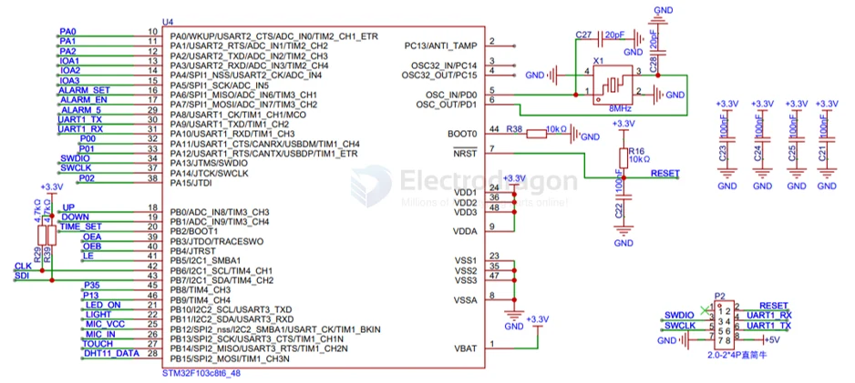
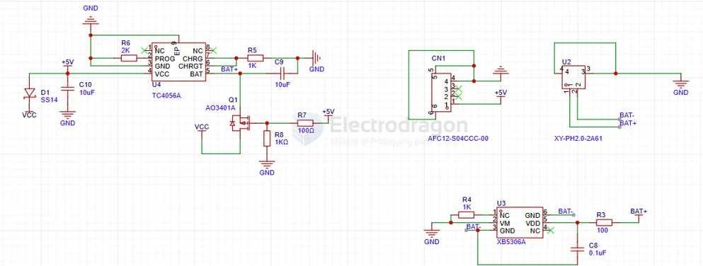
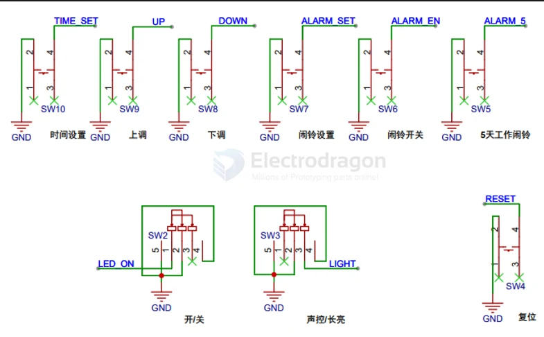
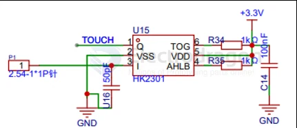
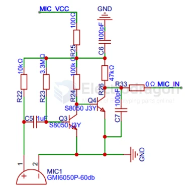
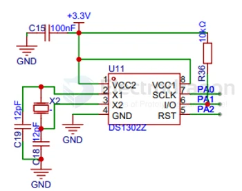
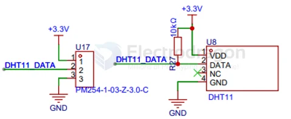
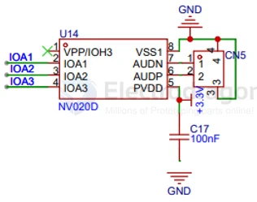
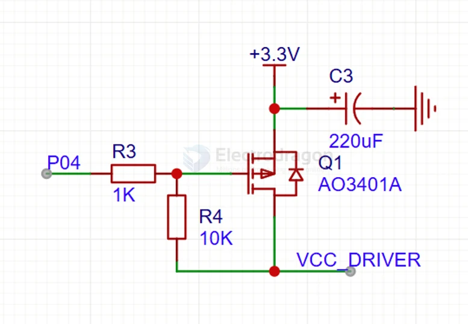
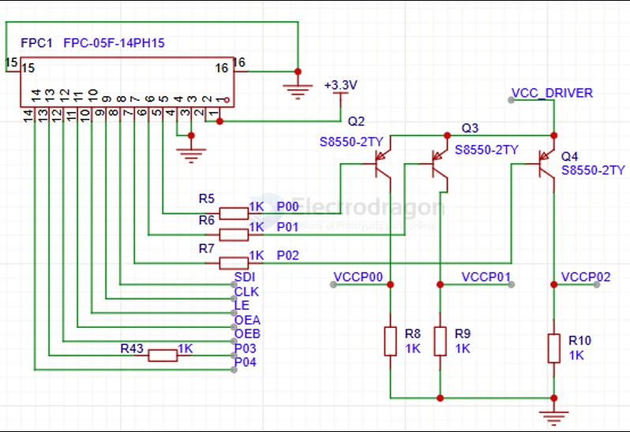

# digital-clock-dat

## SCH 

5.1 主控芯片电路

5.2 电池充电电路

5.3 按键电路

5.4 触摸按键电路

5.5 声控检测电路

5.6 实时时钟电路

5.7 温湿度传感器电路(二选一)

5.8 音乐播放电路 - [[NV020D-dat]] - [[nine-chip-dat]] - [[voice-dat]] - [[voice-prompt-dat]]

5.9 灯板总电源控制电路

5.10 灯板显示控制电路

## ref 