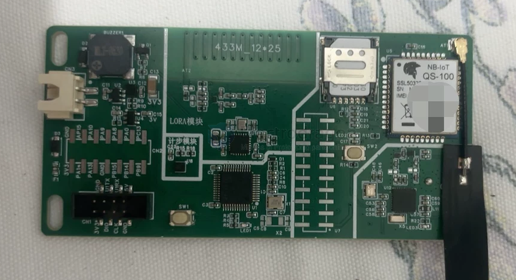
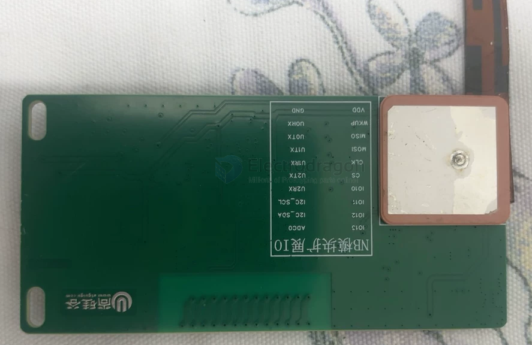
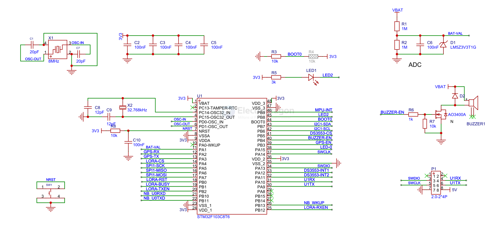
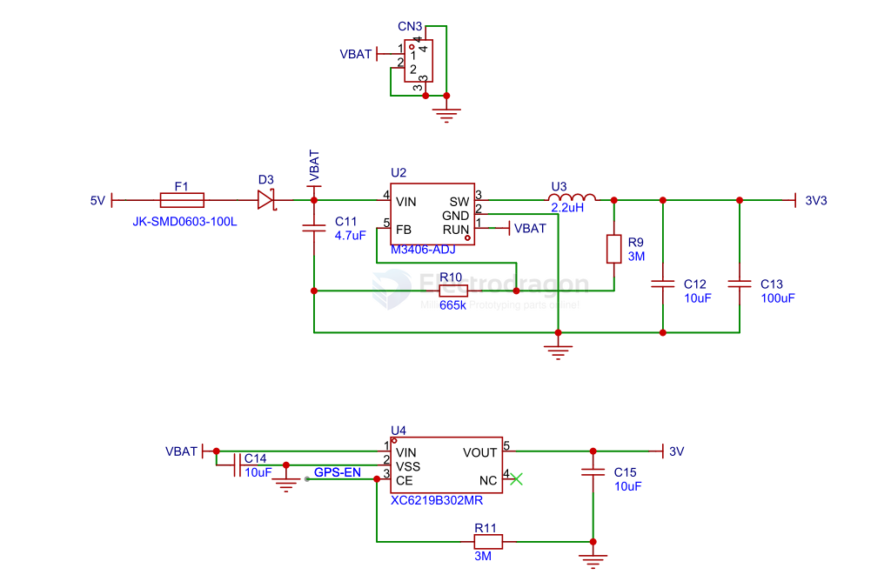
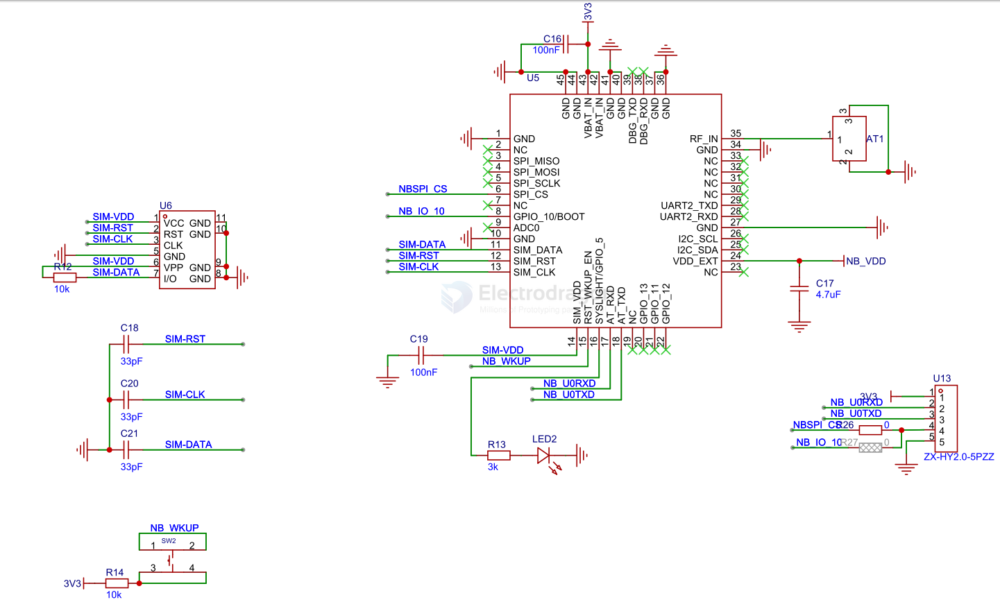
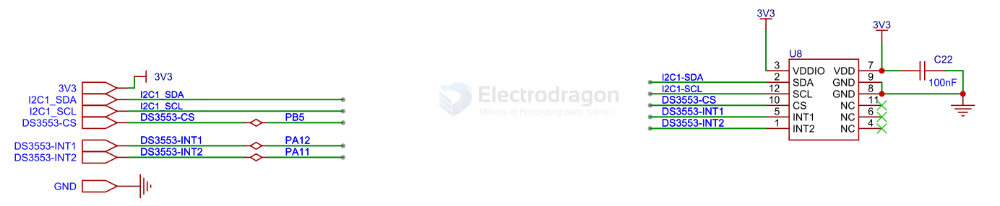
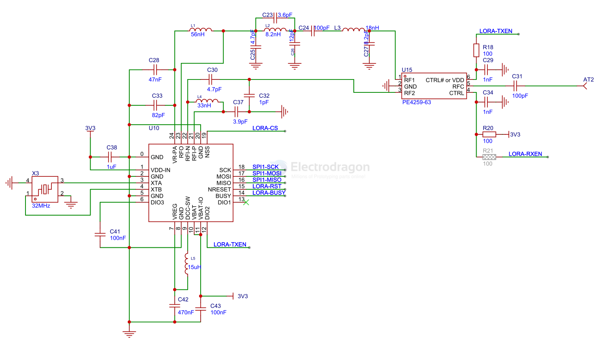
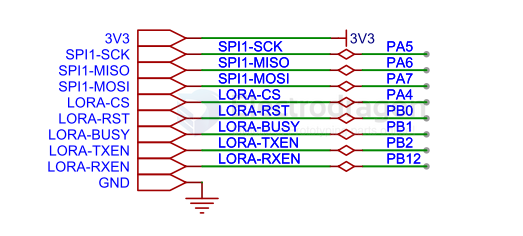
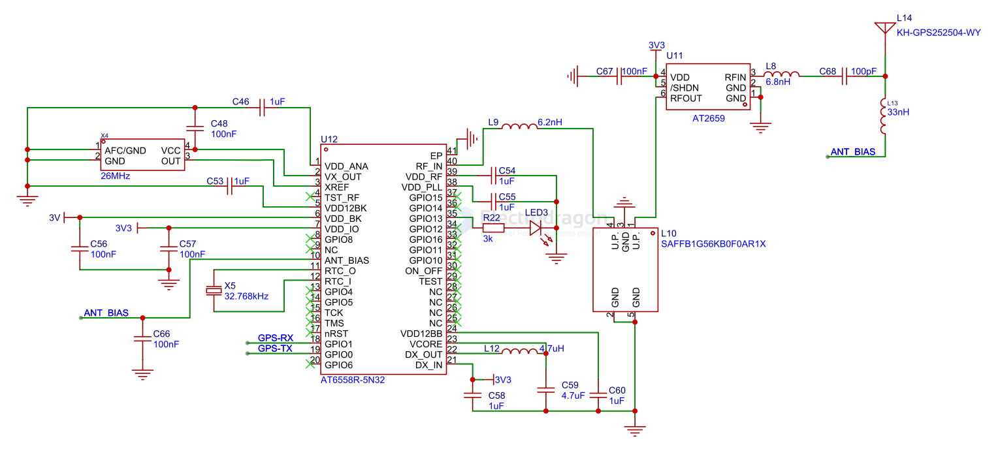
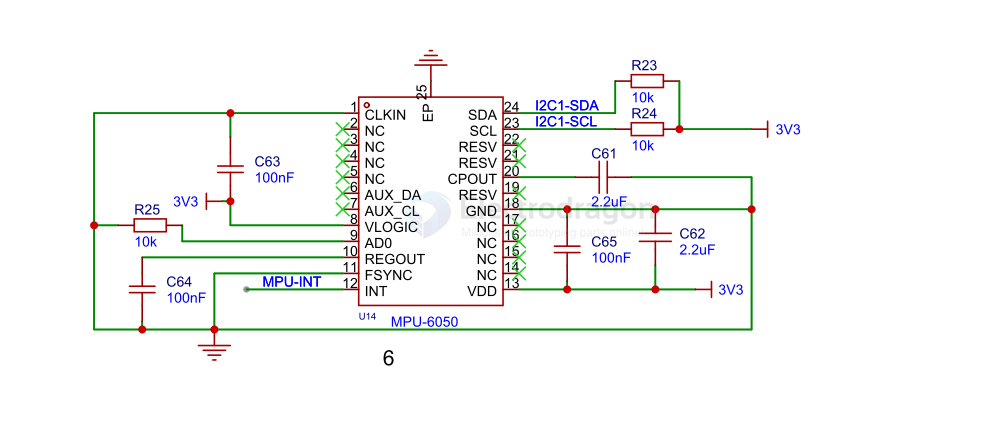

# fall-prevention-dat

## SCH 

- [[STM32-dat]] - [[lora-dat]] - [[location-dat]] - [[sensor-motion-dat]] - [[LTE-dat]] - [[NBIOT-dat]]

- [[sensor-pedrometer-dat]] - [[miraMEMS-dat]] - [[sensor-dat]] - [[sensor-motion-dat]] - [[DS3553-dat]]

- [[AT6558-dat]]

- [[MPU6050-DAT]] - [[WS2812-dat]]

## ref 