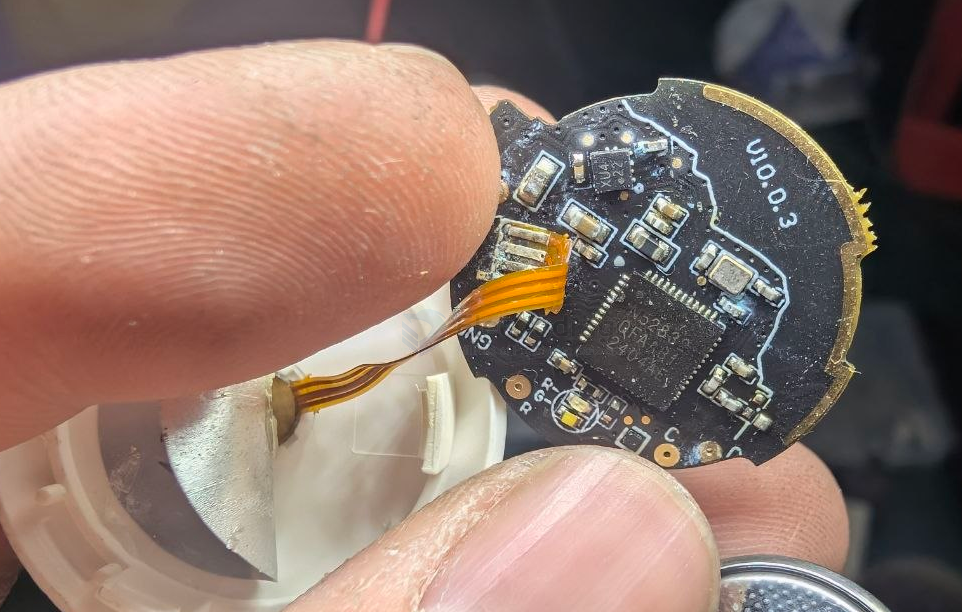
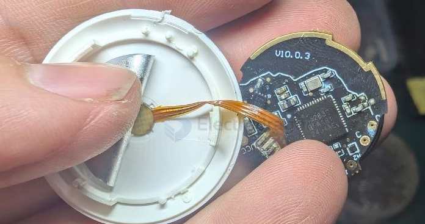

# healthcare-baby-monitor-dat

## build 

- [[NRF52832-dat]] - [[healthcare-dat]] 

- [[sensor-bio-dat]] - [[healthcare-dat]] 

- • 多维度健康监测：可24小时动态追踪宝宝的静息呼吸、静息心率、体表温度、体姿态及运动量等数据。 
- • 智能睡眠与安全报警：
	• 支持睡姿监测（如识别趴睡、睡醒、踢被子着凉/捂热等异常）并及时发出预警。
	• 具备高低温报警、哭闹/夜醒提醒以及AI算法辅助识别的咳嗽、跌落掉床等安全功能。 
- • 非摄像头设计：不依赖摄像头，主要通过穿戴式硬件结合AI算法感知宝宝状态，降低夜间干扰。 

## ref 