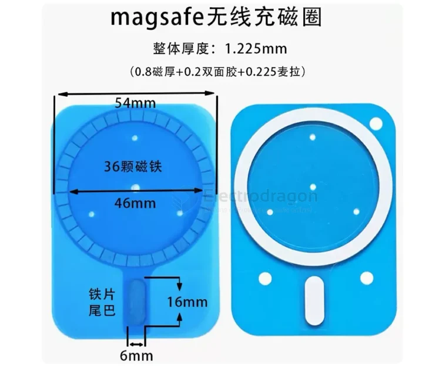

# magsafe-dat

- [[magsafe-dat]] - [[magnetic-dat]] - [[magnet-dat]]

- [[phone-pixel-dat]] - [[pixel-stand-dat]] - [[magsafe-dat]]

一、MagSafe 是什么
Apple 2020 年随 iPhone 12 推出的磁吸无线充电系统，由两部分组成：
① 磁环阵列（手机背面）
   外径约 55-56mm / 内径约 45-46mm，多极充磁（N/S 交替）
   作用：让充电线圈【自动精准对齐】+ 配件吸住不掉
        ↓
② 私有协议 + MFi 认证
   配件要过 Apple 认证才能解锁满速

项	MagSafe	Qi2（开放版）
谁管	Apple 私有	WPC（无线充电联盟）
时间	2020（iPhone 12）	2023-04
磁环	✅	✅ 基于 Apple 的 MPP
功率	15W（2024-09 起 25W）	15W（Qi2.2 / 2025-04 起 25W）
认证	Apple MFi	WPC（691 项测试）
谁能用	只有 Apple 设备	⭐️ 所有厂商都能做

⭐⭐ 关键：Qi2 = Apple 把 MagSafe 的磁吸方案【交出来开放了】
   2025 年 Qi2 还成为国际标准 IEC 63563
        ↓
📌 所以现在市面上"磁吸充电器"多半是 Qi2，不是真 MagSafe
二、🔴 Pixel 8 Pro 能用吗：原生不行
Google 官方支持页面原话：
Quote 「The Pixel 10 and later devices, excluding Pixel 10a, support Qi2.」
「MagSafe wireless chargers don't work with Pixel 9a and earlier phones.」
（MagSafe 无线充电器不适用于 Pixel 9a 及更早型号）

项	Pixel 8 Pro 实际情况
原生磁吸环	🔴 没有
Qi2 认证	🔴 没有（协议是 Qi 1.2.4，不是 Qi2）
标准 Qi 无线充	✅ 12W
Pixel Stand 2（专用）	⭐️ 最高 23W
有线充电	✅ 最高 30W（需 PD PPS）

## ref 