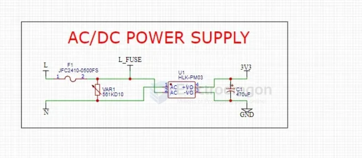
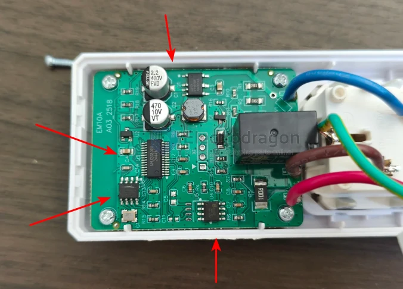
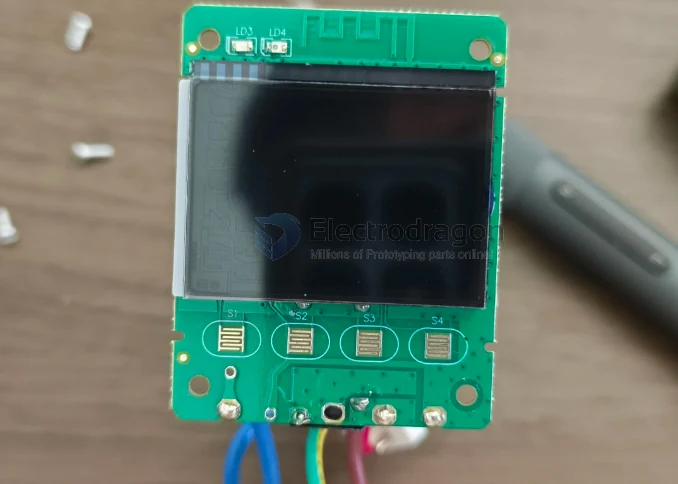
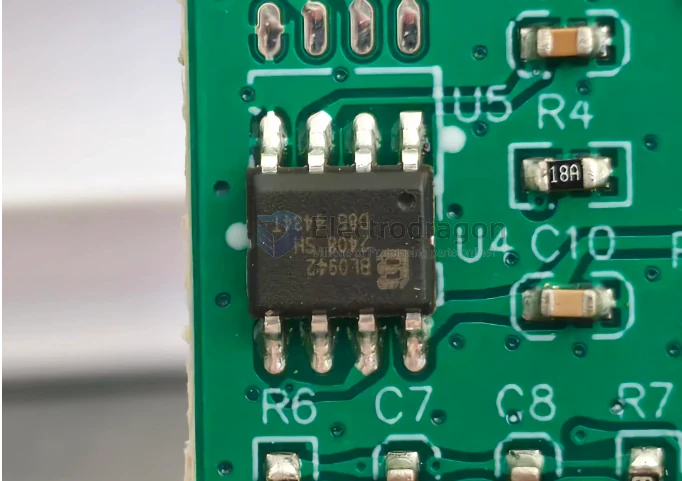
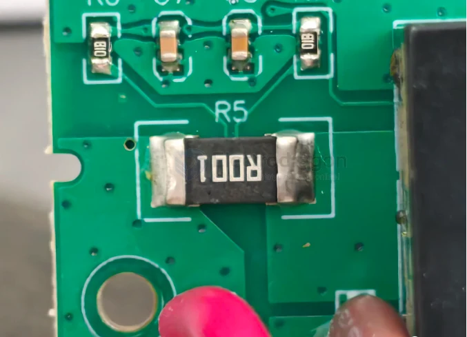
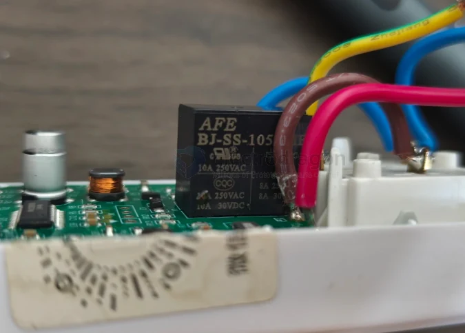
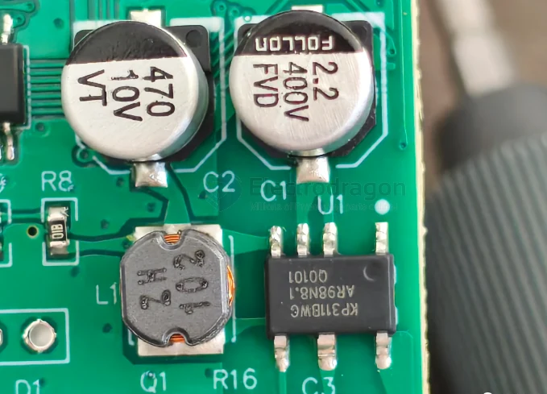
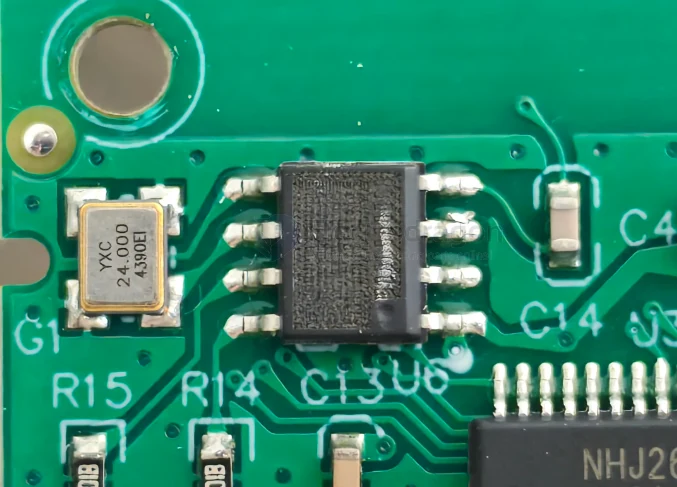
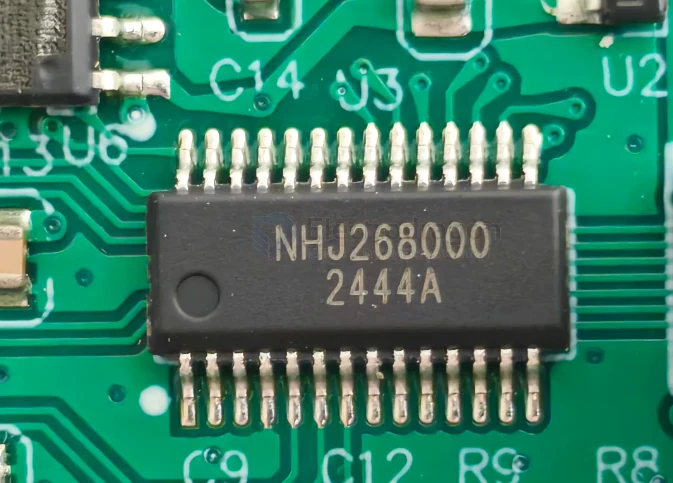

# meter-energy-dat

- [[meter-energy-dat]] - [[sensor-energy-dat]] - [[meter-dat]] - [[meter-power-dat]]

## tech 

- [[HLW8012-dat]] - [[HLW8032-dat]]

- [[analog-device-dat]] - [[ADE7953-dat]]

- [[ACDC-dat]] - [[meter-energy-dat]]

- [[ESP32-S3-HDK-dat]]

## ACDC 

## build app tech stack 

- [[relay-dat]] - [[ACDC-dat]]

## build 

build 1 

display 

板上能叫出名字的东西不多，但都很关键：一颗计量芯片、一颗主控、一颗降压芯片、一颗 1 毫欧采样电阻、一只 10A 继电器、一颗 24MHz 晶振，还有一颗丝印被磨掉的芯片。

翻过来是显示屏那一面。屏下面一排四块镀金焊盘，丝印 S1 到 S4。正面那四个塑料按键，就是压在这四块焊盘上工作的——整块板上找不到一颗常见的那种贴片轻触开关。

这一面还有个细节：屏的玻璃直接压在板上，没有单独的固定框，靠两侧的塑料筋和后盖顶着。便宜做法，装回去的时候得对位置，不然屏会歪。

- [[BL0942-dat]] - [[meter-energy-dat]] - [[belling-dat]]

1 毫欧什么概念：过 10A 电流，它两端只有 10mV 压降，自身发热 0.1W。而 BL0942 的电流通道满量程是 30mV rms。也就是说配这颗电阻，芯片能一路测到 30A。

AFE 的 BJ-SS-105，触点标称 10A 250VAC，带 cURus 和 CQC 认证，另外还标了 8A 250VAC / 10A 30VDC 的 UL 口径。

整机标 10A，继电器也标 10A。一点余量都没留。

这句话不是骂它偷工减料——10A 的插座配 10A 的继电器，是行业里的标准做法，德力西这么干合规，认证也过了。但你得知道这意味着什么：

你插一台 2000W 的电暖器上去，就是让这只继电器贴着自己的额定值在跑。 触点长期满负荷，氧化、粘连、接触电阻变大，都是这么来的。空调、电热水器、大功率取暖器这类东西，本来就不该往 10A 的计量插座上插。

真正决定这台机器能扛多久的，不是那颗 30A 的芯片，是这只 10A 的继电器和插孔里的铜件。芯片的余量是给测量留的，不是给功率留的。

- [[ACDC-dat]]

▲ 图 8　KP311BWGA 和它的外围：左边 470µF/10V 是 5V 输出滤波，右边 2.2µF/400V 是母线电容，中间那颗电感是降压用的

这颗芯片挺有意思。它把 500V 高压 MOSFET、续流二极管、高压启动电路、采样电阻全集成进去了，220V 交流进来接两个脚，出来就是稳定的 5V，外围只需要一个电感、几个电容。整块板的 5V 电源，就这么一颗芯片加八颗粒料解决。

顺带纠正一个常见的误读：那个"470"是 470 微法，耐压 10V，不是"470V 的电容"。真正扛高压的是旁边那颗 2.2µF / 400V。

然后是安全上最要紧的一句：

非隔离。 这颗芯片的 5V 地和市电是连着的，整块板——包括主控、计量芯片、屏幕、按键焊盘——都带着市电电位。

所以：不通电拆，拆完别用手摸板子，撬的时候别用金属家伙。所有几十块的计量插座都这么干，成本决定的，不是德力西一家的毛病。但你拆之前得知道。

BLE - [[BLE-dat]]

晶振旁边有一颗 8 脚芯片，紧挨着一颗 YXC 24.000 MHz 的晶振。24M 晶振贴着芯片放，走线短，这是射频 SoC 的标准画法。再对上型号里的 BLE，三样凑齐，我判断它是蓝牙 SoC。

但那颗芯片的正面，是黑的。

▲ 图 9　8 脚芯片，表面被打磨/涂覆过，丝印一点都读不出来，旁边是 24.000MHz 晶振

不是脏，是处理过。表面有明显的磨砂痕迹，原本的激光字被磨掉或者盖住了。

这事在国产小家电里太常见了，叫"磨丝印"，目的是防抄板——竞品买一台回去，拆开看不见型号，就没法直接照着 BOM 抄。有些还会在磨完之后再点一层黑胶。

对你的影响很实在：

查不到型号，就查不到 datasheet，出问题没法自己判断是芯片坏了还是外围坏了；

没有公开的固件和 SDK，这颗蓝牙除了厂家自己的 App，你接不进任何东西；

保修期外坏了，只能整块换或者扔。

- [[MCU-dat]]

另一颗大芯片是 14 脚的 NHJ268000，下面一行 2444A 是批次。

我把这个型号在几个渠道翻了一遍，没有结果。没有 datasheet，没有厂家页面，没有选型表。

从位置和走线看，它管着屏、按键、继电器驱动，还跟 BL0942 通信，基本可以确定是主控（带 LCD 驱动的 MCU）。但这只是从板子上推的，不是查到的，所以我按"推测"算。

14 脚、带 LCD 驱动、单价估计一两块钱——这个配置在计量插座里很典型。屏上的段码、菜单逻辑、按键响应，全在这颗芯片里。

这意味着：这台机器的"智能"部分，是完全封闭的。你能看到的只有屏幕上那几个数字。

### power consumption assumption 

它自己吃多少电，我算了笔账
回到最开始那个问题。

拆完能算出个大概，但先说明：我没有实测它的自耗电，下面是按器件规格估的。

待机（继电器断开）：KP311 空载功耗官方标小于 50mW，BL0942 典型 10mW，加上主控和屏的零头，大概 0.1W 这个量级。

通电（继电器吸合）：多一个线圈。这类 5V 小型继电器的线圈功率一般在 0.3~0.4W。所以常年开着用，整机大概 0.4~0.5W。

按 0.45W 算，一年 8760 小时，不到 4 度电，两块钱左右。

有意思的是这里：10A 满载的时候，那颗 1 毫欧电阻才发热 0.1W，而继电器线圈常年就在烧 0.3~0.4W。

你盯着电量计上跳动的功率数字，以为损耗在那颗采样电阻上。其实真正持续吃电的，是那只一直吸着的继电器线圈。

白嫖来的东西，一年倒贴两块钱电费。这笔账还是赚的。

## info 

## single-phase counter energy meter

A single-phase counter energy meter is typically used to measure and record electricity consumption in single-phase power systems. These meters are suitable for homes, small businesses, and similar scenarios. Below are its main features and working principles:

### Features:

Single-phase design: Suitable for single-phase power systems (usually 220V).
Counter display: Displays electricity consumption using a mechanical counter or an LCD screen (usually in kilowatt-hours, kWh).
Measurement accuracy: Generally complies with national standards and provides accurate measurement of electricity consumption.
Easy installation: Compact size, easy to install and maintain.
Cost-effective: Relatively affordable, making it a common choice for households and small users.

### Working Principle:

A single-phase counter energy meter calculates the actual electricity consumption by measuring the product of voltage and current, combined with the meter's internal time reference. Its basic components include:

- Voltage and current sensors: Detect the voltage and current in the circuit.
- Energy calculation module: Calculates power and accumulates it into electricity consumption.
- Display module: Displays the cumulative electricity consumption.

### Application Scenarios:

- Residential homes: Monitors daily electricity consumption in households.
- Small shops: Records daily electricity usage for small businesses.
- Rental properties: Tracks electricity consumption for billing purposes.

For a more advanced option, you can consider smart energy meters with remote communication features, which support remote meter reading and real-time electricity usage analysis.

## ref 

- [[meter-energy]] - [[meter]] - [[fab-tools]]