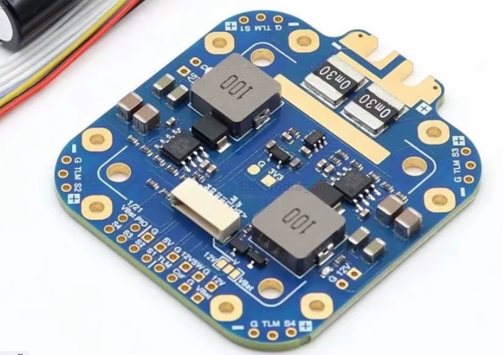

# power-pdb-dat

- [[power-pdb-dat]] - [[power-distribution-dat]] - [[power-dat]] 

- [[ESC-single-dat]] - [[ESC-4in1-dat]] - [[power-PDB-dat]]

## build 

board 1 

440A分电板，适合FPV穿越机、无人机供电使用。

8-60V DC输入，支持3-12S LiPo电池，5V/12V双路BEC输出，带高精度电流检测。

## Integrated PDB (Power Distribution Board)

An **Integrated PDB** is a circuit board built **into a drone’s flight controller or frame** that distributes power from the battery to all electronic components, such as:

- ESCs (Electronic Speed Controllers)
- Motors
- Flight Controller (FC)
- Video Transmitter (VTX)
- LEDs and other accessories

## ref 