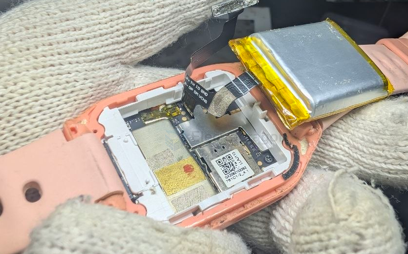
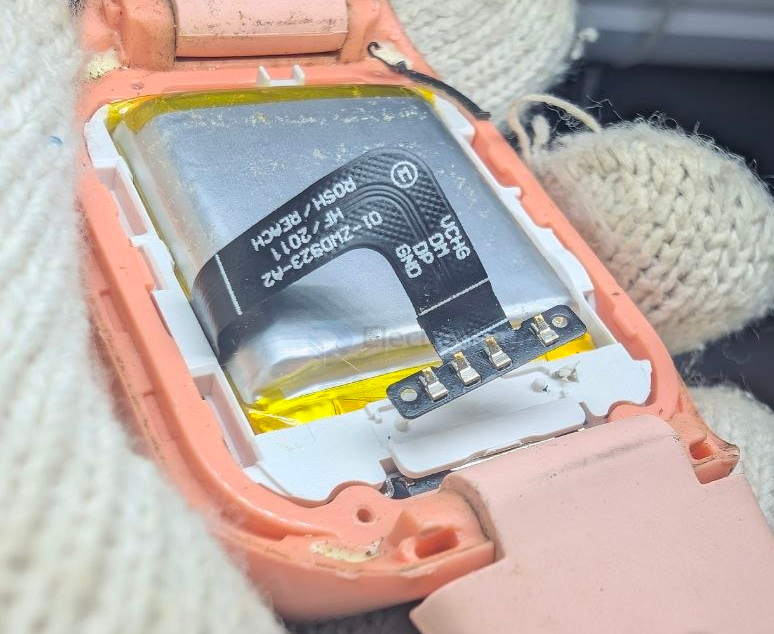
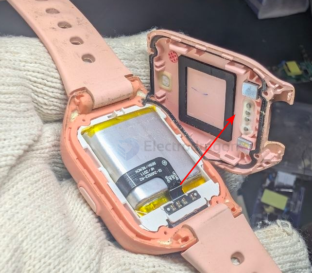
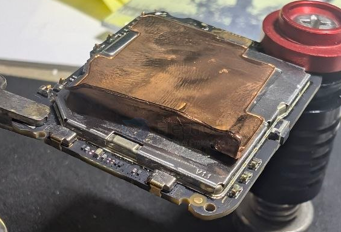
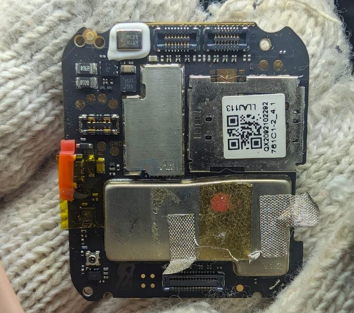
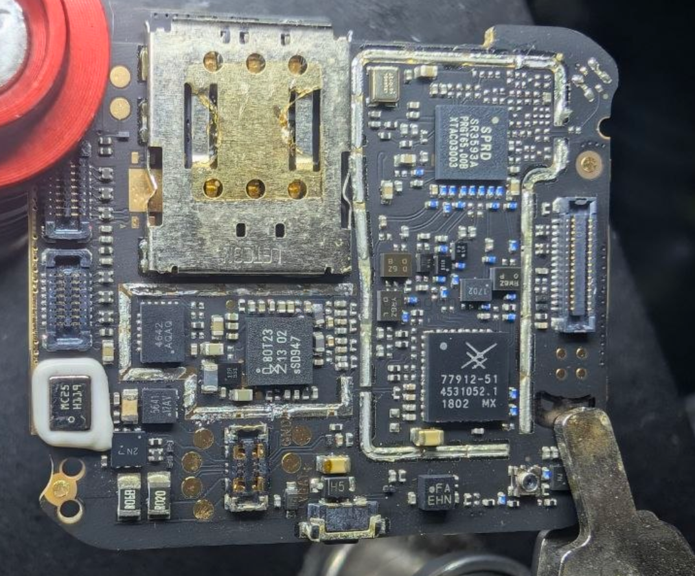
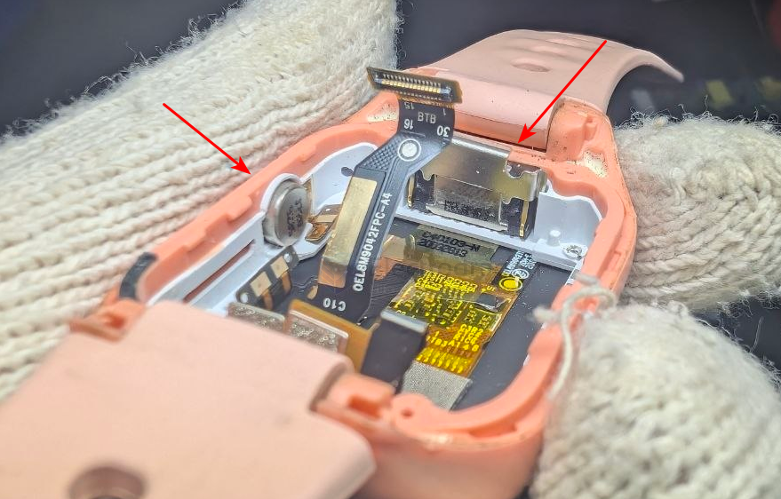
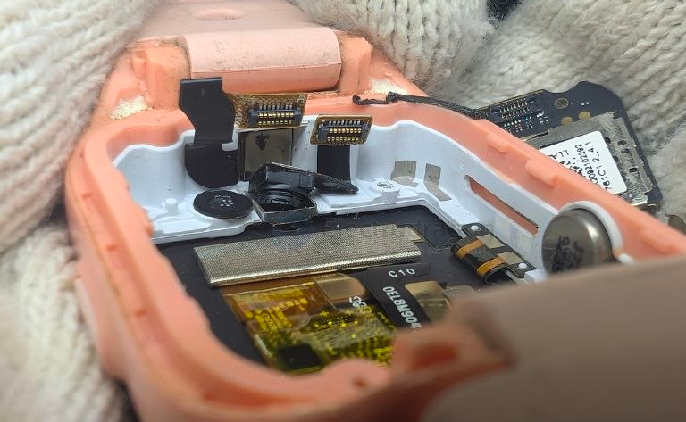
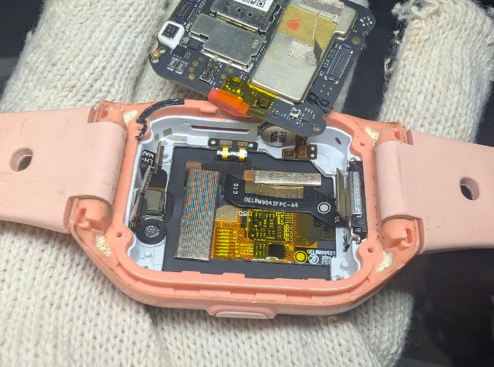

# smart-watch-dat

## build 

## build 1 

- [[xiaomi-dat]] - [[smart-watch-dat]] 

### overview 

- [[conn-battery-dat]] - [[smart-watch-dat]] 

### inside modules 

- [[spreadtrum-dat]] - [[unisoc-dat]] - [[SL8521ET-dat]] - [[IOT-LTE-dat]] - [[4G-dat]] - [[projects-dat]] - [[IOT-dat]]
  
- [[SPRD-dat]] - [[SC2721G-dat]] - [[PMIC-dat]] - [[SR3593A-dat]] 

FRONT 

77546-11 == [[skyworks-dat]] - [[spreadtrum-dat]] - [[unisoc-dat]] - [[SL8521ET-dat]] - [[IOT-LTE-dat]] - [[4G-dat]] - [[projects-dat]] - [[IOT-dat]]

BACK 

- [[skyworks-dat]] - [[SKY77912-dat]] - [[smart-watch-dat]]

### outside peripherals 

- [[peripherals-dat]] - [[speaker-dat]]

- [[camera-dat]]

## ref 