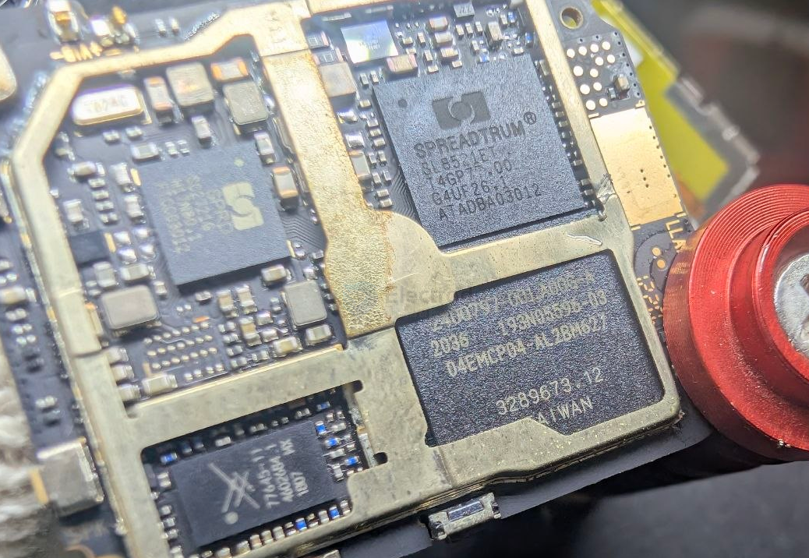
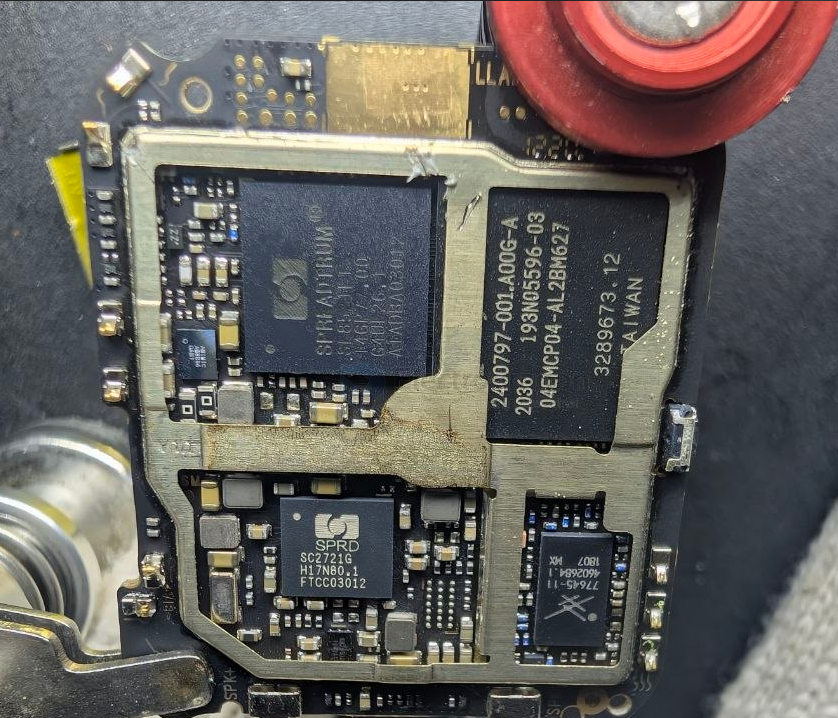

# smart-watch-dat

## build 

- [[xiaomi-dat]] - [[smart-watch-dat]] 

## inside modules 

- [[spreadtrum-dat]] - [[unisoc-dat]] - [[SL8521ET-dat]] - [[IOT-LTE-dat]] - [[4G-dat]] - [[projects-dat]] - [[IOT-dat]]
  
- [[SPDR-dat]] - [[SC2721G-dat]] - [[PMIC-dat]]

77546-11 == [[skyworks-dat]] - [[spreadtrum-dat]] - [[unisoc-dat]] - [[SL8521ET-dat]] - [[IOT-LTE-dat]] - [[4G-dat]] - [[projects-dat]] - [[IOT-dat]]

## ref 