# smart-watch-dat

- [[electronics-consumer-dat]] - [[smart-wristband-dat]] - [[smart-watch-dat]] - [[fitness-tracker-dat]]

## build 5 

- [[AC6323A-dat]] - [[jieli-dat]] - [[SSD1312-dat]]

- [[AC6323A-dat]] - [[jieli-dat]] == JL BP26418-23A2

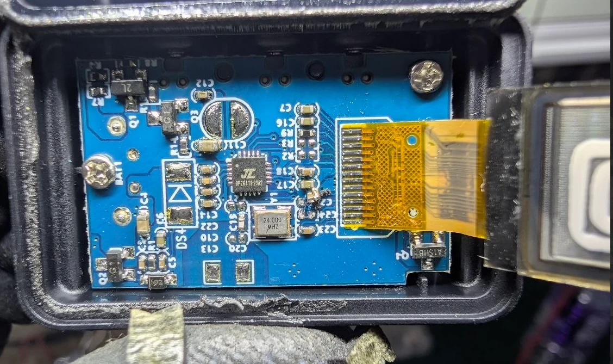

## build 4 

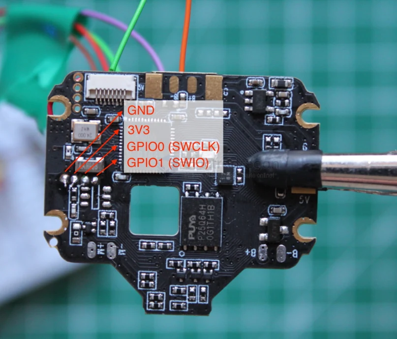

- [[huntersun-dat]] - [[HS6620-dat]] - [[smart-watch-dat]] - [[electronics-consumer-dat]] - [[engineering-reverse-dat]] - [[projects-dat]] - [[hack-dat]]

## build 3

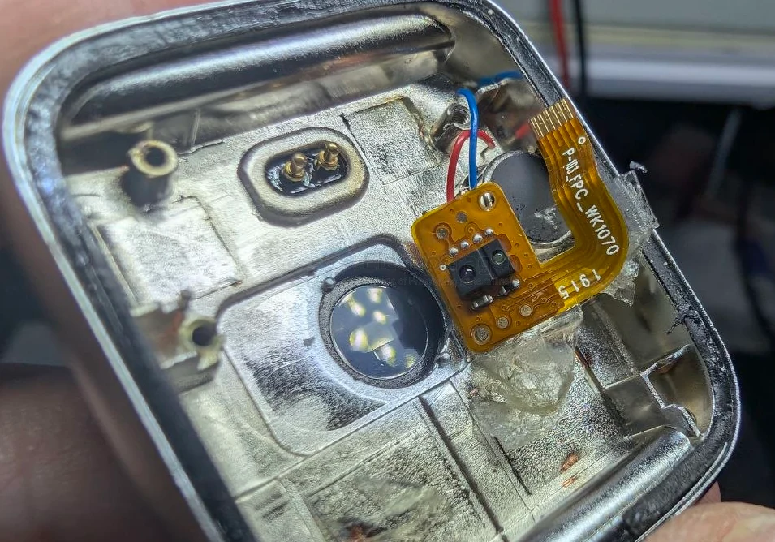

- [[huntersun-dat]] - [[HS6620-dat]] - [[smart-watch-dat]]

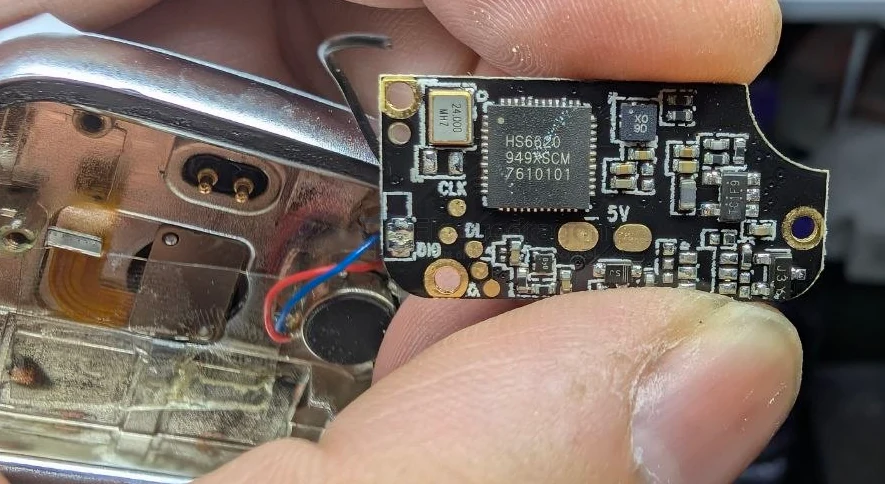

XT25F1288W01G - [[memory-dat]] - [[xtxtech-dat]] == 128Mbit; 电压: 2.7~3.6V; 温度范围 - [[flash-NOR-dat]] - [[smart-watch-dat]]

CS1816S

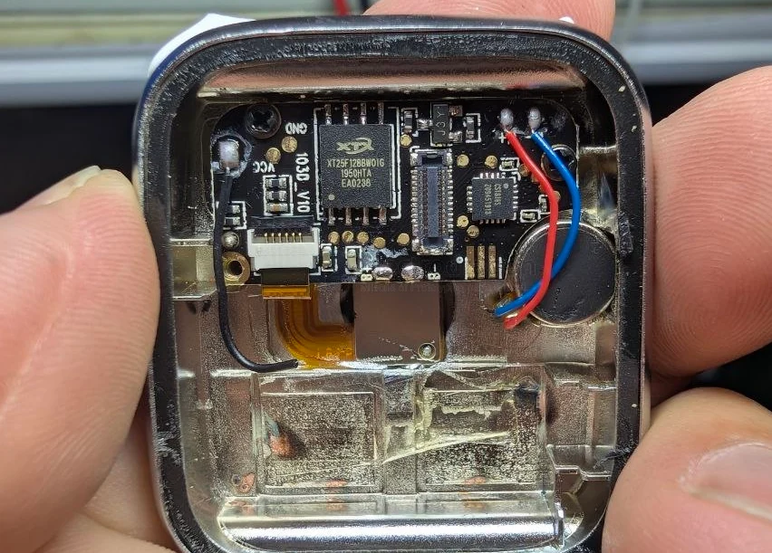

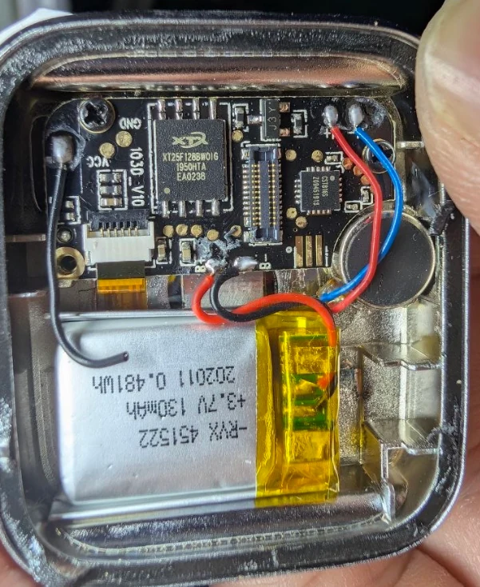

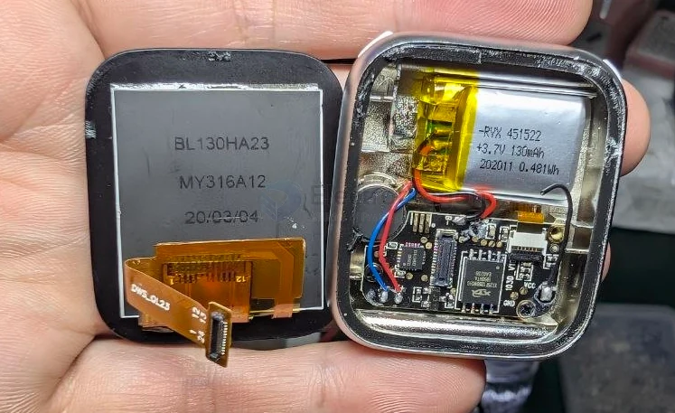

## build 2 

- [[smart-watch-dat]] - [[SSD1312-dat]] - [[AC6323A-dat]]

## build 1 

- [[xiaomi-dat]] - [[smart-watch-dat]] 

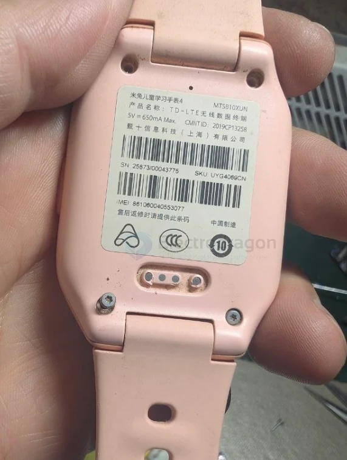

### overview 

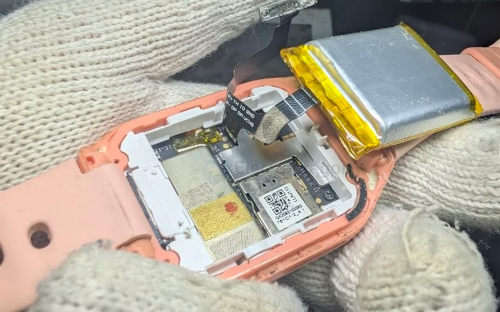

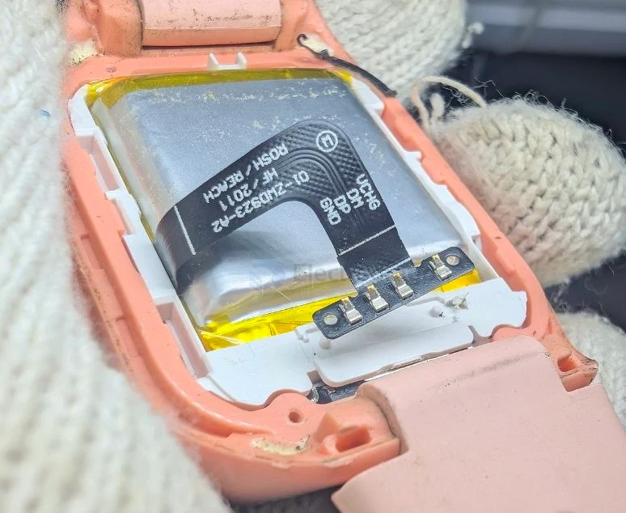

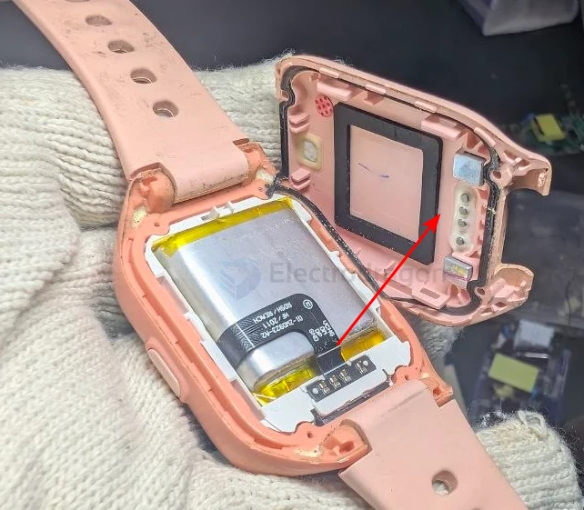

- [[conn-battery-dat]] - [[smart-watch-dat]] 

### inside modules 

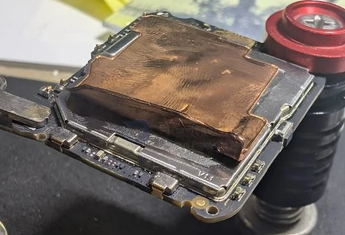

- [[spreadtrum-dat]] - [[unisoc-dat]] - [[SL8521ET-dat]] - [[IOT-LTE-dat]] - [[4G-dat]] - [[projects-dat]] - [[IOT-dat]]
  
- [[SPRD-dat]] - [[SC2721G-dat]] - [[PMIC-dat]] - [[SR3593A-dat]] 

FRONT 
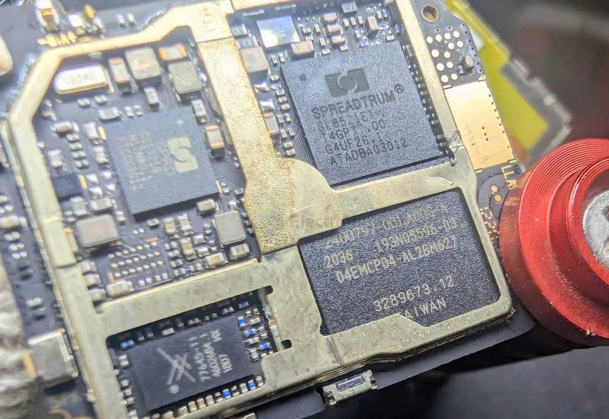

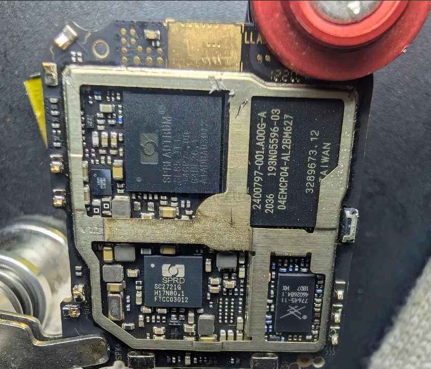

77546-11 == [[skyworks-dat]] - [[spreadtrum-dat]] - [[unisoc-dat]] - [[SL8521ET-dat]] - [[IOT-LTE-dat]] - [[4G-dat]] - [[projects-dat]] - [[IOT-dat]]

BACK 

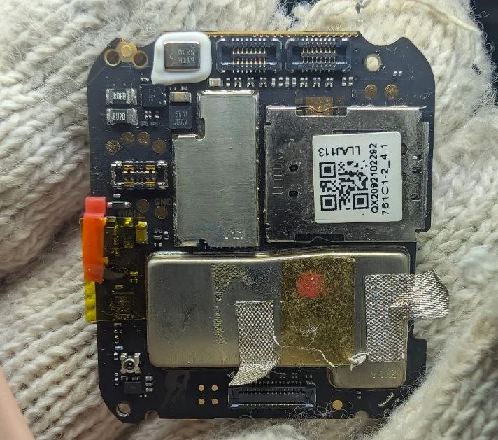

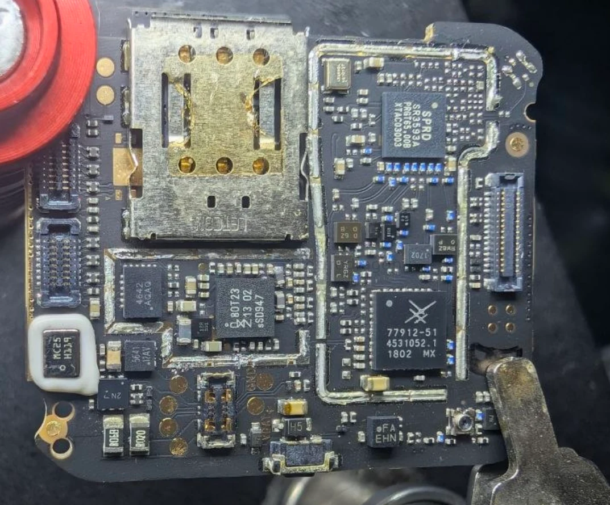

- [[skyworks-dat]] - [[SKY77912-dat]] - [[smart-watch-dat]]

### outside peripherals 

- [[peripherals-dat]] - [[speaker-dat]] - [[sensor-microphone-dat]] - [[smart-watch-dat]]

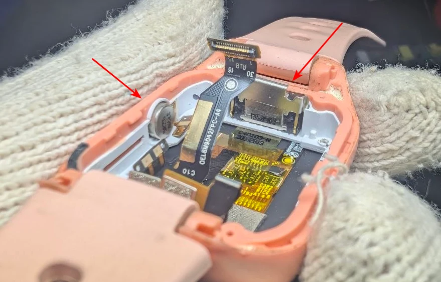

- [[camera-dat]]

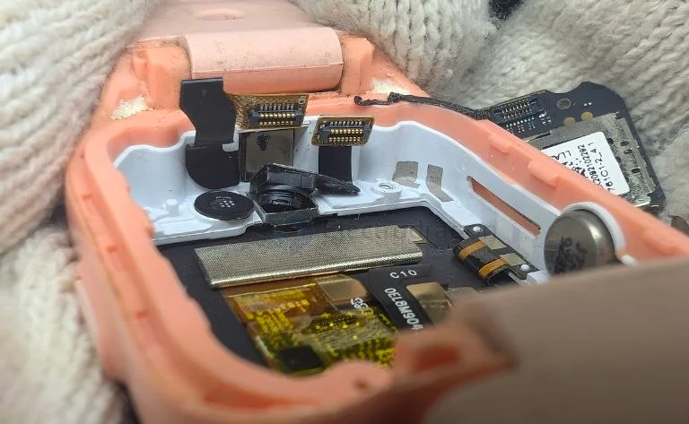

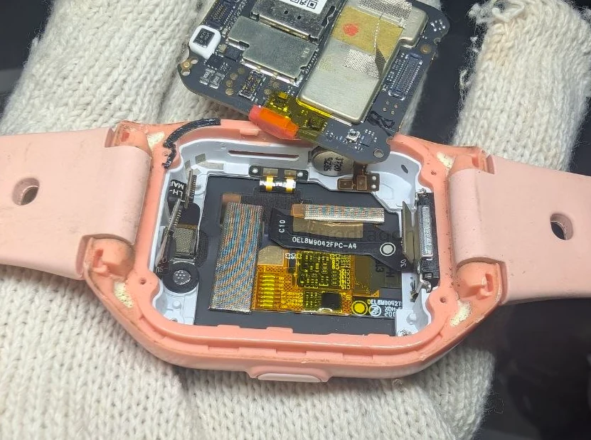

## ref 