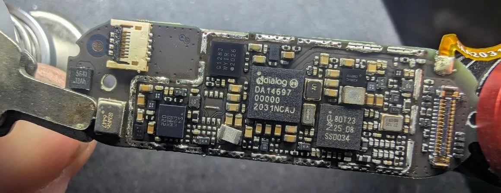
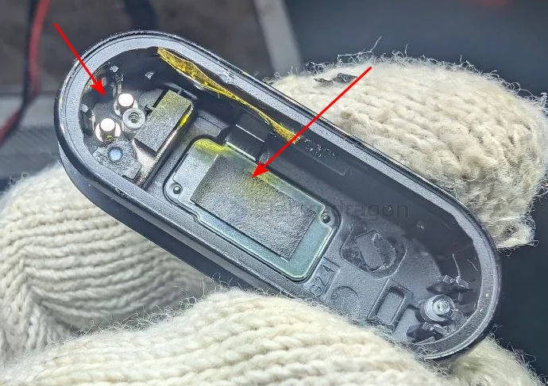
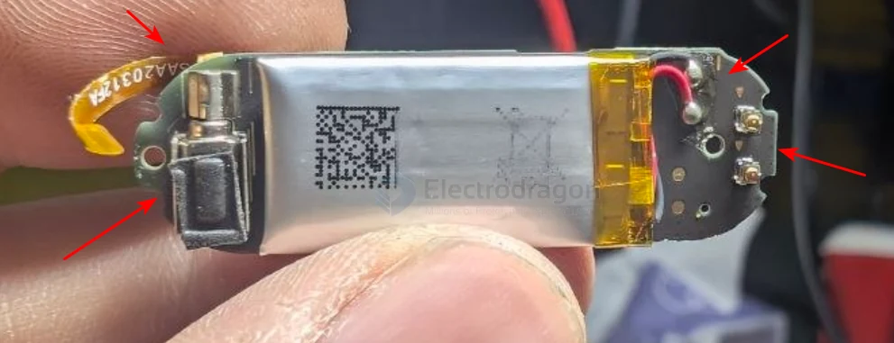
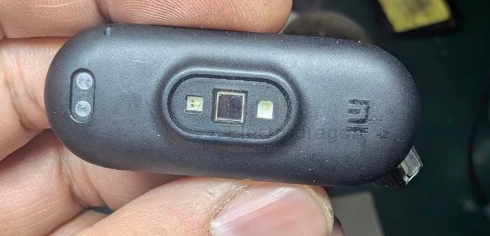
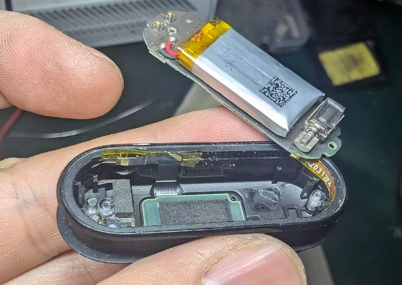
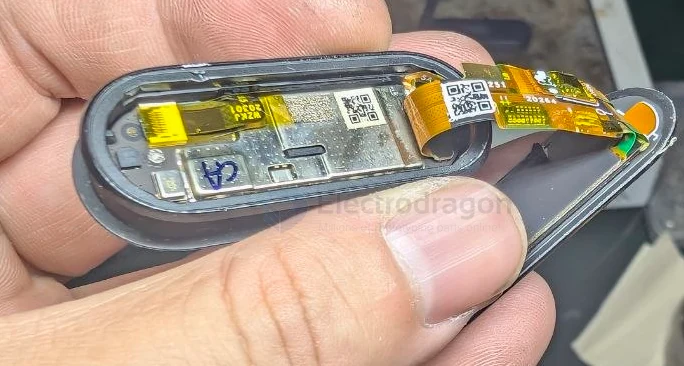
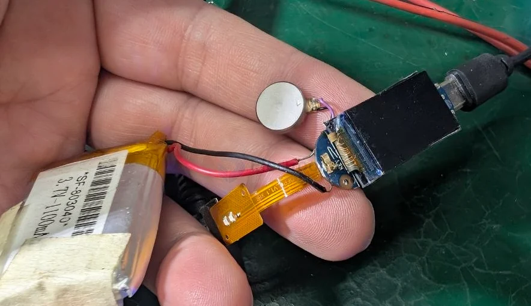
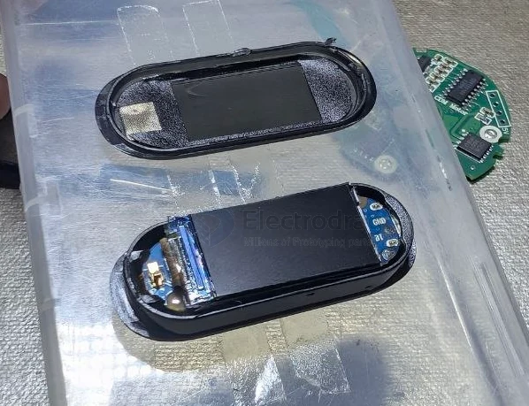
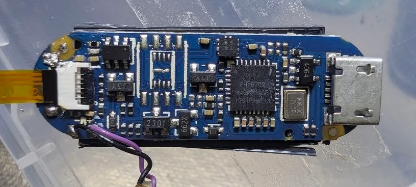
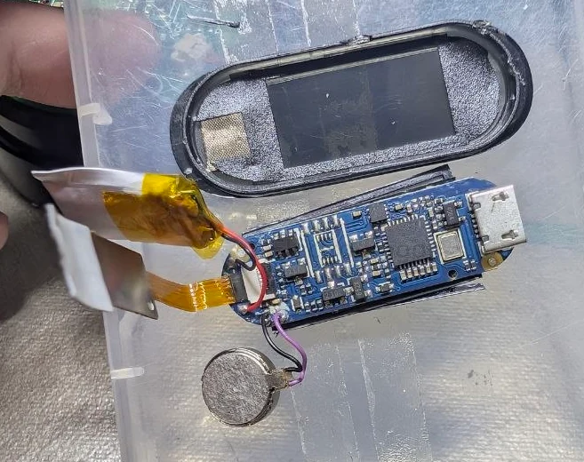

# smart-wristband-dat

- [[electronics-consumer-dat]] - [[smart-wristband-dat]] - [[smart-watch-dat]] - [[fitness-tracker-dat]]
  

method - [[heatbed-dat]]

## build 

build 2 

- [[smart-wristband-dat]] - [[xiaomi-dat]] - [[dialog-dat]] - [[DA14697-dat]]

- [[display-dat]]

build 1 

system == [[vibrator-dat]] - [[led-dat]] - [[display-dat]] - [[battery-charger-dat]] == 4064 - [[linear-technology-dat]]

- [[BLE-dat]] - [[phy-co-dat]] - [[smart-wristband-dat]]

- [[mosfet-dat]] - [[LDO-dat]] - [[transistor-dat]]

## ref 

