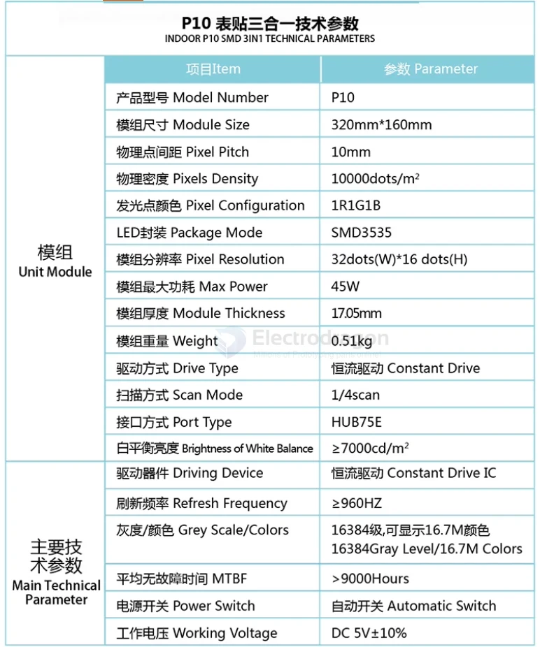

# LED-RGB-panel-P8-dat

- [[led-rgb-panel-dat]] - [[LED-RGB-panel-P8-dat]] - [[LED-RGB-panel-P6-dat]] - [[LED-RGB-panel-P3-dat]]

| Type | LED SPECs | XY LEDs | subtotal | Dimension      | spec         | Usage              | Scan | Power | Status  | SKU             | intern      |
| ---- | --------- | ------- | -------- | -------------- | ------------ | ------------------ | ---- | ----- | ------- | --------------- | ----------- |
| P8-1 | 8mm       | 32 x 16 | 512      | 25.6 x 12.8 CM | 2613_3216_8  | Outdoor, wateproof | 1/4  | ~30W  | selling | [[ILE1058-dat]] | [[ILE1058]] |
| P8-2 | 8mm       | 40 x 20 | 800      | 32 x 16 CM     | 3216_4020_8  | Outdoor, wateproof | 1/4  | ~30W  | selling |                 |

- P8-3216 - 256 x 128 mm 
- P8-4020 - 320 x 160 mm

## specs 

## ref 

