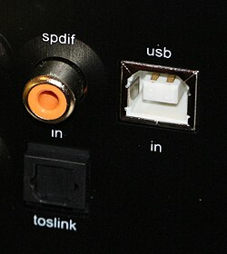

# CABLE-TWINAXIAL-dat

- [[cable-dat]] - [[CABLE-Coaxial-dat]]

# coaxial-cable-dat

🔶 Coaxial (RCA) SPDIF:

- Uses a copper wire inside a coaxial cable.
- Has an RCA connector (looks like those red/white/yellow plugs).
- Carries electrical digital signals.
- Requires a 75-ohm impedance cable for proper SPDIF transmission.

## S/PDIF

https://en.wikipedia.org/wiki/S/PDIF

S/PDIF (Sony/Philips Digital Interface)[1][2] is a type of digital audio interface used in consumer audio equipment to output audio over relatively short distances. The signal is transmitted over either a coaxial cable using RCA or BNC connectors, or a fibre-optic cable using TOSLINK connectors. S/PDIF interconnects components in home theaters and other digital high-fidelity systems.

## ref 

- [[cable-dat]]

A coaxial cable (often shortened to **coax**) is a type of shielded electrical cable used primarily to transmit high-frequency electrical signals, known as **RF (Radio Frequency)** signals. It gets the name "coaxial" because its internal conductors share a common geometric axis.

---

### Structure of a Coaxial Cable

A standard RF coaxial cable consists of four main concentric layers:

1. **Center Conductor:** A solid or stranded copper wire (or copper-clad steel) that carries the primary data or RF signal.
2. **Dielectric Insulator:** A solid or foam plastic layer surrounding the center conductor. It physically separates the inner conductor from the outer shield and sets the cable's characteristic impedance (commonly $50\,\Omega$ or $75\,\Omega$).
3. **Shielding (Braid and Foil):** A combination of metallic foil and a woven metal braid. This acts as a "Faraday cage," blocking external electromagnetic and radio frequency interference (EMI/RFI) while preventing the internal signal from radiating outward.
4. **Outer Jacket:** A protective outer layer (typically PVC or weather-resistant rubber) shielding the cable from moisture, physical wear, and UV radiation.

---

### Why Use Coaxial Cable for RF Signals?

At high radio frequencies, standard wires or unshielded twisted pairs act like antennas—they radiate high-frequency energy into the air and easily pick up environmental noise.

Coaxial cables confine the electromagnetic field entirely to the insulating space between the inner conductor and the outer shield. This unique geometry provides exceptional **signal integrity, low electromagnetic interference (EMI), and stable high-frequency bandwidth**.

---

### Common Applications

1. **Wireless Communications & RF Systems ($50\,\Omega$):**
* Connecting cellular boosters, two-way radios, and wireless transceivers to external antennas.
* **FPV drone systems** for connecting video transmitters, antennas, and ground station receivers.

2. **Television & Broadband ($75\,\Omega$):**
* Cable television (CATV) feeds and broadband internet connections (Cable Modems).

3. **Test and Measurement Equipment:**
* Connecting RF test equipment like spectrum analyzers and network analyzers via BNC, SMA, or N-type jumpers.

---

### Key Specifications

* **Characteristic Impedance:**

---

$50\,\Omega$: Optimized for power handling and wireless RF/data transmission (standard for radio gear, Wi-Fi antennas, and FPV links).

---

$75\,\Omega$: Optimized for low signal loss over long distances, standard for video and broadcast distribution (cable TV).

* **Signal Attenuation:** Higher frequencies suffer more signal loss (attenuation) over distance, meaning long runs require thicker, lower-loss coaxial cables.

## ref 

