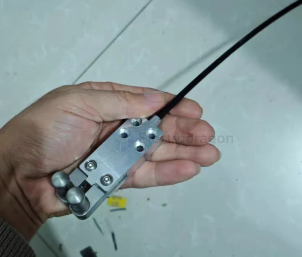

# cable-brake-dat

- [[cable-dat]] - [[cable-brake-dat]]

车辆或自行车制动的“刹车线”，而是弹弓（特别是带滑轨的机械弹弓、重型弹弓或渔猎弹弓）以及DIY弩类发射器上的“撒放器”（释放器）。
结合你的描述，具体解释如下：
 * 为什么叫“刹车线联动”？
   在很多DIY玩家自制的滑轨弹弓（也称“弹弓枪”或“长杆弹弓”）中，发射器（撒放器）安装在滑轨的后端，而握把和扳机在前端。由于前后有一定距离，玩家通常会直接借用自行车或电动车的刹车线（拉线）作为机械传动介质：前端扣动扳机拉动刹车线，刹车线带动后端这个金属机械结构张开，从而瞬间释放皮筋或弓弦（即“撒放”）。
 * 部件结构说明：
   * 前端双柱卡钳： 图中左下角那两个圆头金属柱是用来夹住弹弓皮筋兜（钢珠兜）或弓弦的。
   * 底部4个沉头孔（孔距12x14mm）： 用于通过螺丝将该撒放器固定在金属滑轨、铝合金型材或自制的木质/金属托架上。
   * 黑色线缆： 内部带有钢丝的刹车线外管，另一端连接到前置扳机组件上。
  

## ref 

