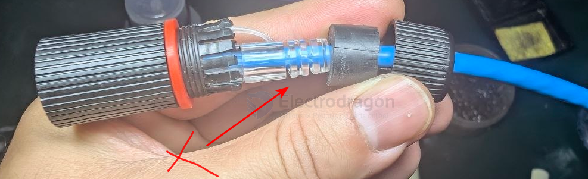
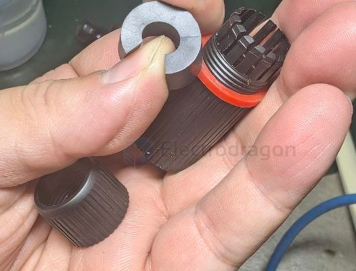
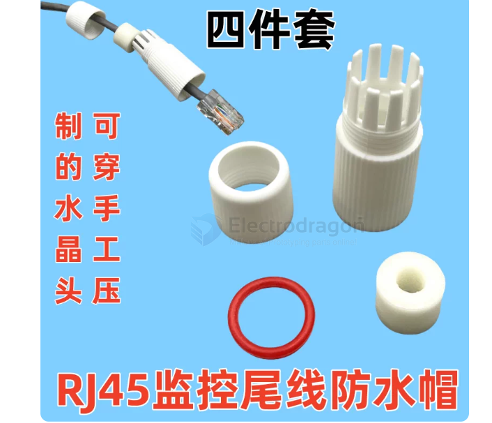
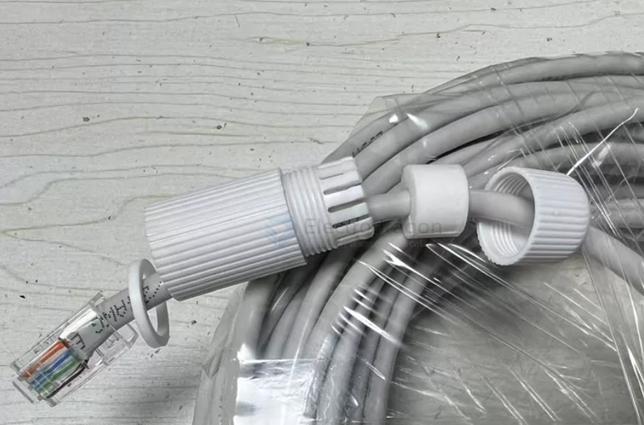
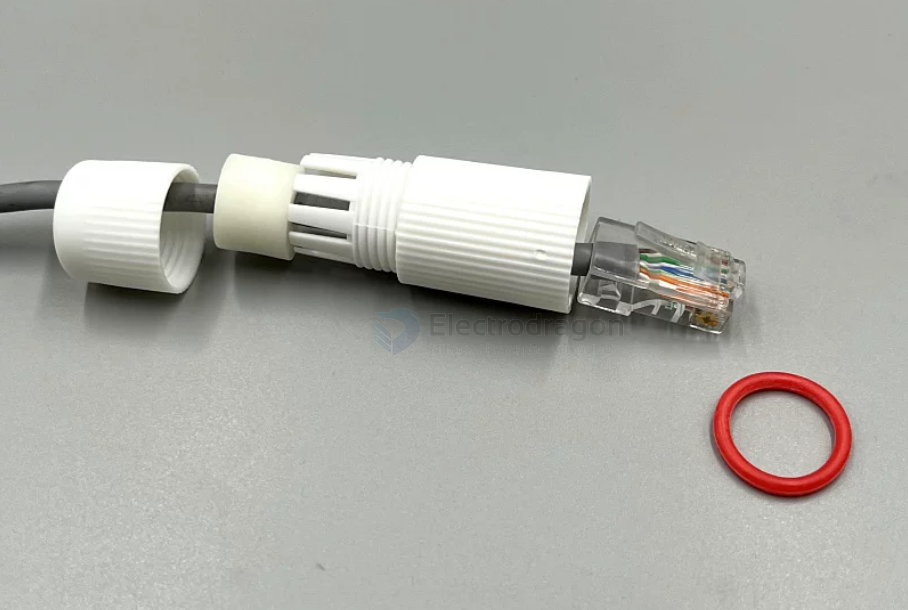
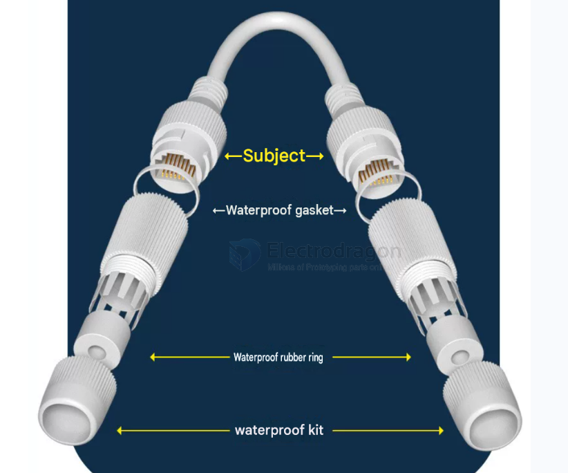
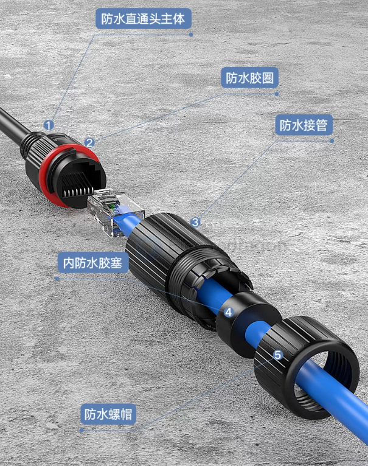

# cable-ethernet-waterproof-dat

- [[cable-ethernet-waterproof-dat]] - [[cable-ethernet-dat]] - [[ethernet-dat]]

## waterproof 

## waterproof cable 

带护套的网线和成品网线不可以连接该款防水直通

监控尾线防水帽 - 可穿手工压制的网线

产品参数：
- 1.连接器:RJ45 female+DC female（5.5*2.1mm）防水头2.材质:纯铜导体.PVC外护套
- 3.外 径（OD）:5.0mm.
- 4.颜色：白色/黑色
- 5.长度:0.7m
- 6.尾部端子处理:可配2P+4P+6P或2P+4P+8P，默认发2P+4P+8P。
- 7.尾线一扎50条，一箱500条。量大从优，欢迎询价。

## ref 

- [[cable]] - [[cable-ethernet]]