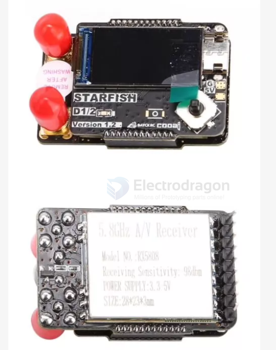
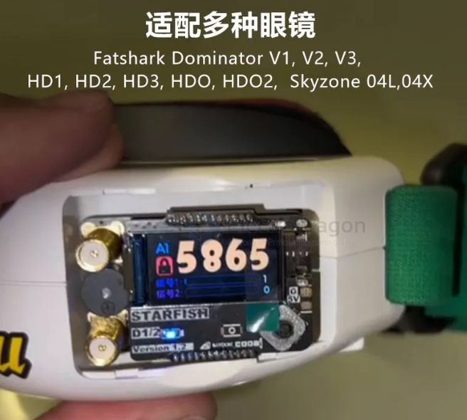
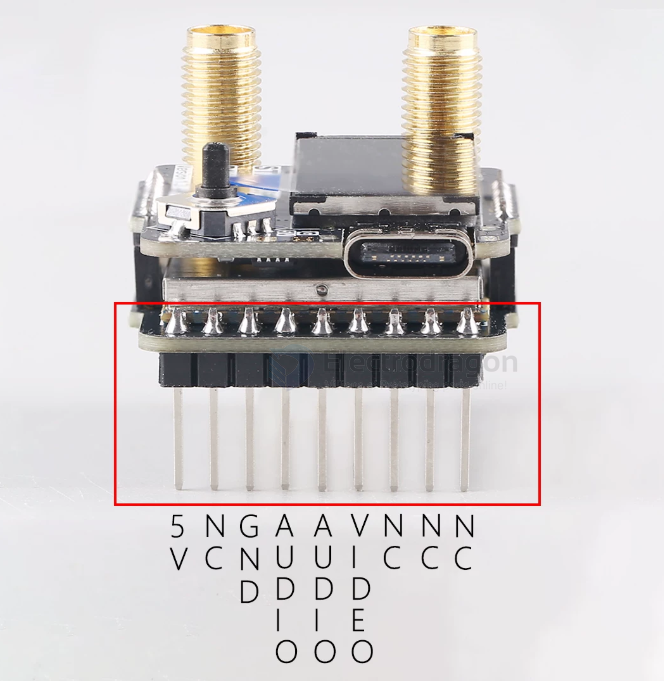
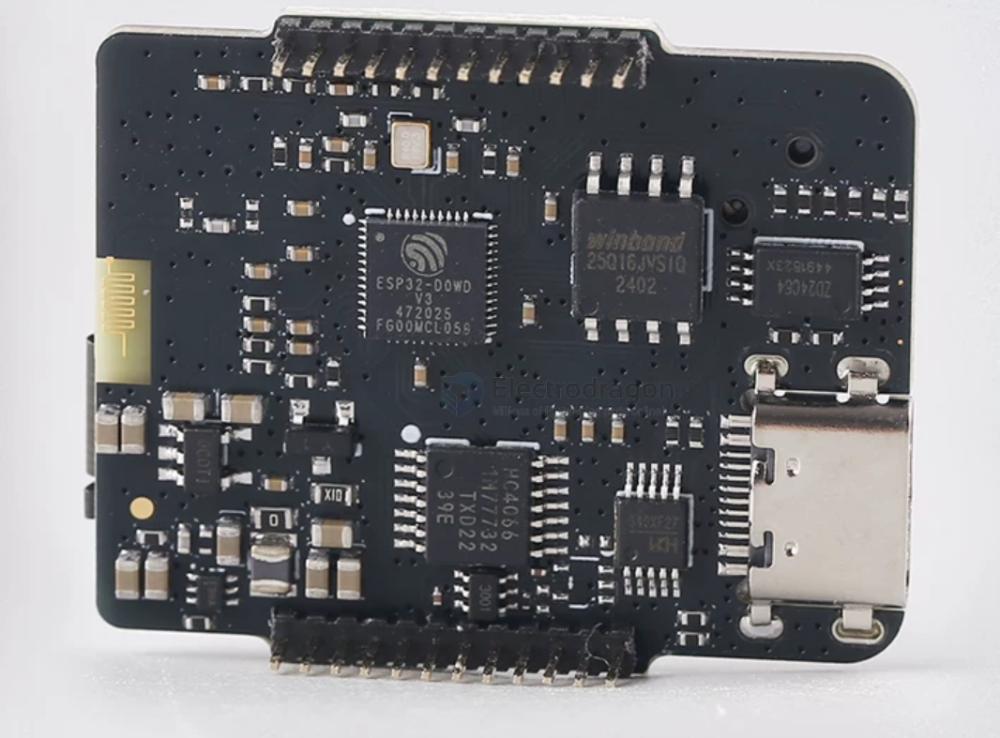

# RX5808-dat


- [[RX5808-dat]] - [[5.8Ghz-dat]] - [[RTC6715-dat]] == [[VRX-analog-dat]] - [[RTC6705-dat]] == [[VTX-analog-dat]] - [[video-analog-dat]]

- [[LVGL-dat]]


The RX5808 is a compact 5.8 GHz analog wireless audio and video receiver module widely used in FPV (First Person View) drone setups, video goggles, and DIY electronics projects.

## Key Specifications

• Frequency Range: 5.725 GHz – 5.865 GHz (standard 8 channels, or up to 48 channels depending on firmware/band configuration)
• Receiving Sensitivity: -90 dBm
• Supply Voltage: 3.3V to 5.5V (~170 mA current draw)
• Outputs: Direct analog audio and video (AV) signals, plus RSSI (Received Signal Strength Indicator)
• Dimensions: 28 × 23 × 3 mm (approx. 3.6 g)

## Common Uses

• DIY FPV Receivers & Diversity Modules: Often paired with microcontrollers like an Arduino Nano and an OLED screen in open-source projects like the sheaivey/rx5808-pro-diversity build to add channel scanning, auto-save, and dual-antenna diversity.
• Drone Ground Stations: Used to pull analog video feeds from quadcopters straight to portable monitors, ground station boxes, or analog goggles.
• Replacement Parts: Available standalone from suppliers like WREKD and RaceDayQuads for repairs or custom telemetry/laptimer projects.


## module info 


## diagram 


## build 

build 1 











产品参数
型号：海星D1接收机
OSD界面：支持
适配:Fatshark、DominatorV1,V2,V3,HD1、HD2、HD3、
HDO、HDO2、Skyzone、04L、04X
双天线工作方式：基于RSSI值，视频端切换
硬件配置：ESP32单片机+0.96寸TFTLCD+5向按键+RF同款-98d
bm接收模块+蜂鸣器
模块灵敏度：-98dbm
界面：基于LVGL中英双语界面
频率：频率5.8G 48频点(A、B、E、F、R、L)
电源：5V@450mA
重量：23g
尺寸：长42.4mm*宽28mm*高20.5mm


## 8. Reference Architecture: Dual-RX5808 Diversity Base

```
   Antenna A (directional)        Antenna B (omni)
         │                              │
   ┌─────┴─────┐                  ┌─────┴─────┐
   │  RX5808   │                  │  RX5808   │
   │ (RTC6715) │                  │ (RTC6715) │
   └──┬────┬───┘                  └──┬────┬───┘
      │    │ RSSI                    │    │ RSSI
      │    └──────────┐   ┌──────────┘    │
      │ VIDEO         ▼   ▼               │ VIDEO
      │          ┌──────────────┐         │
      │          │     MCU      │         │
      │          │  (ESP32/etc) │         │
      │          │  • SPI → both│         │
      │          │  • ADC ← RSSI│         │
      │          │  • UI / logic│         │
      │          └──────┬───────┘         │
      │                 │ switch cmd      │
      ▼                 ▼                 ▼
   ┌──────────────────────────────────────────┐
   │   Analog video switch (MAX4544 / 74HC4053)│
   └───────────────────┬──────────────────────┘
                       ▼
              CVBS out → goggles / monitor AV IN
```

**Three rules that make or break this design:**

1. ⭐ **The MCU never touches the video.** ESP32/AVR cannot decode CVBS. It only does SPI (channel), ADC (RSSI), and switch control.
2. ⭐ **Never parallel two video outputs directly.** You need an analog switch, and the switch must be fast enough (or buffered enough) not to lose sync. FENIX switches at **15 kHz ≈ once per NTSC line**, which is invisible to the eye.
3. **Feed the switch from a stable 5 V rail** — backlight boost converters and ESP32 WiFi bursts are the two biggest noise sources on this rail.


## 9. Open-Source Project Directory

### 9.1 Receivers (VRX)

| Project | Platform | Highlights |
| :--- | :--- | :--- |
| ⭐⭐ **FENIX-rx5808-pro-diversity**<br>`github.com/jyesmith/fenix-rx5808-pro-diversity` | ESP32 | Touchpad UI, **15 kHz switching (≈ once per NTSC line)**, **72 selectable frequencies**, MIT. Fork of sheaivey. Also `StonedDawg` fork. |
| ⭐ **sheaivey/rx5808-pro-diversity**<br>`github.com/sheaivey/rx5808-pro-diversity` | Arduino Nano (AVR) | The original. Best-documented entry point; every later version forks from here. |
| ⭐⭐ **Twotoz/C5VRX**<br>`github.com/Twotoz/C5VRX` | **ESP32-C5** | **Zero-CPU, no RX5808 module**: Wi-Fi 6 PHY **MODEM_DIAG** raw sampling → BitScrambler **WBFM demod** → **passive resistor DAC** → real CVBS. One Seeed XIAO ESP32-C5. |
| ⭐ **LouisHitchcock/FPVGateC5RX**<br>`github.com/LouisHitchcock/FPVGateC5RX` | ESP32-C5 | Makes the C5's 5 GHz radio "behave exactly like an RX5808 module", so existing tooling keeps working. |
| **Ft-Available/RX5808-Div**<br>`oshwhub.com/ftps/rx5808-div` | (PCB project) | Chinese OSHWLab project with **full PCB** and UI menus; easiest to order boards + parts domestically. |
| ⭐ **xythobuz/rpi-rx5808-stream**<br>`github.com/xythobuz/rpi-rx5808-stream` | Raspberry Pi | Diversity RX5808 that **restreams video over the network** — many viewers, recording, remote monitoring. |
| **DIY Homemade FPV Monitor**<br>`hackaday.io/project/160893` | — | Self-built 5.8 GHz **monitor with diversity**; good enclosure/display reference. |
| **rx5808-5.8ghz-SPI-scanner**<br>`github.com/LouDnl/rx5808-5.8ghz-SPI-scanner` | Arduino + OLED | **RSSI spectrum scanner** + receiver with autoscan. Also the best write-up of the **SPI enable resistor mod**. |

### 9.2 Alternative front-ends (no dedicated module)

| Project | Approach |
| :--- | :--- |
| ⭐ **lukeswitz/fpv-sdr**<br>`github.com/lukeswitz/fpv-sdr` | Decode analog **1.2 GHz & 5.8 GHz** FPV video with **generic software-defined radios**; cross-platform decode + visualization. Great for surveying/forensics, poor for real-time flying. |
| **ESP32-C5 PHY routes** (C5VRX, FPVGateC5RX) | Reuse the Wi-Fi 6 PHY as the RF front end. Cheapest path, still being validated by the community. |

### 9.3 Transmitters (VTX) — analog side is thin

| Project | Notes |
| :--- | :--- |
| ⭐⭐ **OpenVTx**<br>`github.com/OpenVTx/OpenVTx` | The only mature open-source **analog VTX firmware**. Supports **MSP / TBS SmartAudio / IRC Tramp**. Runs STM32 (some AVR). ExpressLRS team involvement. |
| **OpenDrone-hw/OpenVTX**<br>`github.com/OpenDrone-hw/OpenVTX` | Open-source **VTX hardware**: **RTC6705 + STM32G4**, software-defined OSD. ⚠️ Early stage — **no schematic yet**. |
| **Happymodel OVX300 / OVX303 / OVX306** | Commercial RTC6705 modules **shipping with OpenVTx preloaded**. OVX306: whoop-size, 48CH, 25/100/400 mW, auto-detects SmartAudio/Tramp. |

> Everything else in the "VTX" category of the open-source world is **digital WiFi** (OpenHD, RubyFPV, Wifibroadcast-NG, wfb-ng on OpenIPC, DroneBridge, EZ-Wifibroadcast, hx-esp32-cam-fpv). Those belong to the OpenIPC line, not to analog.

### 9.4 Ecosystem applications

| Project | Role |
| :--- | :--- |
| ⭐⭐ **RotorHazard**<br>`github.com/RotorHazard/RotorHazard` | **Open-source FPV race timing & event management.** Each timing-box node listens on one channel (one RX5808 + Arduino per node) and triggers lap times from **RSSI**; a Raspberry Pi aggregates, with a full web UI. This is, by volume, the most-used RX5808 application in the world. |
| ⭐ **LouisHitchcock/FPVGate**<br>`github.com/LouisHitchcock/FPVGate` | ESP32-S3 standalone RSSI lap timer — the lightweight, single-device alternative to a full RotorHazard box. |
| ⭐ **ExpressLRS VRx Backpack**<br>`expresslrs.org/hardware/backpack/backpack-vrx-setup/` | Lets the **radio automatically switch the ground VRX's channel** when you change model/frequency. Requires the RX5808 in **SPI mode** wired per the official diagram. |
| ⭐ **awesome-flying-fpv**<br>`github.com/Matthias84/awesome-flying-fpv` | Curated index (718★, CC0). Note: its **Video Receivers** category has only **3 entries**, and **analog VTX has only OpenVTx** — the analog open-source ecosystem is genuinely thin. |

---

## 10. Design Gotchas (field-tested list)

1. **SPI must be unlocked** (resistor mod) and the **DIP switch removed** — otherwise the module ignores your MCU.
2. **3.3 V logic** from a 5 V MCU needs a level shifter; add 1–10 kΩ series resistors on SPI lines.
3. **ADC nonlinearity**: ESP32 ADCs are not linear at the rails — use **relative + hysteresis** logic for diversity, never absolute thresholds.
4. **Calibrate RSSI per module.** Two modules from the same batch can differ noticeably.
5. **Video switching needs buffering.** Direct switching loses sync on every transition; use fast analog switches and, ideally, per-line switching.
6. **Never parallel video outputs.** 75 Ω terminations fight each other.
7. **Power rail noise** — ESP32 WiFi bursts and LCD backlight boosts both couple into the 5.8 GHz front end. Separate rails / LC filtering / shielding.
8. **Two modules close together couple.** Keep physical distance and use shield cans.
9. **Polarization must match** — the air-side VTX is typically **RHCP**, so ground antennas must be RHCP too. A linear antenna here costs you ~3 dB immediately.
10. **SMA vs RP-SMA** — check the module's connector; they are not interchangeable.
11. **Each module draws ~170–180 mA nominal** (measured often higher) — budget 5 V / ≥500 mA for a pair plus MCU.
12. **Module specs are 2010-era and cloned heavily.** Verify sensitivity and current on your own unit.


## ref 

