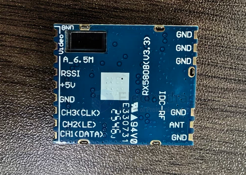
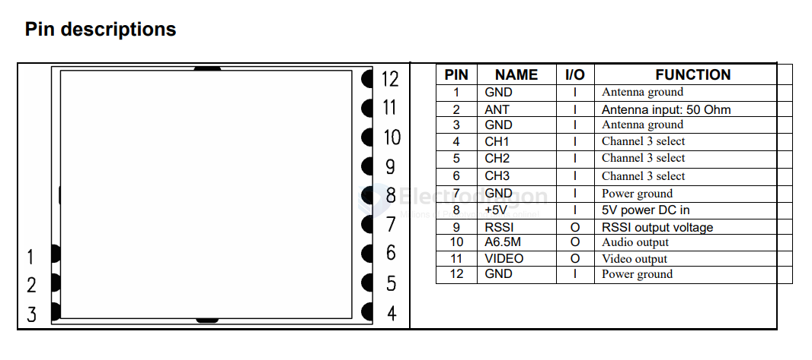
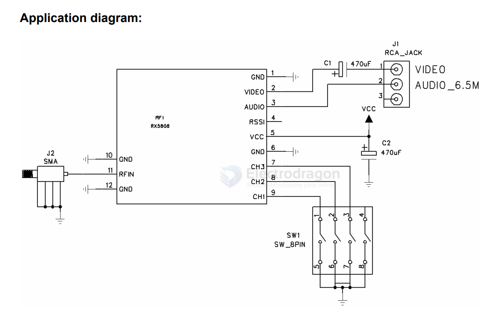

# RX5808-dat

- [[RX5808-dat]] - [[5.8Ghz-dat]]

The RX5808 is a compact 5.8 GHz analog wireless audio and video receiver module widely used in FPV (First Person View) drone setups, video goggles, and DIY electronics projects.

## Key Specifications

• Frequency Range: 5.725 GHz – 5.865 GHz (standard 8 channels, or up to 48 channels depending on firmware/band configuration)
• Receiving Sensitivity: -90 dBm
• Supply Voltage: 3.3V to 5.5V (~170 mA current draw)
• Outputs: Direct analog audio and video (AV) signals, plus RSSI (Received Signal Strength Indicator)
• Dimensions: 28 × 23 × 3 mm (approx. 3.6 g)

## Common Uses

• DIY FPV Receivers & Diversity Modules: Often paired with microcontrollers like an Arduino Nano and an OLED screen in open-source projects like the sheaivey/rx5808-pro-diversity build to add channel scanning, auto-save, and dual-antenna diversity.
• Drone Ground Stations: Used to pull analog video feeds from quadcopters straight to portable monitors, ground station boxes, or analog goggles.
• Replacement Parts: Available standalone from suppliers like WREKD and RaceDayQuads for repairs or custom telemetry/laptimer projects.

## module info 

## diagram 

## ref 

