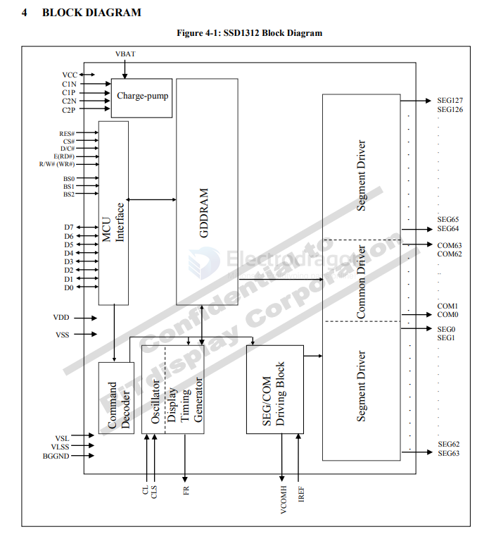

# SSD1312-dat

- [[SSD1312-dat]] - [[SSD-dat]] - [[oled-driver-dat]] 

- [[SSD1312_Datasheet.pdf]]

SSD1312 is a single-chip CMOS OLED/PLED driver with controller for organic/polymer light emitting
diode dot-matrix graphic display system. It consists of 128 segments and 64 commons. This IC is
designed for Common Cathode type OLED/PLED panel.

SSD1312 displays data directly from its internal 128 x 64 bits Graphic Display Data RAM (GDDRAM).
Data/Commands are sent from general MCU through the hardware selectable I2C Interface, 6800-/8080-
series compatible Parallel Interface or Serial Peripheral Interface.

The 256 steps contrast control and oscillator which embedded in SSD1312 reduces the number of external
components. SSD1312 is suitable for portable applications requiring a compact size and high output
brightness, such as set-top box, car audio, wearable electronics, etc. 

2 FEATURES

 Resolution: 128 x 64 dot matrix panel
 Power supply
o VDD = 1.65V – 3.5V, ≤ VBAT (for IC logic)
o VBAT = 3.0V – 4.5V (for charge bump regulator circuit)
o VCC = 7.5V – 16.5V (for Panel driving)
 Segment maximum source current: 480uA
 Common maximum sink current: 61.5mA
 Embedded 128 x 64 bit SRAM display buffer
 Pin selectable MCU Interfaces:
o 8 bits 6800/8080-series parallel Interface
o 3/4 wire Serial Peripheral Interface
o I
2C Interface
 Screen saving continuous scrolling function in both horizontal and vertical direction
 Screen saving infinite content scrolling function
 Internal or external IREF selection
 Internal charge pump regulator
 RAM write synchronization signal
 Programmable Frame Rate and Multiplexing Ratio
 Row Re-mapping and Column Re-mapping
 Portrait Addressing Mode
 Power On Reset (POR)
 Dynamic Grayscale
 On-Chip Oscillator
 Chip layout for COG, COF
 Wide range of operating temperature: -40C to 85C 

## diagram 

## apps 

- [[smart-watch-dat]] - [[SSD1312-dat]] - [[AC6323A-dat]]

## ref 