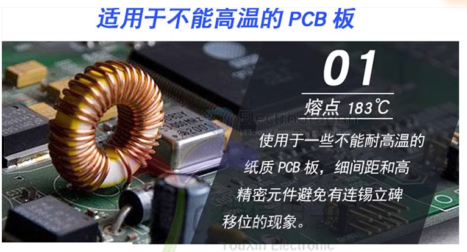
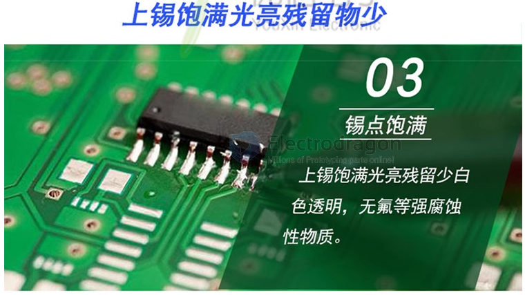
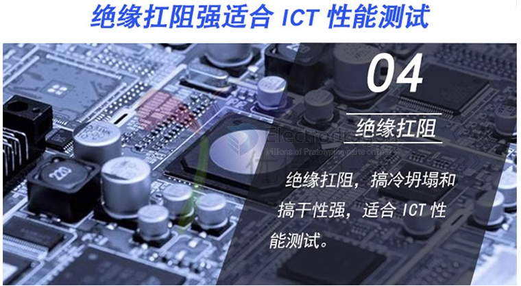

# solder-paste-dat

- [[soldering-paste-low-temperature]] - [[solder-paste-dat]] - [[fab-soldering-materials-dat]]

- [[PCB-soldering-dross-dat]] - [[fab-PCB-soldering-dat]] - [[flux-thinner-dat]]

- [[high-precise-printing-dat]]

- [[fab-PCB-soldering-dat]] - [[solder-paste-dat]]

- [[fab-stencil-printer-dat]] - 

## supporting tools 

- [[syringe-dat]] - [[syringe-pusher-dat]]

- [[Flux-Thinner-dat]]

- [[soldering-flux-dat]]

### Solder Paste Types and Applications

| Solder Paste Model   | Composition         | Powder Type | Application/Notes                                   |
| -------------------- | ------------------- | ----------- | --------------------------------------------------- |
| Mobile Repair GY618B | Sn62.8-Pb36.8-Ag0.4 | Type 4      | For mobile phone repair                             |
| A-888                | Sn63-Pb37           | Type 3      | resistors, capacitors, simple IC PCBs               |
| A-888                | Sn63-Pb37           | Type 4      | resistors, capacitors, fine-pitch/multi-pin IC PCBs |
| SMT Chip A-888       | Sn63-Pb37           | Type 5      | resistors, capacitors, dense/multi-pin IC PCBs      |
| GY-626B              | Sn62.9-Pb36.9-Ag0.2 | Type 4      | QFN type PCBs                                       |
| GY-618B-B            | Sn62.8-Pb36.8-Ag0.4 | Type 4      | BGA pack-Age PCBs                                   |
| LED Chip GY361       | Sn55-Pb45           | Type 3      | LED lamps, strips, and tapes                        |
| GY638A               | Sn60-Pb40           | Type 3      | Performance superior to GY361                       |

## Common type Solder Paste 

| melting point | tin content | Note                                                                 |
| ------------- | ----------- | -------------------------------------------------------------------- |
| 138 C         | 42%         | ultra-low temperature, bismuth-based, for special low-temp soldering |
| 150 C         | 42%         | low temperature, bismuth-based, for temperature-sensitive components |
| 183 C         | 63%         | best for most common PCB, small spacing, high parts density          |
| 217 C         | 99.3%       | lead-free, SAC305 alloy, standard for RoHS compliant PCBs            |

## What Is Solder Paste Thawing?

**Solder paste thawing / warm-up** is the process of taking solder paste out of cold storage (typically a dedicated refrigerator at **2 °C – 10 °C**) and letting it warm naturally to workshop ambient temperature **without opening the sealed package**.

---

## Core Functions of Solder Paste Thawing

Solder paste consists of metal powder, flux, and solvent. Using refrigerated paste directly causes a series of serious soldering defects; thawing matters mainly in the following three ways:

* **1. Prevents moisture condensation from the air (most critical)**:
  * A refrigerated paste jar is cold. If the lid is opened immediately after taking it out of the fridge, moisture in the workshop air quickly **condenses into droplets on the cold paste surface (dew condensation)**.
  * When moisture mixes into the paste and enters the reflow oven, the high temperature vaporizes it instantly, producing solder balls, splatter, solder voids, or even paste explosion.

* **2. Restores viscosity and rheological properties**:
  * Low temperature thickens the resins and solvents in the flux and raises viscosity. Thawing restores the paste to the manufacturer's designed **standard viscosity and thixotropy**, ensuring it fills stencil apertures smoothly and evenly as the squeegee pushes it.

* **3. Equalizes chemical activity and prevents clumping**:
  * Thawing equalizes the temperature distribution between the metal powder and the flux, avoiding premature flux failure or local separation/settling caused by temperature gradients, thereby keeping the printed shape stable without slumping.

---

## Standard Thawing Procedure and Checklist

* [ ] **Keep it sealed**: Never open the lid or peel the sealing film during thawing; the original packaging must remain sealed.
* [ ] **Timing**: Standard thawing time is generally **4 hours or more** (extend appropriately for large-capacity jars or low winter room temperatures).
* [ ] **No heating**: Never use an oven, heat gun, or any other external heat source to force it; thawing must be at **natural room temperature**.
* [ ] **Temperature confirmation**: After thawing, use an infrared thermometer (or check by touch) to confirm the jar has reached workshop temperature before opening, stirring, and using.

## target 

- [[FPC-dat]] 

## ref 

- [[solder-paste]]

- [[fab-PCB-soldering-dat]]