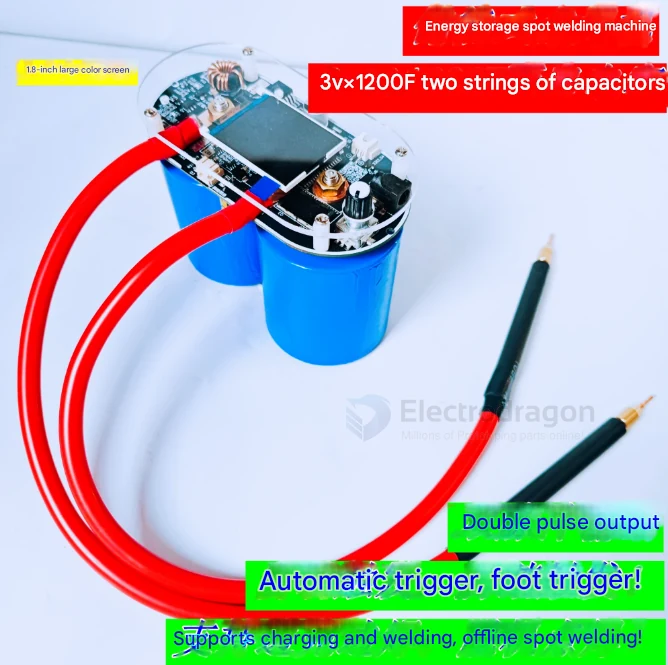
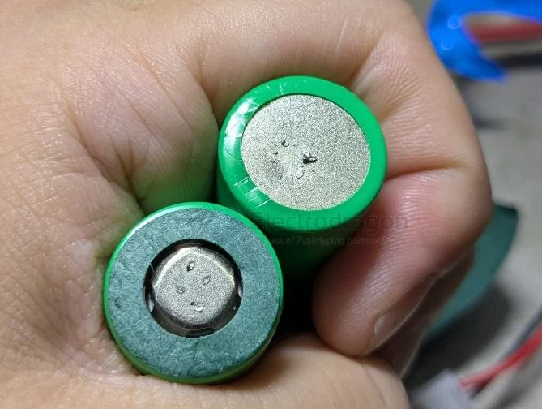

# soldering-tools-spot-welding-dat

== spot welder 

- [[battery-dat]] - [[fab-tools-dat]] - [[battery-tools-dat]] - [[battery-tester-dat]]
- [[fab-soldering-materials-dat]]

- [[soldering-tools-spot-welding]]

## mosfet solder 

- 用通孔 FET 做 DIY 点焊机：开发比廉价板更耐用的套件板 — 这是电池组点焊的关键环节；用通孔方案比 MOS 并联板更耐操，适合自己做电池包。· Battery Technology ·
  https://endless-sphere.com/sphere/threads/creating-a-diy-friendly-spot-welder-using-through-hole-fets-developing-a-kit-type-board-thats-more-robust-than-what-you-can-get-for-cheap.131595/

SCH 

### MCU control

The **ATtiny1616** microcontroller acts essentially as a **precise electronic shutter controller**. Its primary job is to manage user inputs, monitor safety conditions, and precisely control high-current switching (the MOSFET array) with microsecond-level timing.

    [ Power On / Reset ]
            │
            ▼
    ┌──────────────────────────────────────┐
    │          Idle / Monitoring           │
    │  (Read Encoder, Update OLED Screen)  │
    └──────────────────┬───────────────────┘
                        │
                        │ (Trigger: Foot Switch / Auto-detect probe contact)
                        ▼
    ┌──────────────────────────────────────┐
    │        Safety & Pre-Check            │
    │  (Verify Supply Voltage & NTC Temp)  │
    └──────────────────┬───────────────────┘
                        │ (Pass)
                        ▼
    ┌──────────────────────────────────────┐
    │         Pulse 1 (Pre-weld)           │
    │   (~1ms - 5ms to clear oxides)       │
    └──────────────────┬───────────────────┘
                        │
                        ▼
    ┌──────────────────────────────────────┐
    │         Cooling Delay Gap            │
    │    (~10ms - 50ms pause for safety)   │
    └──────────────────┬───────────────────┘
                        │
                        ▼
    ┌──────────────────────────────────────┐
    │         Pulse 2 (Main Weld)          │
    │  (~5ms - 30ms to fuse nickel strip)  │
    └──────────────────┬───────────────────┘
                        │
                        ▼
    ┌──────────────────────────────────────┐
    │       Cooldown & Fault Lockout       │
    │   (Prevent rapid re-triggering)      │
    └──────────────────┬───────────────────┘
                        │
                        └───────────► (Return to Idle)

The core operational logic runs through a non-blocking state machine divided into the following key modules:

---

### 1. Core Execution Flow (Main Loop & State Machine)

* **Idle / Monitoring:** The system waits quietly, updating the UI and continuously monitoring for safety parameters and trigger events.
* **Trigger Detection:** It checks for an input signal (e.g., a foot switch press or an auto-detect trigger when the welding probes touch the nickel strip).
* **Pre-Check / Safety Verification:** It verifies that input voltage (from the supply battery/capacitor bank) and board temperature (via NTC thermistor) are within safe operating limits.
* **Double-Pulse Generation:** Executes the precise weld sequence (detailed below).
* **Cooling Lockout & Reset:** Enforces a brief cooldown period to protect the MOSFETs before returning to the idle state.

---

### 2. Key Functional Modules

#### ① User Interface & Settings

* **Input:** Reads a rotary encoder or buttons to adjust welding parameters—specifically **Pulse 1 duration**, **Cooling Delay**, and **Pulse 2 duration** (typically measured in milliseconds).
* **Display:** Drives an OLED or LED screen to show current settings and system status.

#### ② Trigger Handling & Debouncing

* Monitors the trigger input pin and applies software debouncing to ensure a clean, intentional trigger before initiating any high-current output.

#### ③ Precise Pulse Timing Control (The Core Task)

Using the ATtiny1616's internal **hardware timers (TCA/TCB)**, the firmware delivers a strict double-pulse sequence:

1. **Pulse 1 (Pre-weld / Warm-up):** A short pulse (e.g., 1ms–5ms) used to burn away surface oxidation on the nickel strip and establish initial contact.
2. **Cooling Delay:** A brief pause (e.g., 10ms–50ms) with the MOSFETs turned off to let heat dissipate and current stabilize.
3. **Pulse 2 (Main Weld):** A longer pulse (e.g., 5ms–30ms) that delivers the primary thermal energy required to fuse the nickel strip to the battery cell casing.

* *Note:* The single-chip outputs these signals through gate drivers to rapidly switch the through-hole MOSFET array on and off, preventing excessive thermal buildup and switch failure.

#### ④ Safety & Protection Mechanisms

* **Thermal Protection:** Continuously reads board temperature via an analog input (ADC); locks out operation if the board overheats.
* **Undervoltage Lockout (UVLO):** Checks supply voltage to prevent operation under low-voltage conditions that could cause erratic behavior or poor welds.
* **Maximum Pulse Hard-Limit:** Includes a failsafe time cap to prevent software lockups or stuck buttons from holding the MOSFETs open indefinitely, avoiding thermal runaway or fire risks.

## Capacitor Discharge (CD) Spot Welding

Capacitor Discharge Spot Welder (CD Spot Welder)

Capacitors are not batteries; they can be stored at zero volts, require no maintenance over long periods, have no memory effect, and do not suffer from over-discharge issues. They can be used normally even after being shelved for 2 years.
- Extremely high-current discharge capability.
- A long-term practical tool, not a short-term toy!

- [[capacitor-super-dat]] - [[capacitor-dat]]

Specifically for [[battery-dat]]

- Laser Nickel Welding??

## Desoldering: Removing Nickel Strips

### Method 1: Using Specialized Wire Strippers or Diagonal Cutters (Recommended & Safest)
This is the most common manual disassembly method. The core technique is "rolling" rather than "pulling hard."

- **Tools:** Sharp needle-nose pliers, diagonal cutters, or wire strippers (with insulated handles).
- **Find a Point of Entry:** Look for a slightly raised edge on the nickel strip and grip it with the cutters.
- **"Sushi Roll" Technique:** Never pull straight up vertically (this can deform or puncture the battery's positive cap). Instead, grip one end of the nickel strip and rotate the pliers in one direction—like opening a can or rolling sushi—to slowly wind the nickel strip around the plier jaws.
- **Clean Up:** After removing the main strip, small protrusions (residual weld spots) often remain. Use the tip of the diagonal cutters to carefully flatten or snip them off.

### Method 2: Using a Micro Rotary Tool or Sandpaper (For Precision)
Ideal if you want to avoid physical stress on the battery or desire a perfectly smooth finish.

- **Tools:** Handheld micro rotary tool (with ball or cylindrical grinding stones, diamond bits), and safety goggles.
- **Precision Grinding:** Aim the rotary tool at the weld spot and gently grind down the nickel strip until it naturally detaches.
- **Precautions:**
    - **Temperature Control:** Li-ion batteries are heat-sensitive. Grind in short bursts to prevent overheating the terminal.
    - **Prevent Shorts:** Metal dust is conductive. Ensure flying debris does not bridge the positive terminal and the negative casing.

### Method 3: Using a Flat-head Screwdriver or Pry Bar (For Bulk Initial Disassembly)
- **Tools:** Small insulated flat-head screwdriver or a hard plastic pry bar.
- **Operation:** Insert the flat head into the gap between the nickel strip and the battery. Apply horizontal force and use leverage to pry it upwards.
- **Short Circuit Prevention:** If using a metal screwdriver, wrap the shaft with electrical tape, leaving only the very tip exposed. When working on the positive terminal, the screwdriver must NEVER touch the negative casing at the bottom!

## ⚠️ Golden Rules: Safety Precautions (Extremely Important)

During disassembly, strictly adhere to the following safety rules:

1.  **Prevent Shorts:** When disassembling series or parallel battery packs, handle only one weld spot at a time. When cutting wires, **NEVER** use scissors/cutters to cut both positive and negative wires simultaneously (metal tools will cause a high-current short).
2.  **Protect the Positive Insulation Ring:** The paper or plastic gasket (barley paper/insulation washer) on the positive head of an 18650 cell is critical for isolating the poles. Do not lose or damage this ring while tearing off the nickel strip.
3.  **Wear Protective Gear:** Always wear safety goggles and puncture-resistant gloves.
4.  **Emergency Preparedness:** Operate in a well-ventilated area with an empty metal bucket or sand nearby. If a battery starts smoking or becomes excessively hot, immediately use pliers to drop it into the bucket or sand. **NEVER** grab it with your hands.

## References 

- [[battery-dat]]
- [[soldering-tools-spot-welding]] - [[soldering-tools]]