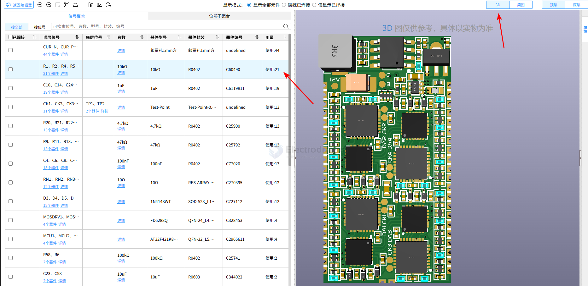

# fab-PCBA-SMT-dat

- [[fab-PCBA-SMT-dat]] - [[fab-PCBA-SMT-post-dat]]

- [[fab-PCBA]] - [[fab-PCBA-dat]]

## html view tools 

- [[32bit-4in1-ESC_pnp-assitant-tootl.html]]

- [[ESC-dat]]

## SMT-post 

- 多用助焊剂修补
- 用纱布手工擦掉多余的焊油, 刷不干净, 不要用刷的

## ref 

- [[fab-PCBA]]