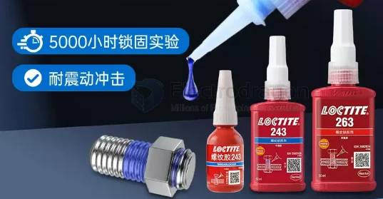

# glue-thread-dat

- [[glue-thread-dat]] - [[glue-dat]] - [[thread-dat]]

**乐泰 243（Loctite 243）** 是一种**中等强度、耐油型蓝色厌氧螺纹锁固剂**，常用于 M6–M20 金属螺纹的防松防漏，日后可用普通手动工具拆卸。

### 一、 核心特点

* **厌氧固化**：只在金属表面接触且隔绝空气（拧紧后）才开始固化，挤出在螺纹外部接触空气的胶液不会变硬。
* **容油性好**：对表面轻微油污有一定耐受度，但彻底清洁仍能达到最佳强度。
* **可拆卸性**：中等强度，日后用扳手或螺丝刀正常用力即可拧开。

### 二、 简要使用方法（4 步）

1. **清洁表面（推荐）**
* 尽量擦除螺栓和螺孔内的油污、铁屑或旧胶残留（可用酒精、丙酮或专业清洗剂，晾干后再涂胶）。
* *注：若为不锈钢、镀锌、氧化铝等惰性金属，固化会较慢，通常室温下需适当延长等待时间。*

2. **摇匀与涂胶**
* 使用前先摇晃瓶身。
* **外螺纹（螺丝）**：在螺纹啮合区域（通常从螺牙前端数第 2 牙开始，涂满 3–5 牙的一圈）滴 1–2 滴，无需涂满整根螺丝。
* **盲孔（螺孔）**：除了涂在螺丝上，还应往螺孔底部滴 1–2 滴，避免拧入时空气压缩把胶挤出。

3. **拧紧装配**
* 涂胶后立即将螺丝按正常工艺扭矩拧紧到位（拧紧过程会让胶液均匀填充螺纹间隙）。
* 用纸巾擦掉挤出在螺母或零件表面的多余胶液。

4. **等待固化**
* **初固时间**：室温（约 22℃）下约 **10–20 分钟**（此时不要再转动螺丝，否则会破坏初步形成的胶膜）。
* **完全固化**：**24 小时**后达到最高锁固强度，建议静置满 24 小时后再承受高负载或剧烈震动。

### 三、 注意事项

* **禁止用于塑料件**：乐泰 243 含有化学溶剂，接触 ABS、PC、亚克力等塑料会导致塑料开裂或溶胀。
* **瓶子不要装满且勿回倒**：瓶内留有空气是为了防止胶水在瓶中固化；倒出的多余胶水不要倒回瓶内，以免污染整瓶胶液。

## ref 