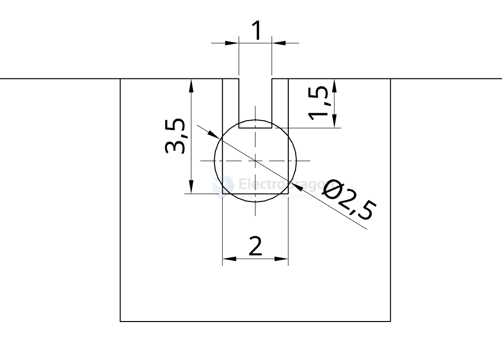

# o-ring-dat

- [[mechanical-parts-dat]] - [[o-ring-dat]] - [[waterproof-dat]]

- [[waterproof-container-dat]]

## 5 meter capable design 

壳体 O-ring 未压缩的直径是 2.5mm 

壳体的
- 凹槽深度是 3.5mm 
- 凸槽深度是 1.5mm (压进去的)
- 凸槽宽度是 1.0mm (压进去的)
- 凹槽宽度是 2.0mm 

### problems  

#### ① 侧隙 0.50mm/侧 → 挤出风险

水深	压力	70 Shore A 允许间隙	判定
5 m（目标）	0.05 MPa	≈ 0.25-0.30 mm	⚠️ 超标但不严重
10 m	0.10 MPa	≈ 0.20 mm	⚠️ 超标
20 m	0.20 MPa	≈ 0.15 mm	🔴 明显超标
50 m	0.50 MPa	≈ 0.10 mm	🔴 严重超标

#### ② 密封带宽只有 1.0mm

O-ring 只被 1.0mm 宽的凸槽压住 → 有效接触带 1.0mm
⚠️ 工程建议 ≥1.5mm（太窄对表面不平、畸变更敏感）
📌 静态密封 + 低压 → 1.0mm 尚可用

#### conclusions 

项	判定	说明
压缩率 20%	✅ 合格	0.50mm 压缩量
填充率 89%	⚠️ 略超	容积够，壳体不会被顶开
侧隙 0.5mm	⚠️ 偏大	5m 内勉强
密封带 1.0mm	⚠️ 偏窄	静态可用
🔴 压缩量余量 0.5mm	🔴 主因	壳体变形 0.5mm 就吃光

## 三、⭐️⭐️ O-ring 的核心指标是压缩率 15-25%

胶条截面	槽深	压缩量	压缩率	判定
2.0 mm	1.7 mm	0.3 mm	15.0%	✅ 合格（下限）
2.0 mm	1.6 mm	0.4 mm	20.0%	✅ 合格
2.5 mm	2.0 mm	0.5 mm	20.0%	✅ 合格

⚠️ 压缩率 <15% → 密封不住
⚠️ 压缩率 >25% → O-ring 永久变形、寿命短
⚠️ 不均匀 → 从最松那一点漏（就是你遇到的）

## 四、⭐️⭐️⭐️ 第一步别猜，先做「纸片测试」定位

⭐ 做法：
   ① 空壳、不装东西
   ② O-ring 装好、压扣全扣上（正常使用状态）
   ③ ⭐ 拿一张 0.1-0.2mm 薄纸 / 薄塑料片
   ④ 沿接合面一圈，每隔 3-5cm 试一次：
      往缝隙里插，看能不能【轻松插进去】
        ↓
   能轻松插入 = ⭐ 该处没压紧
   插不进     = ✅ 压紧了
        ↓
⭐⭐ 5 分钟就能画出「哪段松、哪段紧」的分布图

## ref 

