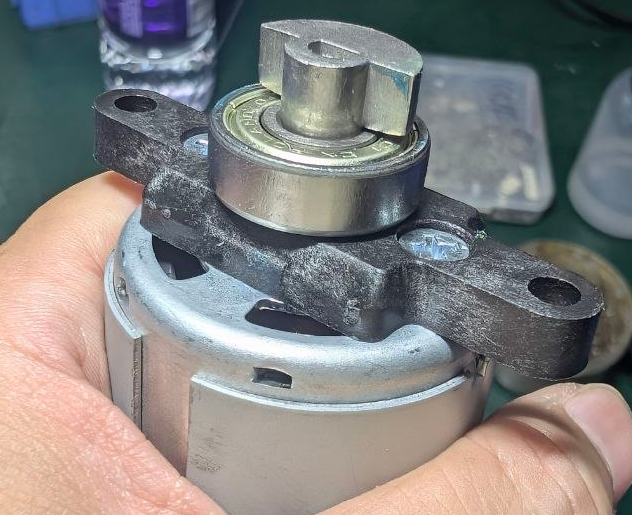
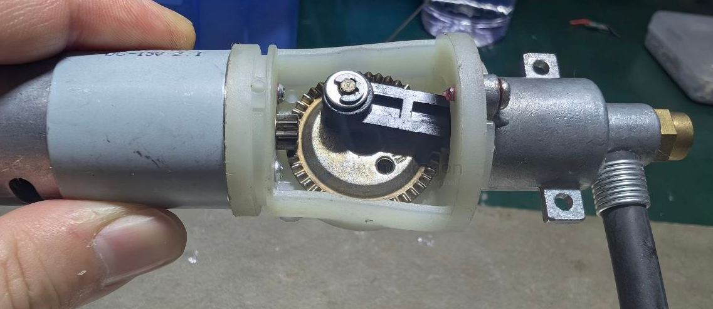

# shaft-motor-dat

- [[shaft-dat]] - [[shaft-motor-dat]] - [[motor-dat]] - [[shaft-driven-dat]]

## build 

- [[bearing-dat]] - [[wheel-Eccentric-dat]] - [[shaft-coupling-dat]]

build 2 

## D-Shaped 

### 🔧 1. D-Shaped Clamping Hub (Best Balance of Strength + Simplicity)

Why: The flat face prevents slipping; the clamp applies even pressure all around the shaft without damaging it.

Torque Handling: Very good — suitable for most high-torque hobby and light industrial setups.

### 2. D-Shaft Gear/Pulley with Dual Set Screws
Why: Set screws bite into the flat and round sides of the shaft. Dual screws reduce slippage.

Torque Handling: Medium-high (depends on the hub material and screw torque).

## Key Type  == 键槽联轴器

## ref 

- [[flange-dat]] - [[mechanics-dat]]