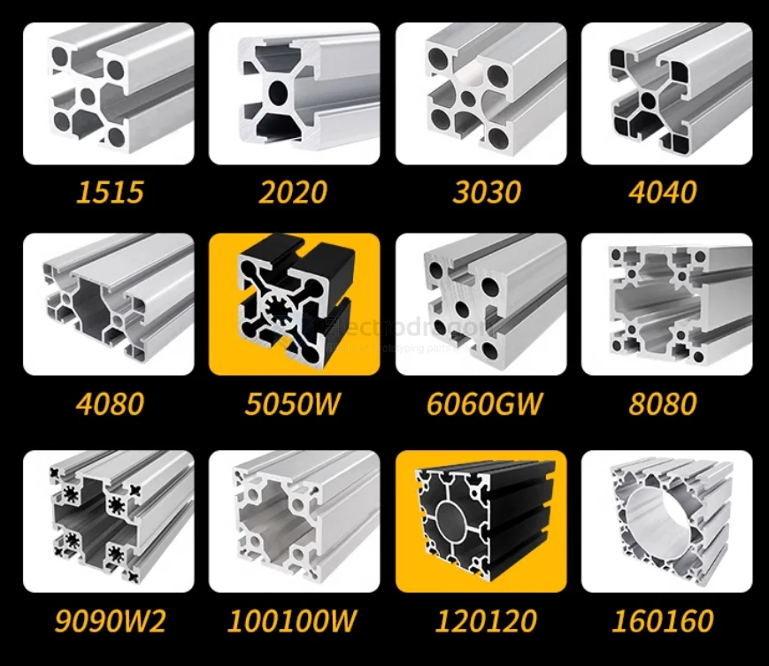
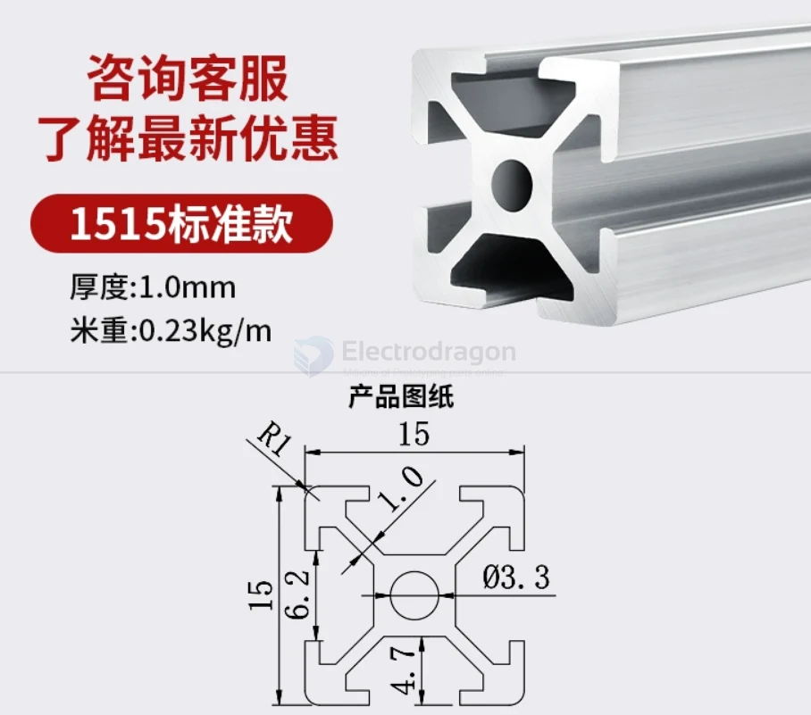

# ALU-extrusion-1515-sys-dat

- [[frame-profile-dat]] - [[alu-extrusion-dat]] - [[ALU-extrusion-1515-sys-dat]]

- [[physics-dat]] - [[geometry-dat]] - [[Triangular-dat]]

## accessories

- [[Profile-Bracket-dat]] - [[Profile-Angle-dat]]

### extra profiles: 

- 15x15

thickness version 1.0 mm, other versions include 1.5 mm, 0.8 mm

profile center hole 3.3 mm 

## info 

> 🔴 根因在**角码这个连接节点**，不在铝型材：角码只是靠摩擦力被夹住。

### 一、⚠️ 三个因素叠加

1. **T 型螺母在槽内可滑动** → 本质是摩擦锁紧，不是固定
2. ⚠️ **铝有室温蠕变** → 拧紧后 24–72 h 预紧力自动降 10–30%
3. **1515 截面小** → 角码接触面积小、力臂只有 5–10 mm

摩擦力本来就不大：

| 项 | 数值 |
| --- | --- |
| M4 8.8 级理论预紧力 | 2.5 kN |
| ⚠️ 1515 槽壁薄，实际只能拧到 | ⚠️ 约 1.0 kN（再高压溃槽壁） |
| 摩擦系数（阳极氧化铝–铝） | 0.25 |
| 实际摩擦力（两面） | 500 N |

| 力臂 | 抗转动阻力矩 |
| --- | --- |
| 5 mm | 2.5 N·m |
| 10 mm | 5.0 N·m |

> ⚠️ 而且这只是"不滑动"的阻力，不是"不转动"的刚度。
> 因为 T 型螺母可以滑 → 角码是被"夹住"，不是被"定位"。

### 二、⭐ 1515 本身确实偏弱

| 型材 | 壁厚 | 惯性矩 I | 抗弯刚度 EI | 相对 1515 |
| --- | --- | --- | --- | --- |
| 1515 | 1.5 mm | 2,491 mm⁴ | 171.9 kN·mm² | 1.0× |
| 2020 | 1.8 mm | 7,305 mm⁴ | 504.0 kN·mm² | 2.9× |
| 3030 | 2.0 mm | 29,419 mm⁴ | 2,029.9 kN·mm² | 11.8× |

### 三、⭐⭐⭐ 关键的数值对比

300 mm 见方的框，1515 型材：

| 方案 | 侧向刚度 | 相对 |
| --- | --- | --- |
| 只有角码（单角 50 N·m/rad） | 约 2.2 N/mm | 1× |
| ⭐️ 加一根对角线斜撑（45°，300 mm） | 约 9,315 N/mm | ⭐️⭐️ 约 4000× |

⭐⭐⭐ 保守说：**加一根斜撑 = 侧向刚度提升 10–100 倍**

📌 根本区别：

| 方式 | 靠什么 | 结果 |
| --- | --- | --- |
| 角码 | **摩擦** | 会松 |
| 斜撑 | **几何** | 不会松 |

### 四、⭐⭐⭐⭐ 方案一：加斜撑（首选，能根治）

1. 在矩形框的一个对角加 45° 短料
2. 两端仍用角码固定
3. ⭐ 斜撑承受纯轴向力，不靠摩擦

→ 框架从"四连杆机构"变成"三角形刚架"。

| 方式 | 说明 | 成本 |
| --- | --- | --- |
| ⭐️⭐️ 1515 短料斜撑 | 45° 端面，量对角长度 | ¥10–20 |
| ⭐️⭐️⭐️ 三角加强片 | 15×15 铝三角片，锁两面 | ¥5–15 |
| ⭐️ 对角拉杆 + 花篮螺栓 | 可调预紧 | ¥20–40 |

⭐ 一个面加斜撑就能消除该方向的平行四边形化；两个方向都要刚 → 两个面各加一根。

### 五、⭐⭐⭐ 方案二：换内置角槽连接件

不用外部角码，改用**插入型材内腔**的连接件：

- 顶丝顶住内腔壁 → 形状锁紧，不靠摩擦
- ⭐ 刚度远高于外部角码（力臂在内腔，不受接触面积限制）
- ⚠️ 要求内腔尺寸标准（杂牌 1515 内腔可能不规整）

### 六、⭐⭐⭐ 方案三：打孔贯穿螺栓

钻通孔（Φ4.2 走 M4）+ 长螺栓贯穿 + 尼龙锁紧螺母（nyloc）：

- ⭐ 完全形状锁紧，振动不会松
- ⚠️ 位置固定后不能调；钻孔要避开加强筋

### 七、⭐ 方案四：螺丝防松（只能延缓）

| 措施 | 效果 | 说明 |
| --- | --- | --- |
| ⭐️⭐️ 螺纹胶（乐泰 243） | 好 | 可拆；⚠️ 别用 271（拆不动） |
| ⭐️⭐️ 齿形垫圈 | 好 | 咬入铝面 + 增加摩擦系数 |
| ⭐️ 弹簧垫圈 | 一般 | 对铝蠕变补偿有限 |
| ⭐️⭐️ 方形钢螺母代替弹片 T 螺母 | 好 | 不转动、接触面大 |
| ⭐️⭐️ 锤入式螺纹嵌件 | 好 | 端头打入，外面螺栓拉紧 |
| ❌ 橡胶垫增摩擦 | 差 | 橡胶蠕变比铝还快，越用越松 |

### 八、⚠️ 方案五：换 2020/3030

⚠️ 1515 抗弯刚度只有 2020 的 **1/2.9**、3030 的 **1/11.8**。

📌 1515 的合理定位：

- ✅ 3D 打印机框架、小仪表支架、展示架、轻负载装饰框
- ❌ 承重台、抗侧向力的立架、长悬臂

### 九、⭐ 推荐组合（性价比最高）

针对"已有 1515 材料、只想止松"：

1. ⭐⭐⭐ 要抗侧向力 → **一个面加 45° 斜撑 或 三角加强片**
2. ⭐⭐ 所有螺丝上 **乐泰 243 螺纹胶**
3. ⭐ 角码与型材之间加 **齿形垫圈**
4. ⭐ 弹片 T 螺母换成 **方形钢螺母**

→ 这套做完，"松"基本消失。

### 十、⚠️ 装配要点（容易忽略）

1. ⭐⭐ 拧紧后**24 小时再复紧一次** —— 补偿铝的初始蠕变
2. ⭐ 对角交替、分 2–3 次加力，不要一次拧死
3. ⚠️ M4 在 1515 上别超 2.5 N·m，否则压溃槽壁
4. ⭐ 角码贴合面有毛刺先修平（点接触必松）
5. ⭐⭐ 别让型材"悬空受力"，尽量让载荷走型材轴线

### 📌 一句话

> "刚装好挺紧、过几天就松" ← 这是**铝的蠕变 + 摩擦锁紧**，不是你拧得不够。

⭐ 别再纠结角码了：**加一根斜撑，把"靠摩擦"换成"靠几何"** —— 侧向刚度能提升 10–100 倍，而且永远不会松。

## build 

baba-hao 

- [[waterproof]]

https://cad.onshape.com/documents/347c235acb7b3e9f2a3c1f2a/w/326f6dc5e165bd0946fc1c4f/e/68a18b214d8e792586952603

## ref 

- [[ALU-extrusion-1515-sys]]

- [[alu-extrusion-dat]]