# alu-profile-connector-dat

- [[alu-extrusion-dat]] - [[alu-profile-connector-dat]] - [[profile-internal-corner-dat]]

- [[alu-profile-connector-dat]] - [[profile-angle-dat]] - [[profile-bracket-dat]] - [[profile-nut-dat]] - [[profile-internal-corner-dat]]

- [[nut-dat]] - [[alu-profile-connector-dat]] - [[profile-nut-dat]]

- [[frame-profile-dat]] - [[profile-bolt-dat]] - [[bolt-dat]] - [[alu-extrusion-dat]] - [[alu-profile-connector-dat]] - [[profile-nut-dat]]

## 1515+ available 

### flat plate 

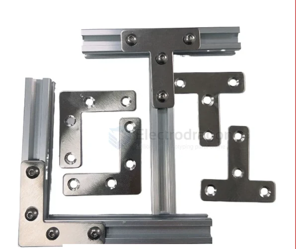

### 3D connector 

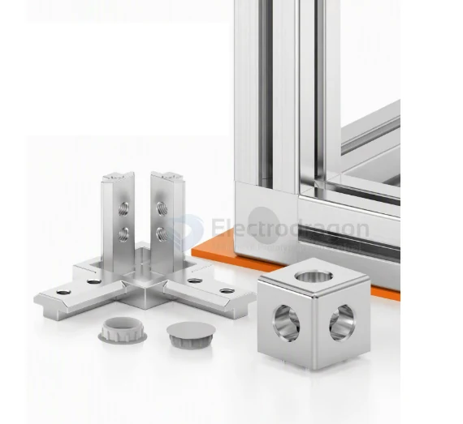

### limiter 

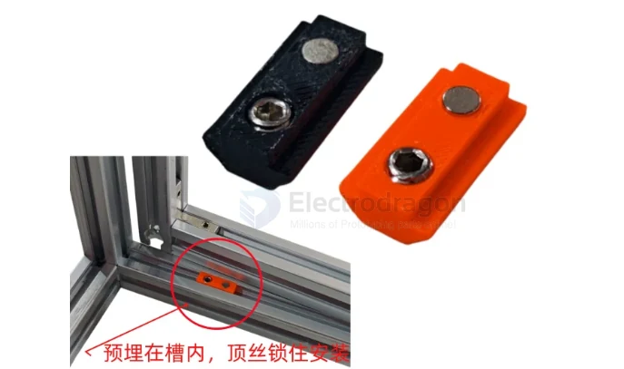

## 2020+ only 

### rod holder 

铝型材光轴固定底座
无损快速安装拆卸I适配欧标20/30/40系列型材

### end cover 

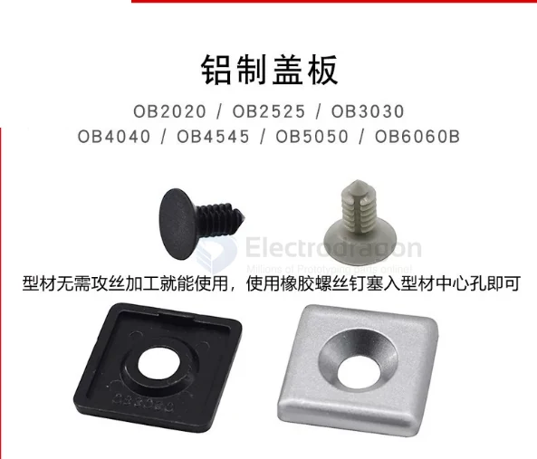

### wheel 

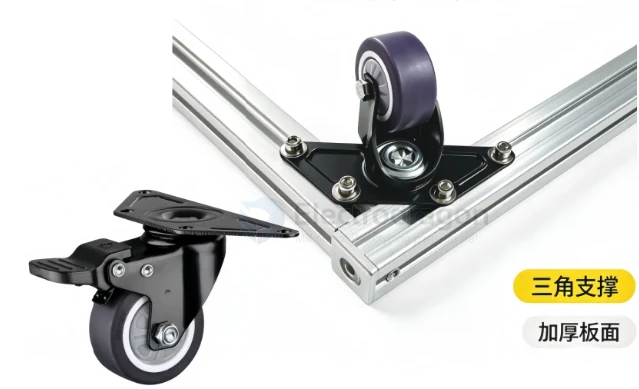

### plate holder 

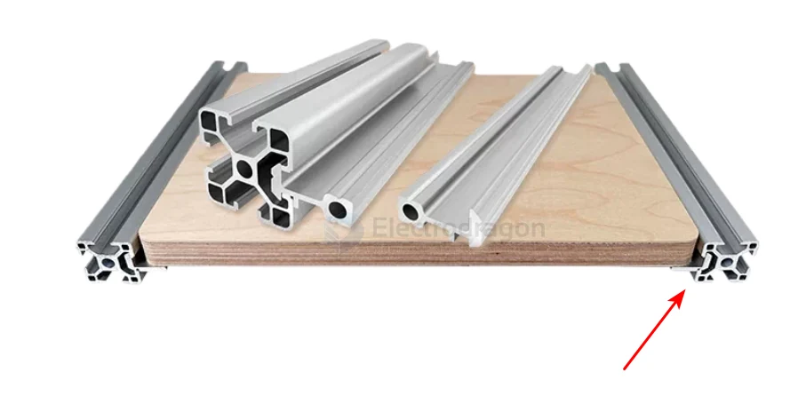

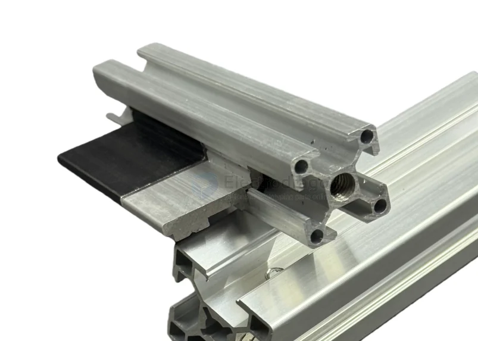

### hinge 

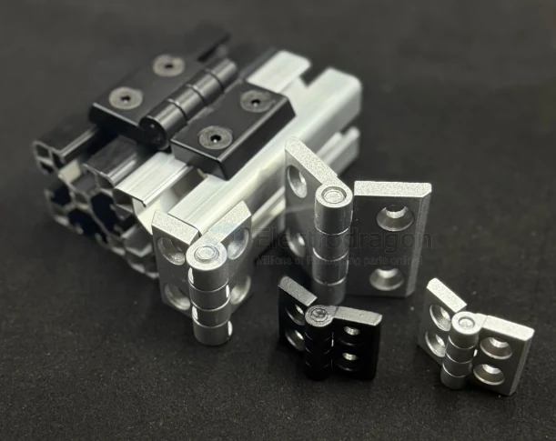

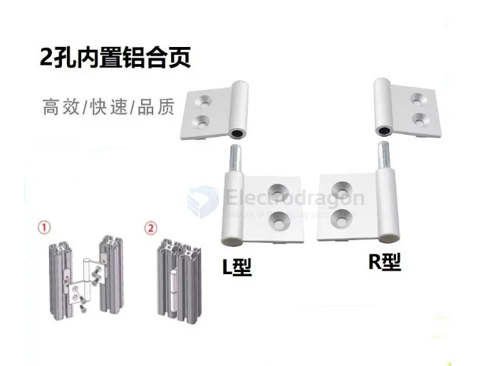

### hook 

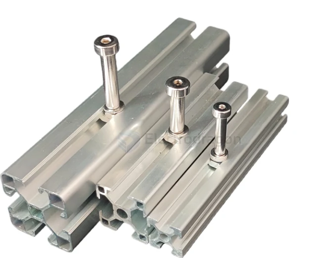

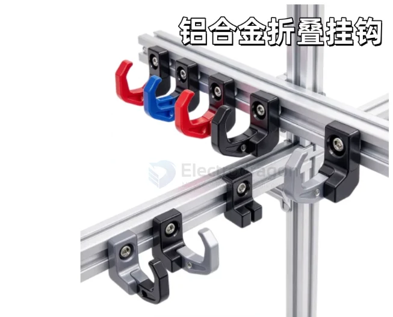

### plug lock 

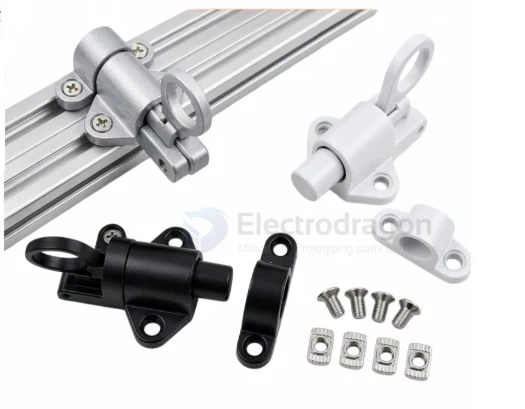

### vertical holder 

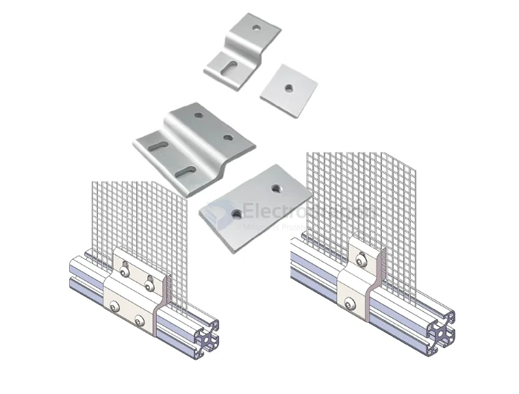

holder V2 

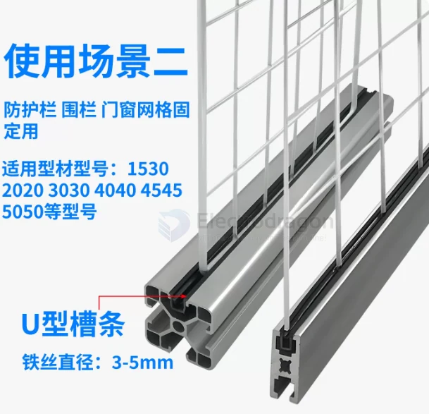

### door snap 

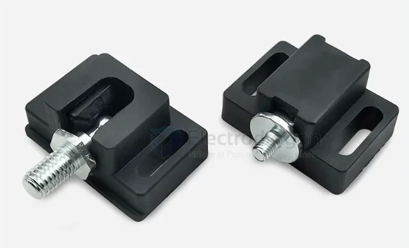

### foot 

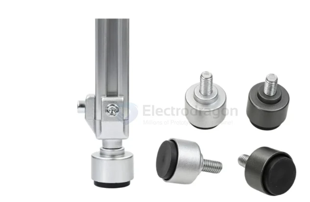

### slider 

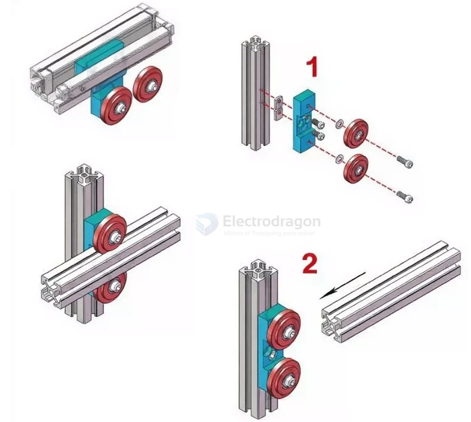

### wire holder 

## un-defined 

for 3030 

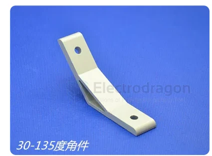

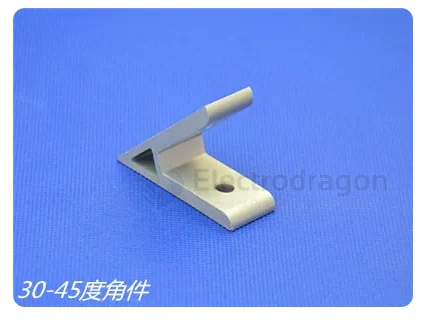

## ref 

- [[alu-profile-connector]] - [[alu-extrusion]] - [[frame-profile]] - [[mechanical-structure]]