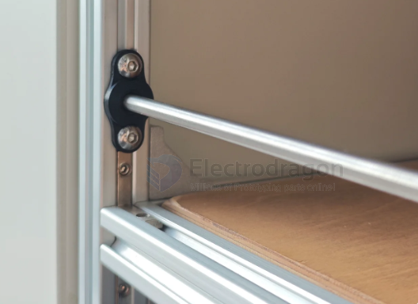

# alu-profile-connector-dat

- [[alu-extrusion-dat]] - [[alu-profile-connector-dat]] - [[profile-internal-corner-dat]]

- [[alu-profile-connector-dat]] - [[profile-angle-dat]] - [[profile-bracket-dat]] - [[profile-nut-dat]] - [[profile-internal-corner-dat]]

- [[nut-dat]] - [[alu-profile-connector-dat]] - [[profile-nut-dat]]

## flat plate 

## 3D connector 

## 2020+ only 

### rod holder 

铝型材光轴固定底座
无损快速安装拆卸I适配欧标20/30/40系列型材

### end cover 

### wheel 

### plate holder 

## ref 

- [[alu-profile-connector]] - [[alu-extrusion]] - [[frame-profile]] - [[mechanical-structure]]