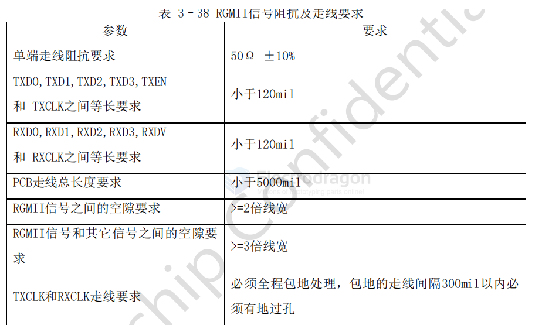

# impedance-GRMII-dat

- [[impedance-dat]] - [[RGMII-dat]] - [[impedance-GRMII-dat]]

## requirements 

- [[RTL8211-dat]] - [[impedance-dat]] - [[RGMII-dat]] - [[impedance-GRMII-dat]]

(官方定义)以RTL8211F/FI为例，PHY侧的注意点：

>  晶体电路布局需要优先考虑，布局时应与芯片在同一层并尽量靠近放置以避免打过孔，晶体
>
> 走线尽可能的短，远离干扰源，尽量远离板边缘。
>
>  晶体以及时钟信号需要全程包地处理，包地线每隔100mil至少添加一个GND过孔，并且必须保
>
> 证邻层的地参考面完整。
>
>  务必确认RJ45封装和原理图是否一致，RJ45有分Tab down和Tab up，信号顺序刚好是相反。
>
> 如果使用RTL8211F/FI建议采用Tab down，MDI顺序是顺的。
>
>  网络变压器尽可能靠近RJ45座子，MDI走线不得超过4.5inch
>
>  RSET电阻必须靠近RTL8211F/FI的管脚，走线不得超过800mil，远离其它干扰信号。
>
>  PHY到网络变压器的MDI差分信号差分阻抗为100Ω ±10%。
>
>  PHY到网络变压器的差分信号MDI0+、MDI0-、MDI1+、MDI1-、MDI2+、MDI2-、MDI3+、MDI3-差分对内长度偏差控制在±5mil以内，MDI差分对应严格遵循差分规则走线。例如，必须保持相同的长度、相同的宽度、相同的层和固定的线距，并尽可能保持对称
>
>  MDI差分对间线长延迟控制在800mil以内。
>
>  MDI0/1/2/3之间空隙：>=3倍线宽
>
>  MDI0/1/2/3和其它信号之间空隙：>=4倍线宽。
>
>  MDI尽量减少换层过孔，必须要换层时，最多只能打2次过孔，并靠近信号过孔放置对称的地缝合孔。
>
>  MDI差分对的参考层需要为完整的地平面，避免出现连续的过孔阻断信号的回流路径的情况
>
>  网络变压器高压侧的MDI差分对，走线线宽建议尽量走粗，建议8mil
>
>  网络变压器高压侧的75 ohm电阻走线建议25mil以上。
>
>  网络变压器中心抽头滤波电容必须靠近网络变压器对应的管脚
>
>  PHY芯片电源的去耦电容，都需要尽量靠近PHY芯片各管脚放置，走线时尽量先经过电容焊盘，再到芯片管脚，管脚和电容之间走线长度不得超过100mil
>
>  RTL8211F/FI内部自带的DCDC，电感必须靠近芯片管脚，LX走线要尽量短而粗，宽度不小于60mil，长度不得超过200mil，输出电容必须靠近电感，走线时，必须先经过输出电容再到后级。PiN21和Pin3,8,38必须星形分开走线，走线线宽30mil以上
>
>  如果PHY IO采用3.3V时VCCIO_PHY和VCC3V3_PHY电源走线必须走星形，走线线宽30mil以上
>
>  PHY芯片的中心焊盘必须良好接地，放置的过孔至少保证5X5个0.50.3mm的过孔
>
>  防雷管的接地必须良好接地，建议不少于3X3个0.50.3mm的过孔，否则会降低防雷管作用
>
>  网络变压器高压侧的相关器件必须远离PCB板的主地
>
>  RJ45接口和网络变压器高压侧属于高压区，禁止覆铜，建议和低压区间隔至少4mm以上

## ref 

