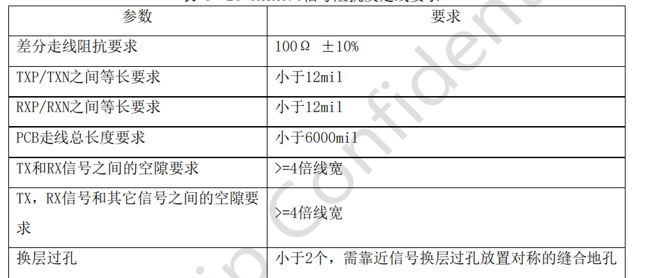

# impedance-SATA-dat

- [[impedance-SATA-dat]] - [[impedance-dat]] - [[mSATA-dat]] - [[sata-dat]]

## 100R 

 TXP/N和RXP/N尽量走在TOP层，必须要换层时，不得超过2个过孔，并靠近信号过孔放置对称的缝合地孔，缝合地孔和信号过孔中心距不得超过30mil，走线拐角尽量用弧线或者钝角，不能为直角或锐角。

 TXP/N，RXP/N信号的参考层需要为完整的地平面，避免出现连续的过孔阻断信号的回流路径的情况

 AC耦合电容请对称放置并靠近SATA连接座

 SATA座子的焊盘和AC耦合电容的焊盘的下方必须挖空一层来保证阻抗的连续性，挖空的大小，不小于封装焊盘尺寸。

总结：

1、阻抗：100Ω±10%

2、按差分形式布线，对内AC电容两端分段等长2mil，收发无等长要求。

3、mSATA3.0信号速率大于5Gbps时，按高速规范设计，伴地孔、过孔隔离、圆弧、Stub最短等原则布线。

4、为减少串扰，同一层其它信号与差分信号线对之间的间距至少为走线相对于参考平面高度的6-10倍，一般控制在5W以上。

5、保持有完整的参考平面，确保阻抗的连续性。

6、mSATA trace远离晶振与clock信号。

7、mSATA signals 与 GND anti-etch 的距离要 >20mils。

8、mSATA3.0焊盘及过孔需做挖空扯理，换层处加地过孔。

## ref 

