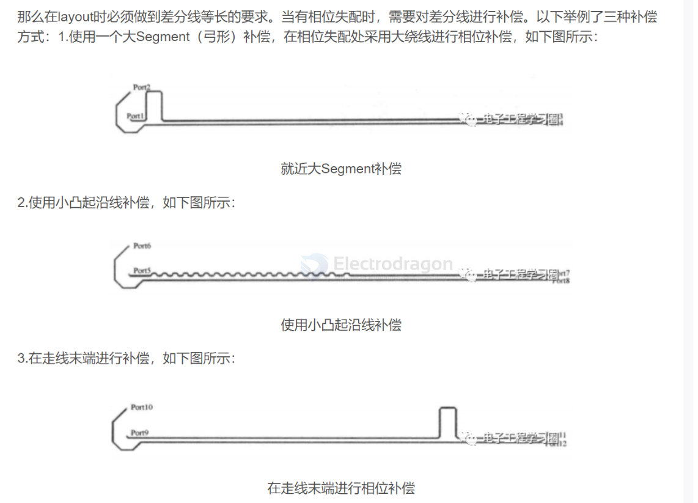
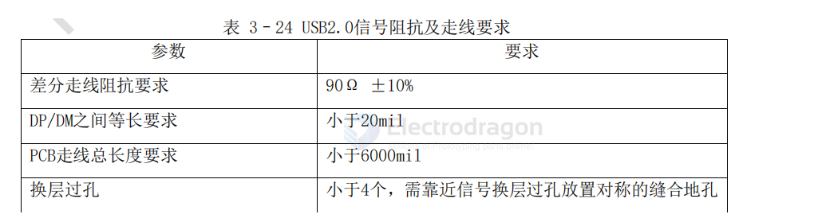

# impedance-USB-dat

- [[USB-hub-dat]] - [[impedance-USB-dat]] - [[USB-2.0-dat]]

- [[impedance-dat]] - [[impedance-differential-dat]] - [[CONN-USB-HDK-dat]] - [[impedance-USB-dat]] - [[USB-2.0-dat]]

## guidelines 

## USB 2.0 == USB 90Ω

USB 90Ω 差分阻抗

HUB这里正常走线即可 无特殊要求， 一般可参考如下布线，在四周放置阻容器件，需要注意的是晶振底部请不要走线，且晶振周围使用密集地孔包围，内部不需要铺铜。

 当USB差分信号走线需要换层时，确保走线上的过孔数量少于4个，不得超过6个，并靠近信号过孔放置对称的缝合地孔，缝合地孔和信号过孔中心距不得超过30mil

 USB差分对尽可能参考层为完整的地平面，如果无法避免跨不同平面走线，那么必须全程包地处理，包地的走线间隔300mil以内必须有地过孔

## ref 

