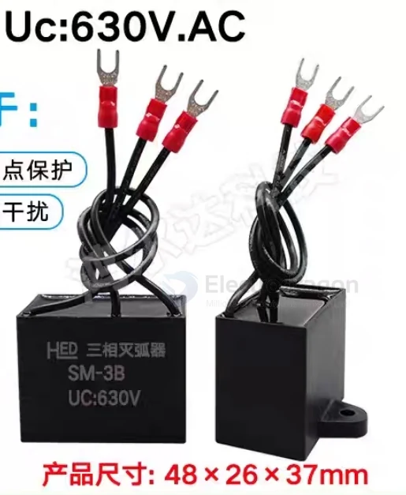
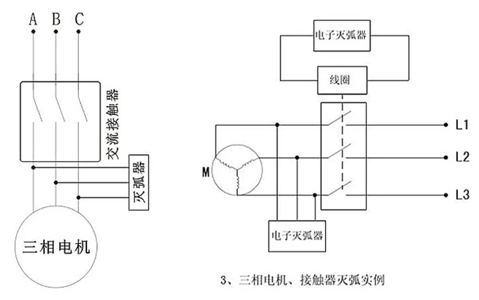
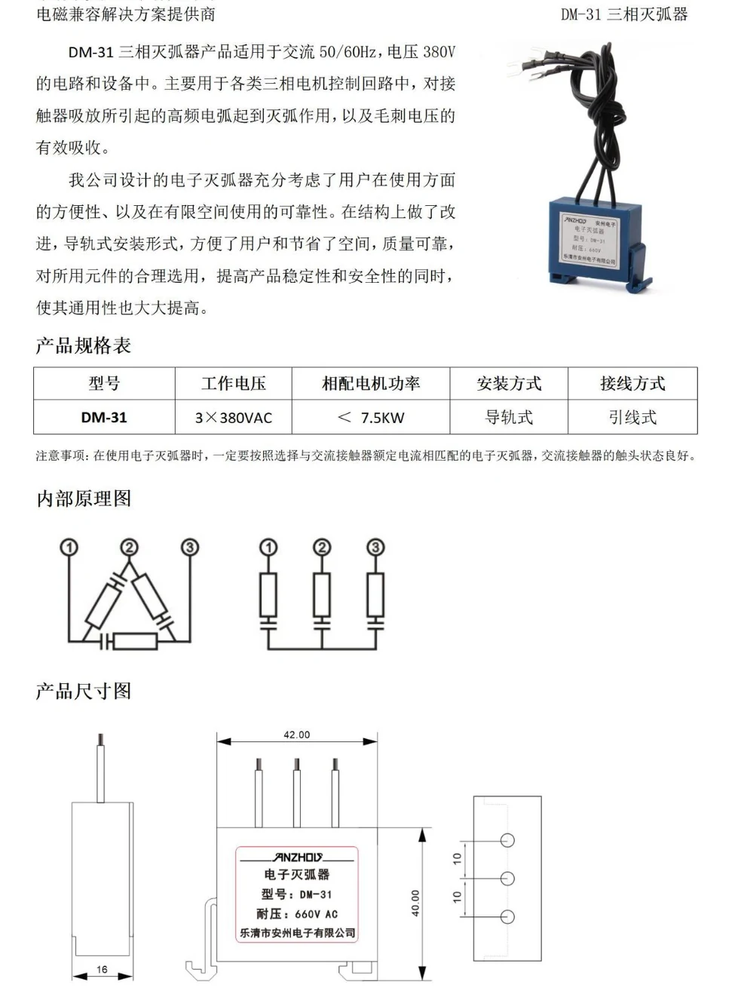

# RC-Snubber-dat

- [[energy-dump-dat]] - [[RC-Snubber-dat]] - [[energy-dat]]

- [[resistor-dat]] - [[capacitor-dat]]

Inductive Load Arc Suppression


- [[NWI1139-dat]]


## Why an RC snubber needs a resistor

Do not fit the capacitor alone.

With only a capacitor across the inductive load:

```text
Coil inductance (L) + capacitor (C)
            ↓
        LC resonant tank
            ↓
Stored energy rings between L and C
            ↓
Voltage may reach approximately 2× supply voltage or higher
            ↓
EMI and voltage stress increase
            ↓
Switch or semiconductor may be damaged
```

The resistor damps the oscillation and converts the stored energy into heat in a controlled way.

Littelfuse describes the resistor as a compromise:

- **Resistance too high:** suppresses current at closing less effectively and may leave an excessive voltage spike when the switch opens
- **Resistance too low:** allows excessive capacitor discharge current and may weld relay or contactor contacts

---

## Three-minute RC snubber design

### Step 1: Calculate the stored inductive energy

$$
E = \frac{1}{2}LI^2
$$

Where:

- $E$ = stored energy in joules
- $L$ = inductance in henries
- $I$ = interrupted load current in amperes

### Step 2: Select the clamp voltage

The clamp voltage is typically:

- 2–4× the supply voltage, or
- approximately 60–70% of the protected device voltage rating

Calculate the minimum capacitor value:

$$
C \geq \frac{2E}{V_{clamp}^{2}}
$$

Use a capacitor voltage rating of at least 1.5× $V_{clamp}$ for a DC circuit.

### Step 3: Select the resistor

A practical starting range is:

$$
R = 0.5\text{ to }3 \times \frac{V_{clamp}}{I}
$$

This range is from Littelfuse's inductive-load suppression guidance.

### Step 4: Calculate the resistor power

The capacitor is charged and discharged once per switching event. A practical upper-bound estimate is:

$$
P \approx C \cdot V_{clamp}^{2} \cdot f
$$

Where $f$ is the switching frequency.

After calculation:

1. Select a resistor rated for at least **2× the calculated power**
2. Verify the pulse-energy rating
3. Check the RC time constant:

$$
\tau = RC
$$

Use $\tau$ substantially shorter than the switching period, typically less than 10% of it. Otherwise, the capacitor may not discharge before the next switching event, and the snubber loses most of its damping effect.

---

## Worked examples

### 1. Small relay coil

**Load:** 24 V DC, 40 mA, 1 H

**Clamp voltage:** 100 V

| Parameter                   |                                    Result |
| --------------------------- | ----------------------------------------: |
| Stored energy               | $E = 0.5 \times 1 \times 0.04^2 = 0.8$ mJ |
| Capacitor                   |                          $C \geq 0.16$ µF |
| Resistance                  |                         1.25 kΩ to 7.5 kΩ |
| Time constant               |                      Approximately 0.2 ms |
| Resistor loss at 10 Hz      |                                   0.016 W |
| Recommended resistor rating |                          0.25 W or higher |

### 2. Solenoid valve

**Load:** 24 V DC, 0.5 A, 100 mH

**Clamp voltage:** 100 V

| Parameter      |                Result |
| -------------- | --------------------: |
| Stored energy  |         $E = 12.5$ mJ |
| Capacitor      |       $C \geq 2.5$ µF |
| Resistance     |        100 Ω to 600 Ω |
| Time constant  | Approximately 0.25 ms |
| Loss at 10 Hz  |     0.25 W; use 0.5 W |
| Loss at 100 Hz |        2.5 W; use 5 W |

### 3. 24 V DC motor

**Load:** 24 V DC, 2 A, 1 mH

**Clamp voltage:** 60 V

| Parameter                   |           Result |
| --------------------------- | ---------------: |
| Stored energy               |       $E = 2$ mJ |
| Capacitor                   | $C \geq 1.11$ µF |
| Resistance                  |     15 Ω to 90 Ω |
| Resistor loss at 100 Hz     |            0.4 W |
| Recommended resistor rating |  0.8 W or higher |

### 4. Why 0.1 µF is not universally suitable

For an inductive load, the approximate unconstrained voltage peak is:

$$
V_{peak} \approx \sqrt{\frac{2E}{C}}
$$

With $C = 0.1$ µF:

| Load        | Energy | Approximate Peak |
| ----------- | -----: | ---------------: |
| Solenoid    |  25 mJ |            500 V |
| Small relay | 0.8 mJ |            126 V |

> The general-purpose **0.1 µF + 100 Ω** combination is suitable only for millijoule-class loads such as small relays. Solenoids, electromagnets, and motors must be sized from their stored energy.

---

## Placement: across the switch or across the load

| Location                     | Advantages                                      | Disadvantages                                                                     |
| ---------------------------- | ----------------------------------------------- | --------------------------------------------------------------------------------- |
| Across the contact or switch | Best arc suppression; longest contact life      | AC or DC leakage current may pass through the RC network while the switch is open |
| Across the load terminals    | No load-side leakage from the switch-open state | Weaker arc suppression; affected by wiring and source impedance                   |

Littelfuse generally recommends placement across the contact, but the resulting leakage must be checked. If the load is leakage-sensitive, such as an LED, small relay coil, or other low-current input, place the RC snubber across the load instead.

### Leakage warning

A 220 V AC contactor coil with an RC snubber across it may cause an LED indicator to glow faintly. The leakage current from an RC network can also prevent a triac or solid-state relay load from turning completely off.

---

## Component selection

### Capacitor

| Circuit  | Recommended capacitor                                                                                         |
| -------- | ------------------------------------------------------------------------------------------------------------- |
| AC mains | X2 safety capacitor, typically rated 275 VAC or higher, with self-healing and approved safety characteristics |
| DC       | Film or C0G/NP0 ceramic capacitor, rated at least 1.5× $V_{clamp}$                                            |

**Do not use an aluminium electrolytic capacitor:**

- It may be subjected to reverse voltage
- Its venting behaviour creates a safety hazard
- Its ESR and high-frequency response are unsuitable for a snubber

### Resistor

- Use a metal-oxide or wirewound, surge-rated resistor
- Use at least 2× the calculated continuous power
- Verify the pulse-energy rating
- Prefer a fusible or flameproof type on the AC side
- Apply the same safety margin as an AC input fusible resistor

### Layout

- Keep the resistor and capacitor leads short
- Place the RC network close to the load or contact
- Minimise the loop area
- Avoid long leads; parasitic inductance can make the snubber ineffective at high frequency

---

## Six common mistakes

1. **Fitting a capacitor without a resistor** — creates an LC tank and may increase the spike
2. **Copying 0.1 µF or 100 Ω** — may be insufficient for high-energy loads
3. **Selecting a resistor that is too small** — permits excessive capacitor discharge current and may weld contacts
4. **Ignoring resistor power** — a 100 Hz solenoid may require 5 W rather than 1 W
5. **Ignoring the RC time constant** — under PWM operation, the capacitor may never discharge
6. **Using the wrong AC capacitor** — an ordinary CBB or ceramic part across 275 VAC may fail or catch fire

---

## When not to use an RC snubber

### DC inductive loads

For relays, solenoids, and electromagnets:

1. Use a flyback or freewheel diode first
2. Add a Zener diode when faster current decay is required
3. Use RC suppression only when a diode is impossible, such as in bidirectional or AC-symmetric circuits

### High-frequency PWM

For motor speed control and stepper drives:

- An RC network dissipates energy on every switching cycle
- Power loss increases approximately with switching frequency
- Use a TVS, Zener clamp, or real current-return path instead

---

## RCD clamp: a separate flyback-primary application

An RCD clamp is not the same as a load-side RC snubber.

```text
MOSFET turns off
      ↓
Transformer leakage inductance resonates with Coss
      ↓
Leakage voltage appears across the drain
      ↓
Diode conducts
      ↓
Capacitor absorbs the energy
      ↓
Resistor dissipates the stored energy
```

For this application:

- Set $V_{sn}$ to approximately 2–2.5× the reflected output voltage
- Use $V_{sn} = nV_o + V_{margin}$ as a starting point
- Estimate power using:

$$
P_{sn} = \frac{1}{2}L_{lk}I_{pk}^{2}f
$$

Here, the capacitor absorbs transformer leakage-inductance energy. This is different from damping load back-EMF and requires the diode in the RCD clamp.

---

## Sources

- Littelfuse — *Inductive Load Arc Suppression*: MOV, TVS, and RC options; R from 0.5–3× $V_{pk}/I_{sw}$; leakage warning for contact-side mounting
- CDE — *Design of Snubbers for Power Circuits*: Rs based on stored energy and capacitor dissipation method
- Fairchild AN4147 — *Design Guidelines for RCD Snubber of Flyback Converters*
- switchmode.io — *RC Snubber Design*: upper-bound loss $P = C_sV^2f$, closed-form resistance selection, and measurement of inductance and capacitance

---

## Application information required

Please provide:

- Load voltage
- Load current
- Inductance, or the load part number
- Switching or operating frequency
- Supply type: AC or DC
- Protected switch or semiconductor type
- Required switching speed and shutdown behaviour

Using this information, the capacitor, resistor, voltage rating, and power rating can be converted into orderable specifications.

## AC inductive load snubber 

A basic design rule of thumb:

> C: 0.01 μF to 0.1 μF (typical for 230V AC applications).
> R: Between 100 Ω to 1 kΩ, depending on load and C.

You want the RC time constant (τ = R × C) to be long enough to absorb the energy but short enough to reset before the next cycle.

For more accurate design, you'd:

Measure or estimate the load's inductance.

Calculate the energy stored:

    𝐸 = 1/2 * 𝐿 * 𝐼^2
 
Ensure the snubber can absorb and dissipate this energy safely.


## Three-Phase Electronic Arc Suppressor (RC Snubber)

三相电子灭弧器，也叫RC灭弧器或电弧抑制器，它的本质是一个 RC串联电路（电阻+电容），并联在接触器触点的两端，通常用于三相交流电机控制回路中，目的是在接触器断开时**抑制电弧（火花）**的产生和传播。


A **three-phase electronic arc suppressor** is used to eliminate electrical arcing when contactors open, especially in circuits with **three-phase induction motors**. Its core is a **series RC circuit (resistor + capacitor)** connected in **parallel** across each contact of the contactor.







### 🔧 Working Principle

When a contactor opens to disconnect an inductive load (like a motor), the sudden interruption of current causes a **high voltage spike** due to the inductance. This spike can generate an **electric arc** across the opening contacts.

The **RC snubber** provides an alternate path for the current to decay safely by:
- **Capacitor (C):** Absorbing the voltage spike
- **Resistor (R):** Limiting the discharge current and damping oscillations

This effectively reduces the arc and protects the contactor.

### ✅ Typical Structure

A three-phase arc suppressor generally includes:
- **Capacitor (C):** e.g., 0.1μF to 0.47μF (AC-rated)
- **Resistor (R):** e.g., 100Ω to 220Ω (sufficient wattage and voltage rating)
- **Encapsulation:** Often epoxy-encased with mounting hardware for panel installation

Each phase (L1, L2, L3) has one RC snubber connected across the contact.

### ⚠️ Notes

- RC values should be chosen based on motor load characteristics and voltage levels.
- Not suitable for direct connection to **VFD (variable frequency drive) output**.
- Designed to **assist with arc suppression**, not as standalone protection.
- Overuse or mismatched parameters can lead to overheating or damage.

### 📘 Example Application

For a 380V AC three-phase motor:
- R = 120Ω, 5W
- C = 0.22μF, 630V AC

One RC network per phase, installed across the contactor terminals.


## ref 

- [[AC-mains-dat]]