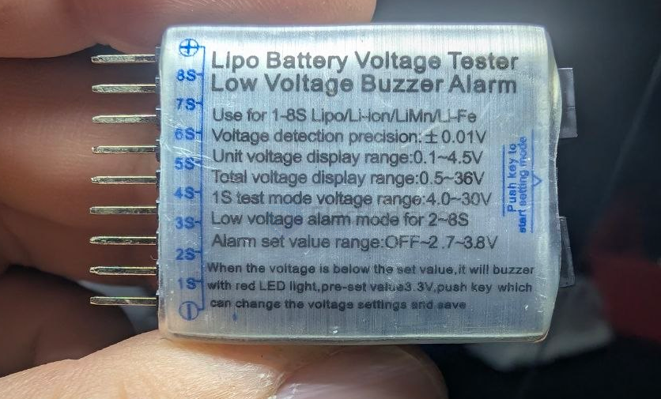
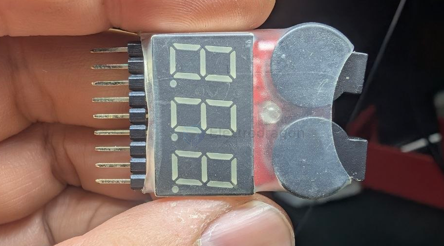
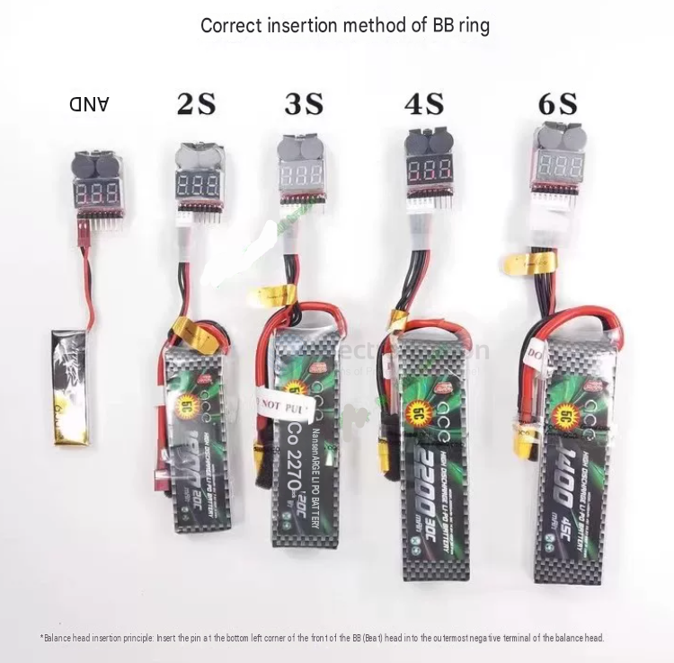

# voltage-app-dat

- [[voltage-dat]] - [[voltage-app-dat]] - [[power-dat]]

- [[beeper-dat]]

## Lipo Battery Voltage Tester Low Voltage Buzzer Alarm

- Use for 1-8S Lipo/Li-ion/LiMn/L-Fe
- Voltage detection precision:± 0.01V
- Unit voltage display range:0.1~4.5V
- Total voltage display range:0.5~36V
- 1S test mode voltage range:4.0-30V
- Low voltage alarm mode for 2~8S
- Alarm set value range:OFF~2.7~3.8V

When the voitage is below the set value, it wil! buzzerwith red LED light,pre-sst value3.3V,push key whichcan change the voltags settings and save

## usage 

## ref 

