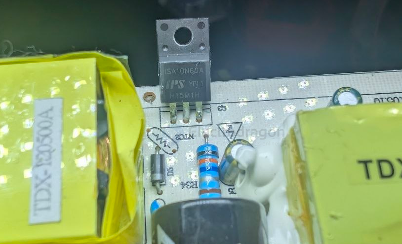
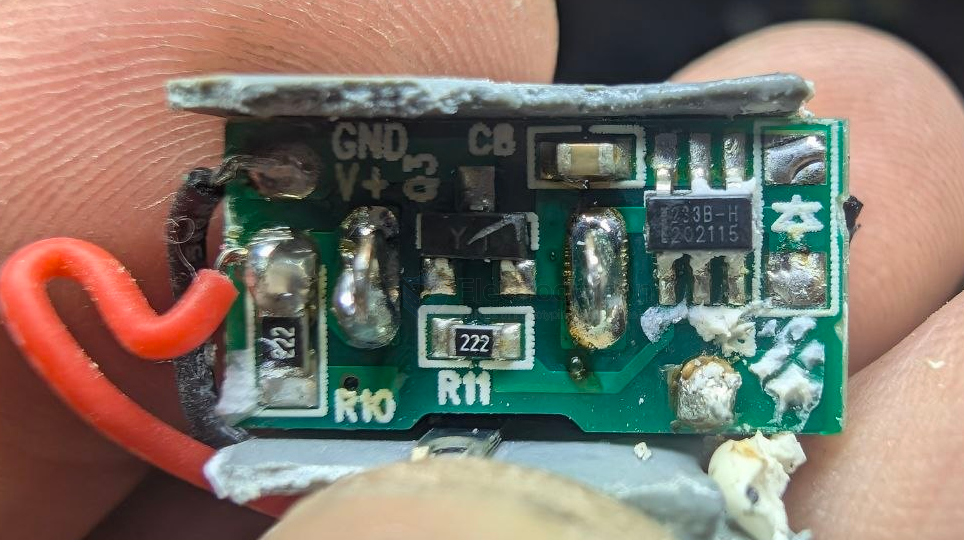

# voltage-high-dat

- [[power-dat]] - [[voltage-high-dat]] - [[voltage-dat]]

## board 

- [[ODC1002-dat]]

- [[meter-voltage-dat]]

## apps 

It's suitable for capacitor charging, hunting, rodent control, and Nixie tube power supplies.

- [[capacitor-ZVS-dat]] - [[capacitor-dat]]

- [[coilgun-dat]] 
- [[nixie-tube-dat]]
- [[tesla-coil-dat]]
- [[geiger-counter-dat]]
- [[crt-dat]]
- [[plasma-globe-dat]]
- [[jacobs-ladder-dat]]
- [[photomultiplier-tube-dat]]
- [[xray-tube-dat]]

- **Tesla Coil**: Generates high-voltage, low-current, high-frequency alternating-current electricity.
- **Geiger Counter**: Uses high voltage to detect ionizing radiation.
- **Cathode Ray Tube (CRT)**: Used in old TVs and oscilloscopes, requires high voltage to accelerate electrons.
- **Plasma Globe**: Decorative device using high voltage to create plasma filaments.
- **Jacob’s Ladder**: Demonstrates electrical arcs climbing between two wires.
- **Photomultiplier Tube**: Sensitive light detector requiring high voltage for operation.
- **X-ray Tube**: Produces X-rays using high voltage to accelerate electrons.

## mosfet 

- [[ACDC-dat]] - [[voltage-high-dat]] - [[rectifier-dat]]

## build 

high voltage generator board 1 

## ref 

- [[meter-voltage-dat]]